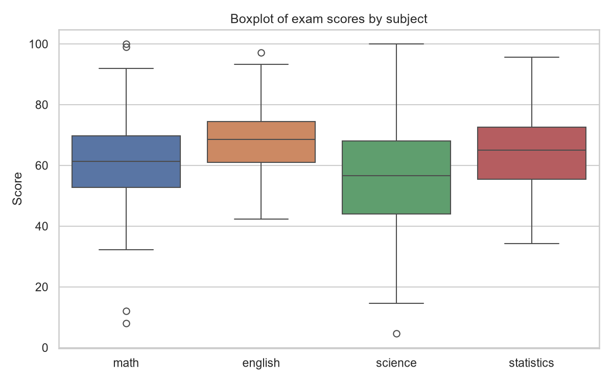
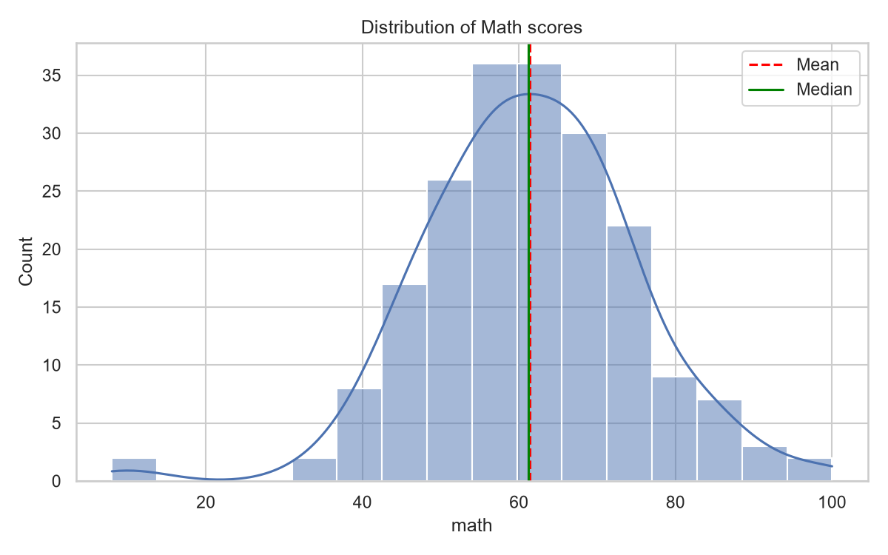

# Topic 1: Measures of Central Tendency and Dispersion

## Objective
Summarise a dataset using measures of centre (mean, median, mode) and spread
(variance, standard deviation, range, quartiles, IQR), and visualise it with a boxplot.

## Dataset
Synthetic exam scores for 200 students in 4 subjects (math, english, science,
statistics), generated with a fixed random seed (42) in `analysis.py`.
Three extreme math scores (8, 12 and 99) were added deliberately to demonstrate
outlier detection. Saved as `data/exam_scores.csv`.

## How to run
```
python analysis.py
```

## Results

| Statistic | Math | English | Science | Statistics |
|-----------|------|---------|---------|------------|
| Mean | 61.36 | 68.20 | 56.74 | 64.56 |
| Median | 61.25 | 68.60 | 56.60 | 65.10 |
| Mode | 65.10 | 70.30 | 42.00 | 52.60 |
| Variance | 182.48 | 103.92 | 332.05 | 149.16 |
| Std deviation | 13.51 | 10.19 | 18.22 | 12.21 |
| Range | 92.00 | 54.80 | 95.40 | 61.40 |
| Q1 | 52.78 | 61.00 | 43.95 | 55.52 |
| Q3 | 69.75 | 74.40 | 68.12 | 72.62 |
| IQR | 16.98 | 13.40 | 24.17 | 17.10 |
| CV (%) | 22.01 | 14.95 | 32.12 | 18.92 |
| Skewness | -0.22 | 0.01 | -0.05 | -0.11 |
| Outliers (1.5 x IQR) | 4 | 1 | 1 | 0 |




Full table: `outputs/summary_statistics.csv`

## Interpretation
- **Mean vs median:** The two are very close in every subject (for example, math
  has a mean of 61.36 and a median of 61.25), so the distributions are roughly
  symmetric. Math has the largest gap in skewness (-0.22), a slight left skew
  caused by the very low scores in the tail.
- **Mode:** The data are continuous (scores to one decimal place), so most values
  appear only once or twice and the mode is not a reliable measure of centre here.
  The mean and median are more informative.
- **Spread:** Science has the largest standard deviation (18.22) and IQR (24.17),
  so its scores are the most spread out. English has the smallest standard
  deviation (10.19), so it is the most consistent.
- **Coefficient of variation:** CV puts spread relative to the mean. Science is the
  most variable (32.12%) and English the least (14.95%), which confirms the
  ranking from the standard deviations.
- **Outliers:** Using the 1.5 x IQR rule, math has 4 outliers (including the three
  I added), english and science have 1 each, and statistics has none. These
  appear as points beyond the whiskers on the boxplot.
- **Conclusion:** English is the strongest and most consistent subject (highest
  mean, lowest CV). Science is the weakest and most variable, with the lowest
  mean and the highest CV.