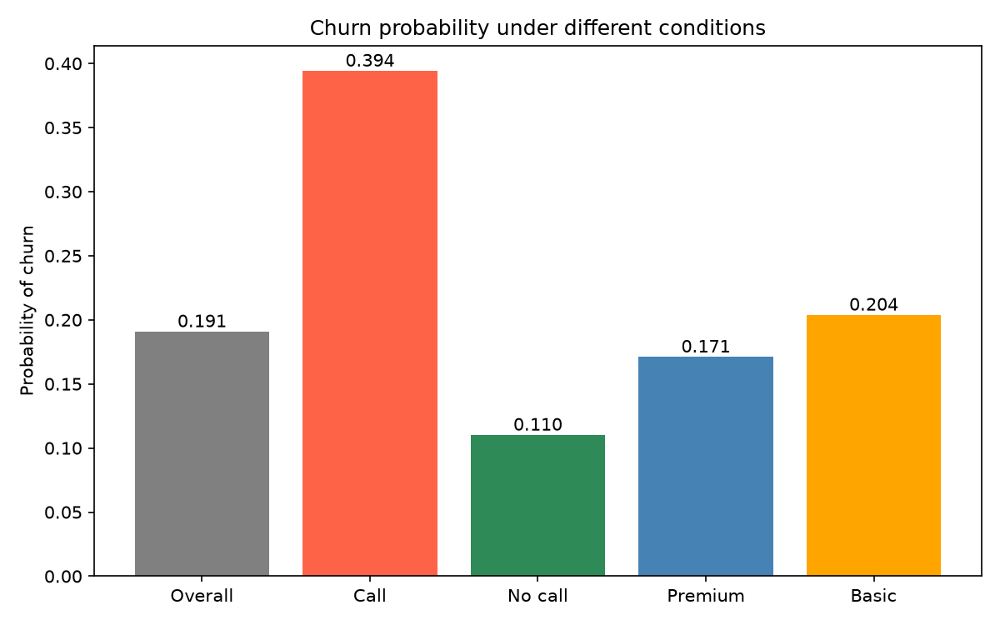
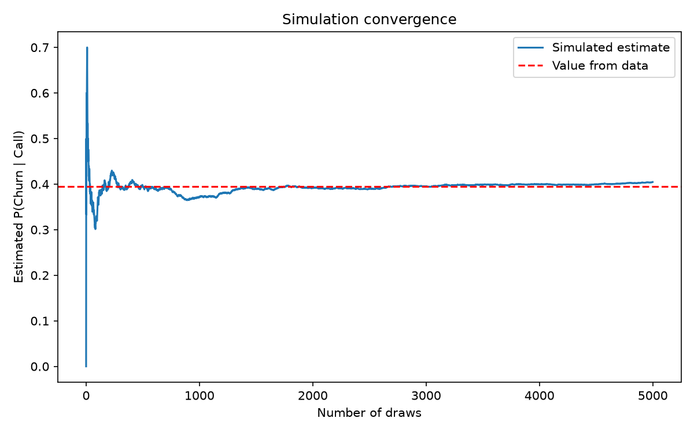

# Topic 2: Probability and Conditional Probability

## Objective
Calculate basic and conditional probabilities from data, test for independence,
apply Bayes' theorem, and verify the results with a simple simulation.

## Dataset
Synthetic data for 1,000 customers (random seed 42) generated in `analysis.py`,
with three variables: `plan` (Basic or Premium), `support_call` (True/False) and
`churned` (True/False). Customers who made a support call were built to be more
likely to churn. Saved as `data/customers.csv`.

## How to run
```
python analysis.py
```

## Results

| Probability | Value |
|-------------|-------|
| P(Churn) | 0.1910 |
| P(Support call) | 0.2840 |
| P(Premium) | 0.3970 |
| P(Call AND Churn) | 0.1120 |
| P(Churn given Call) | 0.3944 |
| P(Churn given No call) | 0.1103 |
| P(Churn given Premium) | 0.1713 |
| P(Churn given Basic) | 0.2040 |
| P(Call given Churn), Bayes | 0.5864 |
| P(Call given Churn), direct | 0.5864 |
| Simulated P(Churn given Call), 5000 draws | 0.4046 |




Full table: `outputs/probabilities.csv`

## Interpretation
- **Basic probabilities:** About 19.1% of customers churned, and 28.4% made a
  support call. 11.2% of all customers both called support and churned.
- **Conditional probabilities:** A customer who made a support call churned with
  probability 0.3944, compared with 0.1103 for customers who did not call. Knowing
  about the support call changes the probability of churn by more than a factor of 3.
- **Independence:** P(Churn) = 0.1910 differs greatly from P(Churn given Call) =
  0.3944, so churn and support calls are **not independent**. Support calls carry
  information about churn risk.
- **Plan type:** Basic customers churned slightly more (0.2040) than Premium
  customers (0.1713). The difference is small compared with the effect of a
  support call.
- **Bayes' theorem:** Using P(Churn given Call) = 0.3944, P(Call) = 0.2840 and
  P(Churn) = 0.1910, Bayes gives P(Call given Churn) = 0.5864. This equals the value
  computed directly from the data, confirming the theorem. Among customers who
  churned, about 58.6% had made a support call.
- **Simulation:** Resampling the customers who called support 5,000 times gave an
  estimate of 0.4046, close to the value from the data (0.3944). The convergence
  plot shows the estimate settling as the number of draws grows, which illustrates
  the law of large numbers.
- **Conclusion:** Support calls are a strong signal of churn risk. A retention
  team could prioritise customers who contact support.