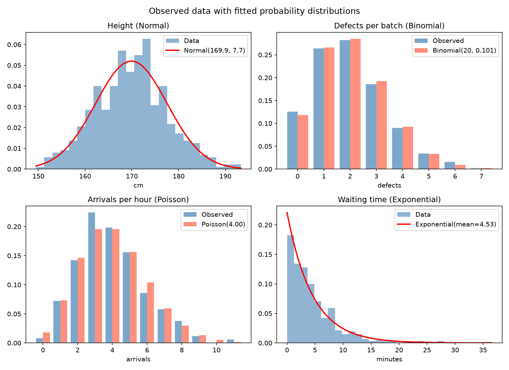
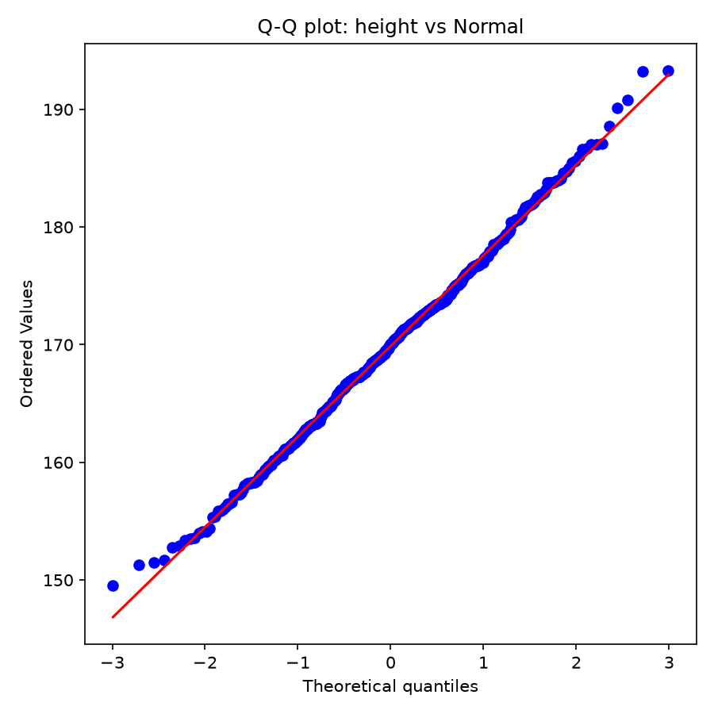

# Topic 3: Probability Distributions

## Objective
Fit common probability distributions (Normal, Binomial, Poisson, Exponential) to
data, estimate their parameters, calculate probabilities, test the goodness of fit,
and compare candidate models for waiting times.

## Dataset
Synthetic data with 500 observations per variable (random seed 42), generated in
`analysis.py`:
- `height_cm`: heights, modelled as Normal
- `defects_per_batch`: defects in a batch of 20 items, modelled as Binomial
- `arrivals_per_hour`: arrivals per hour, modelled as Poisson
- `wait_minutes`: waiting times, modelled as Exponential

Saved as `data/distribution_data.csv`.

## How to run
```
python analysis.py
```

## Results

### Fitted parameters
| Distribution | Variable | Fitted parameters |
|--------------|----------|-------------------|
| Normal | Height | mean = 169.893, sd = 7.671 |
| Binomial | Defects per batch of 20 | n = 20, p = 0.1013 |
| Poisson | Arrivals per hour | lambda = 4.0000 |
| Exponential | Waiting time | mean = 4.5278 min, rate = 0.2209 per min |

### Probabilities
| Distribution | Probability | Value |
|--------------|-------------|-------|
| Normal | P(H < 165) | 0.2618 |
| Normal | P(H > 180) | 0.0938 |
| Normal | P(160 < H < 180) | 0.8076 |
| Normal | 95th percentile | 182.51 cm |
| Binomial | P(X = 0) | 0.1181 |
| Binomial | P(X <= 2) | 0.6695 |
| Binomial | P(X >= 4) | 0.1377 |
| Poisson | P(X = 0) | 0.0183 |
| Poisson | P(X <= 2) | 0.2381 |
| Poisson | P(X > 6) | 0.1107 |
| Exponential | P(T > 10) | 0.1099 |
| Exponential | P(T <= 3) | 0.4845 |
| Exponential | Median | 3.138 min |

### Goodness of fit (Kolmogorov-Smirnov)
| Fit | D | p-value |
|-----|---|---------|
| Normal (height) | 0.0313 | 0.7008 |
| Exponential (wait) | 0.0442 | 0.2744 |

### Model comparison for waiting times (AIC, lower is better)
| Model | AIC |
|-------|-----|
| Gamma | 2509.23 |
| Weibull | 2510.60 |
| Exponential | 2512.23 |
| Lognormal | 2576.03 |




Full table: `outputs/distribution_results.csv`

## Interpretation
- **Normal (height):** The fitted mean (169.89 cm) and standard deviation (7.67 cm)
  are close to the values used to generate the data (170 and 8). About 26.2% of
  people are shorter than 165 cm, 9.4% are taller than 180 cm, and 80.8% fall
  between 160 and 180 cm. The 95th percentile is 182.51 cm.
- **Binomial (defects):** The estimated defect rate is p = 0.1013, so the chance of
  a defect-free batch of 20 is 0.1181. About 66.9% of batches have at most 2
  defects, and 13.8% have 4 or more.
- **Poisson (arrivals):** The estimated rate is lambda = 4.0 arrivals per hour. The
  sample variance (3.80) is close to the mean (4.00), as the Poisson model
  requires. The probability of an hour with no arrivals is only 0.0183, and
  11.1% of hours have more than 6 arrivals.
- **Exponential (waiting):** The mean wait is 4.53 minutes. The median (3.14
  minutes) is lower than the mean, which reflects the right-skew of the
  exponential distribution. About 11% of customers wait more than 10 minutes.
- **Goodness of fit:** Both K-S p-values (0.7008 and 0.2744) are above 0.05, so we
  do not reject the hypothesis that the data follow the fitted Normal and
  Exponential distributions. The Q-Q plot shows the height points lying close to
  the straight line, which supports normality.
- **Model comparison:** Gamma has the lowest AIC (2509.23), but the gap to
  Weibull (2510.60) and to Exponential (2512.23) is small (differences of 1.4 and
  3.0). The Exponential model has only one parameter and is the true generating
  model, so it is a reasonable choice. Lognormal fits clearly worse (AIC 2576.03).
- **Conclusion:** Each variable is well described by its intended distribution. The
  gamma model's slightly lower AIC is the usual small advantage of an extra
  parameter, not strong evidence against the Exponential model.