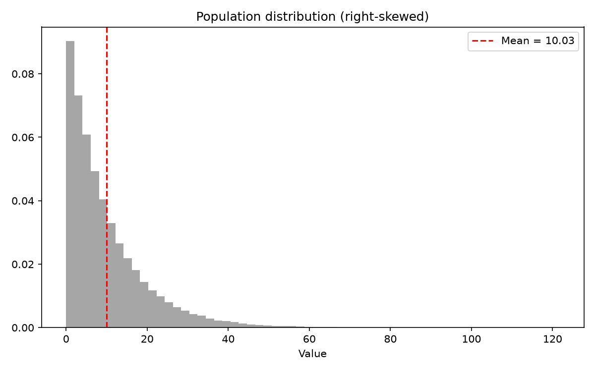
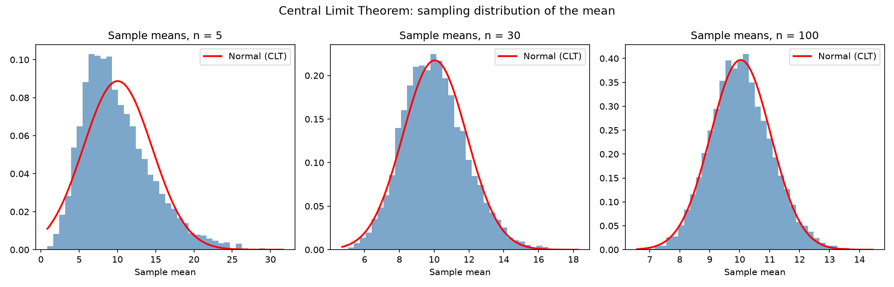
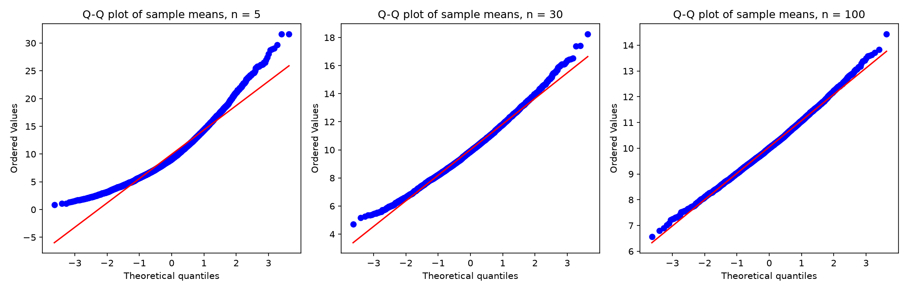
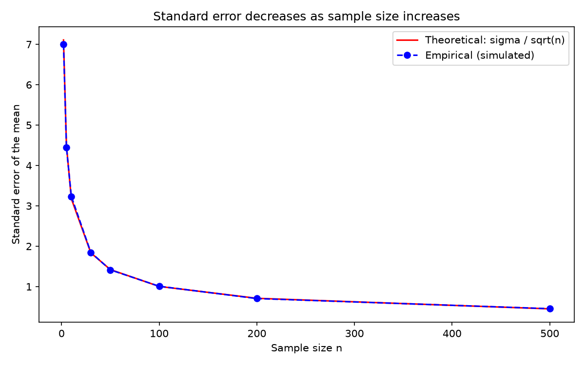

# Topic 4: Sampling Distributions and the Central Limit Theorem

## Objective
Show that the distribution of the sample mean approaches a normal distribution as
the sample size grows, even when the population is not normal, and that the
standard error of the mean equals sigma / sqrt(n).

## Dataset
A synthetic population of 100,000 values drawn from an exponential distribution
(random seed 42), generated in `analysis.py`. It is deliberately strongly
right-skewed, so it is a hard test for the CLT. For each sample size
(n = 5, 30, 100), 5,000 random samples were drawn with replacement and their means
recorded. Sample means saved as `data/sample_means.csv`.

## How to run
```
python analysis.py
```

## Results

### Population
| Size | Mean | Standard deviation | Skewness |
|------|------|--------------------|----------|
| 100,000 | 10.035 | 10.053 | 2.023 |

### Sampling distribution of the sample mean (5,000 samples each)
| n | Mean of sample means | Empirical SE | Theoretical SE (sigma / sqrt(n)) | Skewness |
|---|----------------------|--------------|----------------------------------|----------|
| 5 | 9.964 | 4.490 | 4.496 | 0.911 |
| 30 | 10.016 | 1.829 | 1.835 | 0.362 |
| 100 | 10.049 | 1.023 | 1.005 | 0.218 |

Shapiro-Wilk p-value was 0.0000 for all three sample sizes (see the note below).

### Theoretical standard error by sample size
| n | 2 | 5 | 10 | 30 | 50 | 100 | 200 | 500 |
|---|---|---|----|----|----|-----|-----|-----|
| sigma / sqrt(n) | 7.108 | 4.496 | 3.179 | 1.835 | 1.422 | 1.005 | 0.711 | 0.450 |

For n = 2 the simulated SE was 7.000. The empirical values for all sizes are
plotted in `outputs/standard_error_vs_n.png`.

### Using the CLT to calculate a probability (n = 30)
| Quantity | Value |
|----------|-------|
| P(sample mean > 12), CLT normal approximation | about 0.142 |
| P(sample mean > 12), simulated proportion | 0.1410 |

### One sample of size 50
| Sample mean | Estimated SE (s / sqrt(n)) | Population mean |
|-------------|----------------------------|-----------------|
| 10.360 | 1.547 | 10.035 |






Full table: `outputs/clt_results.csv`

## Interpretation
- **Population:** The population is strongly right-skewed (skewness 2.023), with a
  mean of about 10 and a standard deviation of about 10. It is clearly not normal.
- **Mean of the sample means:** At every sample size the mean of the sample means
  (9.964, 10.016, 10.049) is very close to the population mean (10.035). The sample
  mean is an unbiased estimator of the population mean.
- **Shape and the CLT:** The skewness of the sampling distribution falls from 0.911
  (n = 5) to 0.362 (n = 30) to 0.218 (n = 100), moving toward 0, the skewness of a
  normal distribution. The histograms and Q-Q plots show the sample means becoming
  more bell-shaped and closer to the straight line as n increases, even though the
  population is skewed. This is the Central Limit Theorem.
- **Standard error:** The empirical SEs (4.490, 1.829, 1.023) match the theoretical
  values sigma / sqrt(n) (4.496, 1.835, 1.005) closely. Increasing the sample size
  from 5 to 100 (20 times larger) cut the SE by a factor of about 4.4, close to
  sqrt(20) = 4.47. Quadrupling the sample size is needed to halve the SE.
- **Shapiro-Wilk test:** The p-values are 0.0000 even at n = 100. With 5,000 sample
  means the test is extremely sensitive and detects tiny departures from normality,
  and the sample means at n = 100 still have some residual skewness (0.218). A
  p-value of 0 here does not mean the normal approximation is useless. Skewness and
  the Q-Q plots are better evidence of how close to normal the distribution is.
- **CLT probability:** For n = 30, the normal approximation gives P(sample mean > 12)
  of about 0.142, close to the simulated proportion of 0.1410. The approximation
  works well at n = 30, even for a skewed population.
- **One sample:** In practice we have a single sample. A sample of 50 gave a mean of
  10.360 and an estimated SE of 1.547, which is the sample SD divided by sqrt(50).
  The sample mean is within one SE of the true mean (10.035), as expected.
- **Conclusion:** The sample mean is centred on the population mean, its spread
  shrinks as sigma / sqrt(n), and its distribution becomes approximately normal as n
  grows, whatever the shape of the population. This is the foundation for confidence
  intervals and hypothesis tests in the next topics.