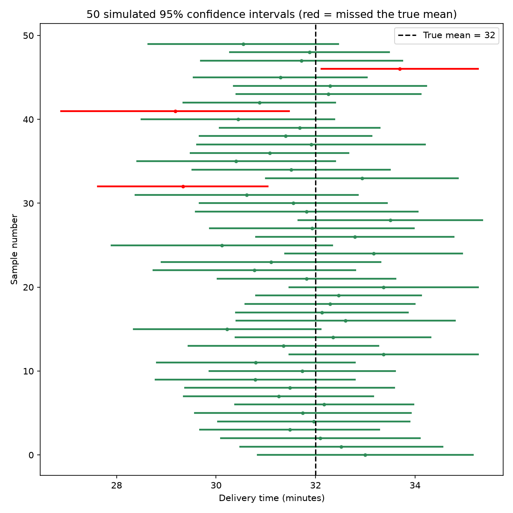
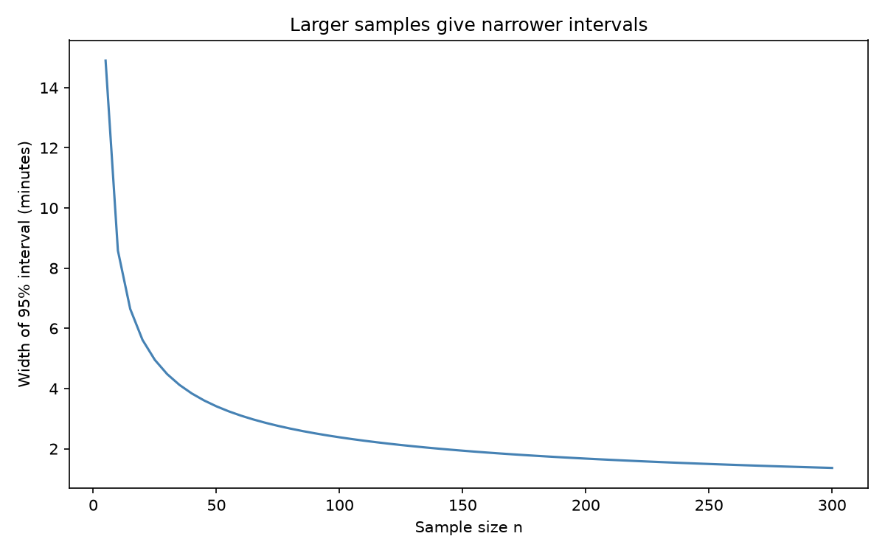
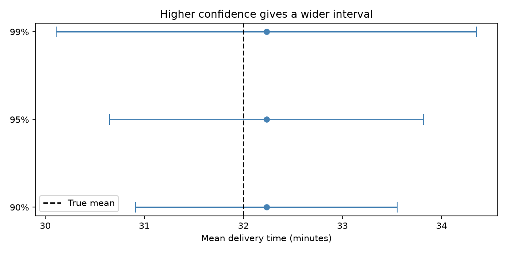

# Topic 5: Confidence Intervals

## Objective
Estimate population parameters (a mean, a proportion, a standard deviation and a
difference in means) with confidence intervals, interpret the uncertainty, and check
by simulation that a 95% interval captures the true value about 95% of the time.

## Dataset
Synthetic data generated in `analysis.py` (random seed 42):
- `data/delivery_times.csv`: delivery times in minutes for two couriers, 40
  deliveries each (courier A was generated with true mean 32 and SD 6).
- `data/survey.csv`: a customer survey of 200 respondents with a satisfied flag
  (1 = satisfied, 0 = not satisfied).

## How to run
```
python analysis.py
```

## Results

### Mean delivery time, courier A (n = 40)
Sample mean = 32.233, sample SD = 4.952, standard error = 0.783.

| Confidence level | Interval | Critical value (t*) | Width |
|------------------|----------|---------------------|-------|
| 90% (t) | (30.913, 33.552) | 1.685 | 2.639 |
| 95% (t) | (30.649, 33.816) | 2.023 | 3.168 |
| 99% (t) | (30.112, 34.353) | 2.708 | 4.241 |
| 95% (z, for comparison) | (30.698, 33.767) | 1.960 | 3.069 |

### Proportion of satisfied customers (140 of 200)
| Method | Estimate | 95% interval |
|--------|----------|--------------|
| Wald | 0.7000 | (0.6365, 0.7635) |
| Wilson | 0.7000 | (0.6332, 0.7593) |

### Variability of courier A
| Quantity | Estimate | 95% interval (chi-square) |
|----------|----------|---------------------------|
| Variance | 24.525 | (16.457, 40.436) |
| Standard deviation | 4.952 | (4.057, 6.359) |

### Difference in mean delivery time (A minus B, Welch)
| Mean A | Mean B | Difference | SE | df | 95% interval | Contains 0? |
|--------|--------|------------|----|----|--------------|-------------|
| 32.233 | 35.098 | -2.865 | 1.125 | 77.9 | (-5.105, -0.625) | No |

### Coverage simulation (2,000 samples of n = 40, true mean = 32)
| Nominal level | Proportion of intervals that captured the true mean |
|---------------|------------------------------------------------------|
| 90% | 0.9010 |
| 95% | 0.9500 |
| 99% | 0.9865 |





Full table: `outputs/confidence_intervals.csv`. Console record: `outputs/console_output.txt`.

## Interpretation
- **Mean:** The point estimate of courier A's mean delivery time is 32.23 minutes.
  We are 95% confident that the true mean lies between 30.65 and 33.82 minutes.
  This does not mean there is a 95% probability that the true mean is in this
  particular interval. It means that if we repeated the sampling many times, about
  95% of the intervals built this way would contain the true mean.
- **Confidence level and width:** Higher confidence gives a wider interval, with
  widths of 2.64 (90%), 3.17 (95%) and 4.24 (99%). We pay for extra confidence with
  less precision.
- **t versus z:** The t-interval (30.649, 33.816) is slightly wider than the
  z-interval (30.698, 33.767) because the t distribution accounts for the extra
  uncertainty from estimating the SD with only 40 observations. With larger samples
  the two converge.
- **Proportion:** 70% of surveyed customers were satisfied, and the true
  satisfaction rate is plausibly between 63.3% and 75.9% (Wilson). The Wald and
  Wilson intervals are similar here, since the sample is large and the proportion is
  not near 0 or 1. Wilson is preferred in general because it behaves better for
  small samples and extreme proportions.
- **Variability:** The standard deviation of delivery times is estimated at 4.95
  minutes, with a 95% interval of (4.06, 6.36). The interval is not symmetric around
  the estimate because the chi-square distribution is skewed. The true SD used to
  generate the data (6) lies inside it.
- **Difference between couriers:** Courier A is faster than courier B by an
  estimated 2.87 minutes. The 95% interval (-5.11, -0.63) does not contain 0, so
  the data suggest a real difference in mean delivery time. This links directly to
  hypothesis testing in Topic 6.
- **Coverage simulation:** The 90%, 95% and 99% intervals captured the true mean in
  90.1%, 95.0% and 98.65% of the 2,000 simulated samples, very close to the nominal
  levels. This confirms what "95% confidence" means. In the 50-interval plot, the
  red intervals are the few that missed the true mean.
- **Sample size:** The width plot shows intervals narrowing as n grows, with
  diminishing returns. Halving the width requires about four times the sample size.
- **Conclusion:** Confidence intervals quantify the uncertainty around an estimate
  rather than giving a single number. Interval width depends on the confidence
  level, the variability of the data and the sample size.