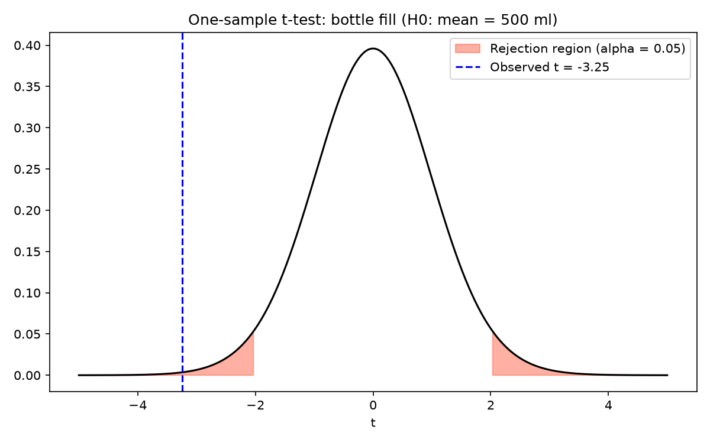
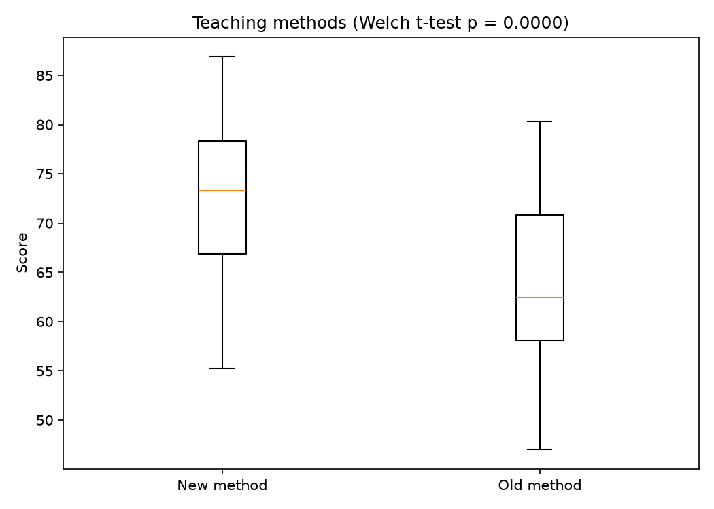
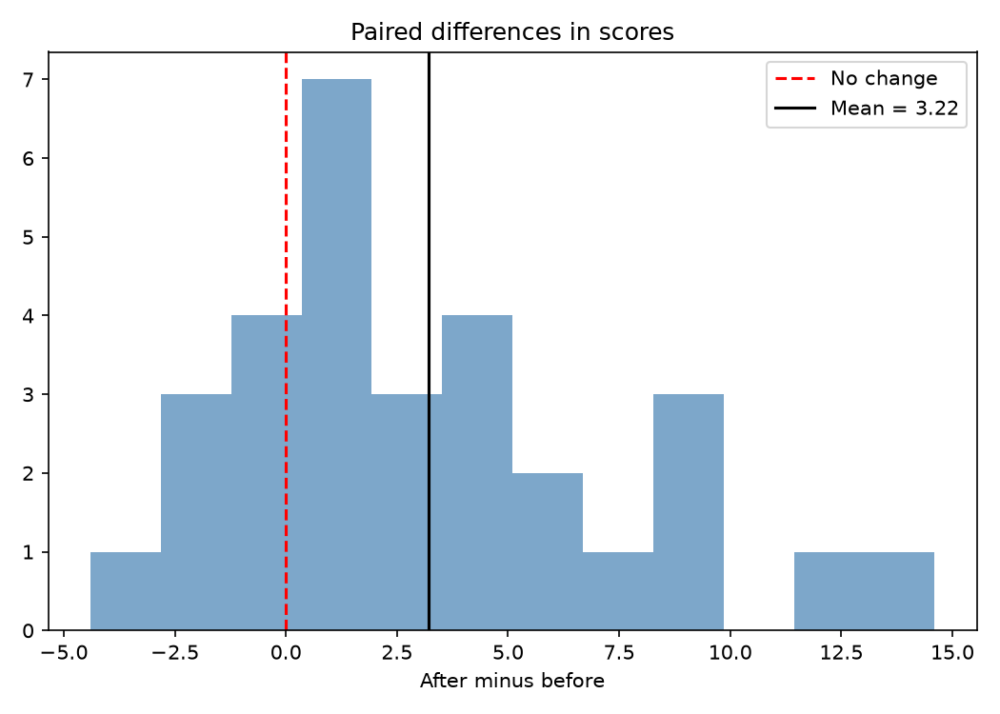
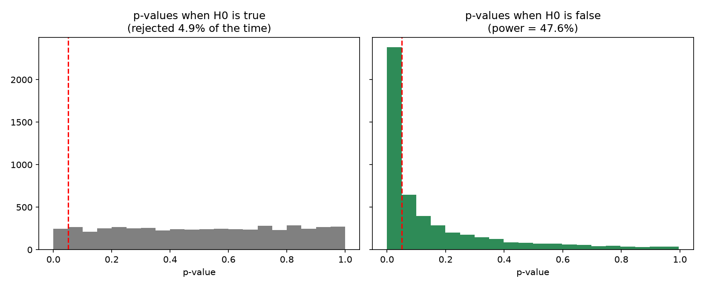
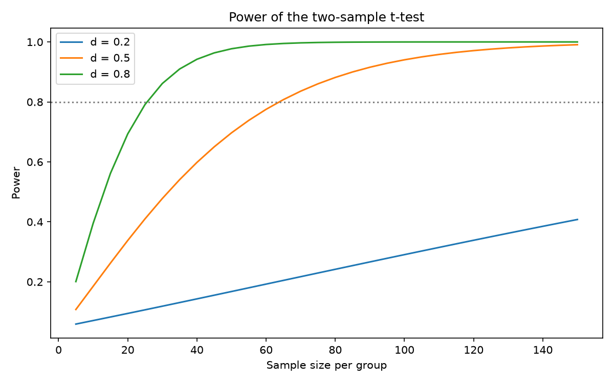

# Topic 6: Hypothesis Testing

## Objective
Apply the common parametric hypothesis tests (one-sample, two-sample, paired t-tests
and one- and two-proportion z-tests), check their assumptions, report effect sizes
and power, and verify by simulation what the significance level and power mean.

## Dataset
Synthetic data generated in `analysis.py` (random seed 42):
- `data/bottles.csv`: fill volume in ml for 35 bottles labelled 500 ml.
- `data/teaching_methods.csv`: exam scores for 40 students under a new method and 40
  under the old method.
- `data/training_scores.csv`: scores for 30 employees before and after training.
- Website conversions are generated inside the script: 500 visitors for the
  one-proportion test, and 1,000 visitors each for pages A and B.

All tests use a significance level of alpha = 0.05.

## How to run
```
python analysis.py
```

## Results

### Summary of the tests
| Test | H0 | Test statistic | p-value | Decision |
|------|----|----------------|---------|----------|
| One-sample t (bottle fill) | mean = 500 ml | t = -3.248 (df = 34) | 0.0026 | Reject H0 |
| Two-sample Welch t (new vs old method) | equal means | t = 4.830 | < 0.0001 | Reject H0 |
| Mann-Whitney U (non-parametric check) | equal distributions | U = 1239.0 | < 0.0001 | Reject H0 |
| Paired t (before vs after training) | mean difference = 0 | t = 3.875 (df = 29) | 0.0006 | Reject H0 |
| One-proportion z (conversion rate) | p = 0.10 | z = 1.789 | 0.0736 | Fail to reject H0 |
| Two-proportion z (page B vs page A) | p_A = p_B | z = 2.119 | 0.0341 | Reject H0 |

### Details for each test
| Test | Key numbers |
|------|-------------|
| One-sample t | n = 35, mean = 497.263, sd = 4.986, critical t = +/-2.032, 95% CI for the mean (495.550, 498.976) |
| Two-sample Welch t | New: mean 71.945, sd 7.626. Old: mean 63.335, sd 8.303. Cohen's d = 1.080 |
| Assumption checks | Shapiro p = 0.5699 (new), 0.4339 (old); Levene p = 0.6744 |
| Paired t | Mean before 60.203, mean after 63.423, mean difference 3.220, sd of differences 4.551, Cohen's d = 0.707, Shapiro p (differences) = 0.2369 |
| One-proportion z | 62 conversions out of 500, p-hat = 0.1240 |
| Two-proportion z | Page A 98/1000 = 0.098, page B 128/1000 = 0.128 |

### Power analysis (two-sample t-test)
| Quantity | Value |
|----------|-------|
| Power with the observed d = 1.080 and n = 40 per group | 0.998 |
| Sample size per group for 80% power at d = 0.5 | 64 |

### Simulation (5,000 experiments, n = 30 per group)
| Quantity | Simulated | Theoretical or nominal |
|----------|-----------|------------------------|
| Type I error rate when H0 is true | 0.0494 | 0.05 |
| Power when the true difference is 5 (d = 0.5) | 0.4762 | 0.4779 |







Full table: `outputs/hypothesis_test_results.csv`. Console record:
`outputs/console_output.txt`.

## Interpretation
- **One-sample t-test:** The mean fill is 497.26 ml, below the labelled 500 ml. The
  p-value (0.0026) is below 0.05, so we reject H0 and conclude that the true mean
  fill differs from 500 ml. The 95% interval (495.55, 498.98) does not contain 500,
  which agrees with the test. The shortfall is about 2.7 ml, so statistical
  significance does not by itself say whether it matters in practice.
- **Two-sample Welch t-test:** The new method scored about 8.6 points higher on
  average (71.95 against 63.34). With p < 0.0001 we reject H0 and conclude the
  methods differ. Cohen's d = 1.08 is a large effect. The Shapiro and Levene
  p-values are all above 0.05, so normality and equal spread are reasonable, and
  the non-parametric Mann-Whitney test reaches the same conclusion.
- **Paired t-test:** Scores rose by 3.22 points on average after training
  (p = 0.0006), so we reject H0 and conclude that training improved scores.
  Cohen's d = 0.71 is a medium to large effect. The differences look normal
  (Shapiro p = 0.2369), so the paired t-test is appropriate.
- **One-proportion z-test:** The observed conversion rate is 12.4%, higher than 10%,
  but p = 0.0736 is above 0.05, so we fail to reject H0. This does not prove the
  rate is 10%. The sample of 500 visitors may simply be too small to detect a
  difference of this size.
- **Two-proportion z-test:** Page B converted at 12.8% against 9.8% for page A.
  With p = 0.0341 we reject H0 and conclude that the pages differ. This result is
  only moderately strong, since the p-value is close to 0.05.
- **Failing to reject is not accepting:** The one-proportion test shows that a
  difference of 2.4 percentage points can be real yet not significant with this
  sample size.
- **Type I error:** When H0 was true, 4.94% of simulated tests rejected it, very
  close to the chosen 5%. This is what alpha means.
- **Power:** With 30 per group and a true difference of 0.5 standard deviations,
  only about 47.6% of simulated tests detected it, matching the theoretical 47.8%.
  Reaching 80% power for d = 0.5 needs 64 per group. The power curve shows that
  small effects need much larger samples.
- **Conclusion:** A hypothesis test gives a decision for a stated alpha, and it
  should be reported with an effect size, a confidence interval and an assumption
  check, not just a p-value.