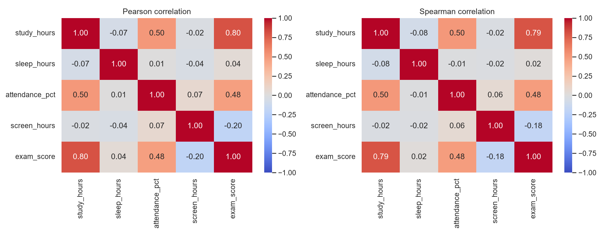
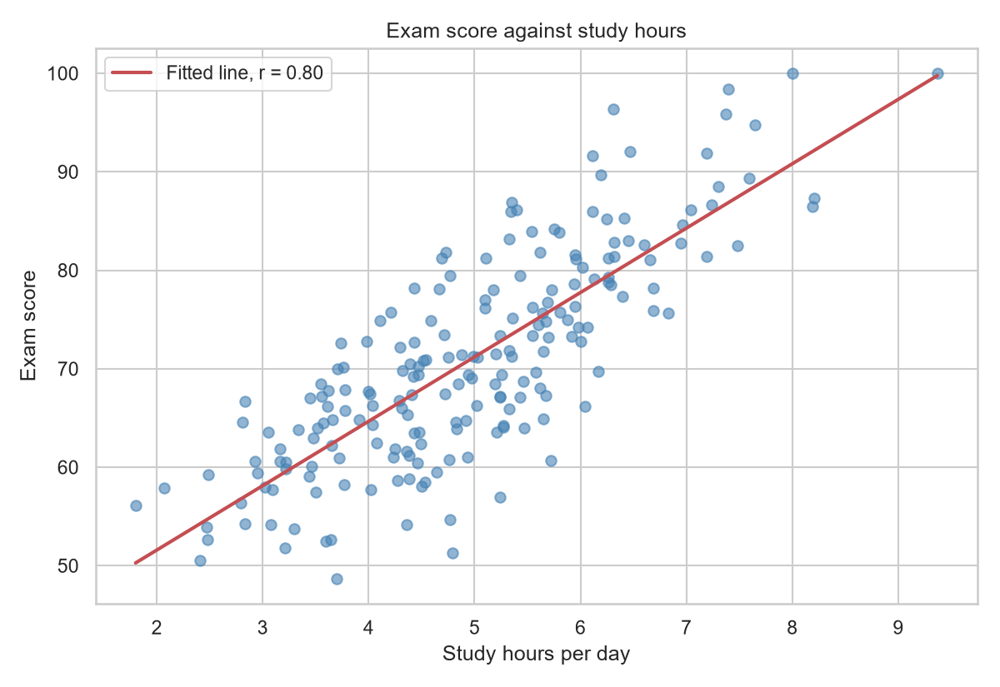
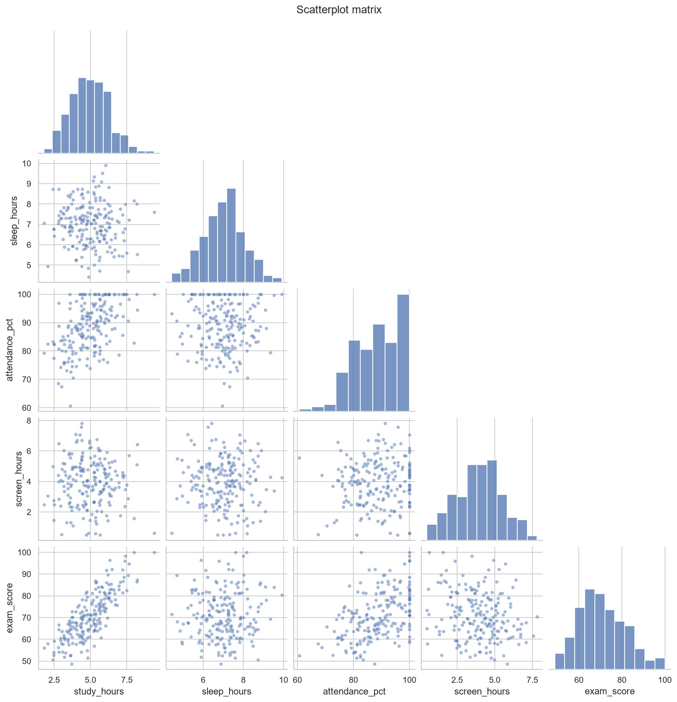
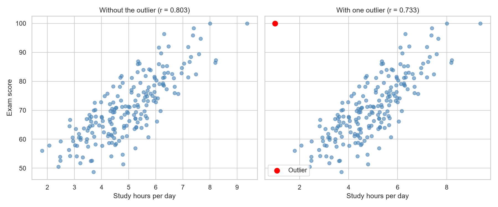
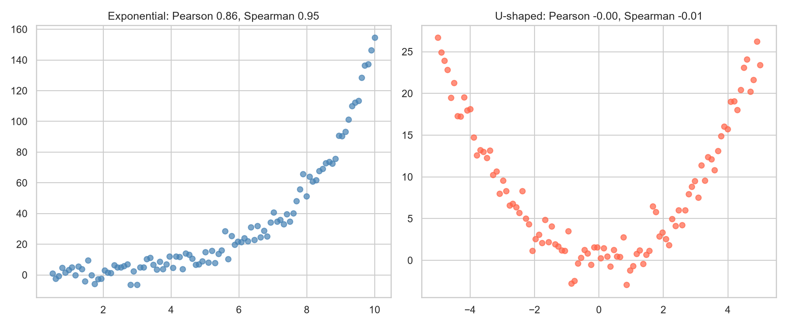

# Topic 7: Correlation and Covariance

## Objective
Measure how variables move together using the covariance matrix and the Pearson and
Spearman correlation matrices, test and interpret the correlations with exam score,
and show how outliers and non-linear patterns affect correlation.

## Dataset
Synthetic data for 200 students generated in `analysis.py` (random seed 42), saved
as `data/student_data.csv`, with five variables:
- `study_hours`: study hours per day
- `sleep_hours`: sleep hours per night
- `attendance_pct`: class attendance in percent
- `screen_hours`: daily screen time in hours
- `exam_score`: exam score, built to depend on the other four variables

Two small simulated series (an exponential curve and a U-shaped curve) are also
generated in the script to illustrate the limits of correlation.

## How to run
```
python analysis.py
```

## Results

### Covariance matrix
| | study_hours | sleep_hours | attendance_pct | screen_hours | exam_score |
|---|---|---|---|---|---|
| study_hours | 1.750 | -0.094 | 5.542 | -0.049 | 11.442 |
| sleep_hours | -0.094 | 1.039 | 0.060 | -0.062 | 0.456 |
| attendance_pct | 5.542 | 0.060 | 69.815 | 0.914 | 42.898 |
| screen_hours | -0.049 | -0.062 | 0.914 | 2.313 | -3.258 |
| exam_score | 11.442 | 0.456 | 42.898 | -3.258 | 116.063 |

### Pearson correlation matrix
| | study_hours | sleep_hours | attendance_pct | screen_hours | exam_score |
|---|---|---|---|---|---|
| study_hours | 1.000 | -0.070 | 0.501 | -0.024 | 0.803 |
| sleep_hours | -0.070 | 1.000 | 0.007 | -0.040 | 0.042 |
| attendance_pct | 0.501 | 0.007 | 1.000 | 0.072 | 0.477 |
| screen_hours | -0.024 | -0.040 | 0.072 | 1.000 | -0.199 |
| exam_score | 0.803 | 0.042 | 0.477 | -0.199 | 1.000 |

### Spearman correlation matrix
| | study_hours | sleep_hours | attendance_pct | screen_hours | exam_score |
|---|---|---|---|---|---|
| study_hours | 1.000 | -0.079 | 0.504 | -0.025 | 0.790 |
| sleep_hours | -0.079 | 1.000 | -0.012 | -0.021 | 0.022 |
| attendance_pct | 0.504 | -0.012 | 1.000 | 0.059 | 0.480 |
| screen_hours | -0.025 | -0.021 | 0.059 | 1.000 | -0.184 |
| exam_score | 0.790 | 0.022 | 0.480 | -0.184 | 1.000 |

The check "correlation = covariance / (sd_x * sd_y)" matched pandas (True).

### Correlations with exam score
| Variable | Pearson r | 95% CI (Fisher z) | p-value | r squared | Spearman |
|----------|-----------|-------------------|---------|-----------|----------|
| study_hours | 0.803 | (0.747, 0.847) | < 0.0001 | 0.645 | 0.790 |
| sleep_hours | 0.042 | (-0.098, 0.179) | 0.5594 | 0.002 | 0.022 |
| attendance_pct | 0.477 | (0.362, 0.577) | < 0.0001 | 0.227 | 0.480 |
| screen_hours | -0.199 | (-0.329, -0.062) | 0.0048 | 0.040 | -0.184 |

### Effect of one outlier (1 hour of study, score 100)
| Measure | Before | After |
|---------|--------|-------|
| Pearson (study hours and exam score) | 0.803 | 0.733 |
| Spearman | 0.790 | 0.764 |

### Non-linear relationships
| Pattern | Pearson | Spearman |
|---------|---------|----------|
| Exponential growth | 0.861 | 0.954 |
| U-shaped curve | -0.004 | -0.014 |







Full tables: `outputs/covariance_matrix.csv`, `outputs/pearson_matrix.csv`,
`outputs/spearman_matrix.csv`, `outputs/exam_score_correlations.csv`.
Console record: `outputs/console_output.txt`.

## Interpretation
- **Covariance:** The sign shows the direction of the relationship. Study hours and
  exam score have a covariance of 11.442 (positive) and screen hours and exam score
  have -3.258 (negative). The size of a covariance depends on the units of the
  variables, so 11.442 cannot be compared directly with 42.898 (attendance and exam
  score). The diagonal holds the variances, for example 116.063 for exam score.
- **Correlation:** Dividing the covariance by the two standard deviations gives a
  unit-free value between -1 and 1. This makes the variables comparable, and the
  matrix check confirms the calculation.
- **Study hours:** r = 0.803 is a strong positive correlation. The interval
  (0.747, 0.847) is narrow and the p-value is below 0.0001. About 64.5% of the
  variation in exam score is linearly associated with study hours (r squared =
  0.645).
- **Attendance:** r = 0.477 is a moderate positive correlation (r squared = 0.227).
  Attendance is also correlated with study hours (0.501), so part of its link with
  exam score may be shared with study time.
- **Screen time:** r = -0.199 is a weak negative correlation. It is statistically
  significant (p = 0.0048), but it explains only 4.0% of the variation in scores.
- **Sleep:** r = 0.042 is essentially zero, with an interval (-0.098, 0.179) that
  contains 0 and p = 0.5594. There is no evidence of a linear relationship in this
  sample.
- **Pearson against Spearman:** The two agree closely for the exam-score
  relationships (for example 0.803 and 0.790), which suggests the relationships are
  roughly linear with no strong outliers. For the exponential curve, Spearman
  (0.954) is much higher than Pearson (0.861), because Spearman captures any
  monotonic relationship while Pearson measures only the linear part.
- **Outlier:** Adding one student with 1 hour of study and a score of 100 lowered
  Pearson from 0.803 to 0.733, while Spearman moved only from 0.790 to 0.764.
  A single point can change Pearson noticeably, and rank-based Spearman is more
  resistant.
- **A relationship that correlation misses:** The U-shaped curve is a perfect
  deterministic pattern plus noise, yet Pearson (-0.004) and Spearman (-0.014) are
  both about zero. A correlation near 0 means no linear or monotonic relationship,
  not no relationship. Always look at a scatter plot.
- **Correlation is not causation:** Study hours and exam score are strongly
  correlated here, but correlation alone cannot show that one causes the other.
  Here the link was built into the simulation, but with real data confounding
  variables must be considered.
- **Conclusion:** Study hours is by far the strongest correlate of exam score,
  followed by attendance, with screen time a weak negative factor and sleep
  unrelated. This sets up Topic 8, where linear regression uses these variables to
  predict exam score.