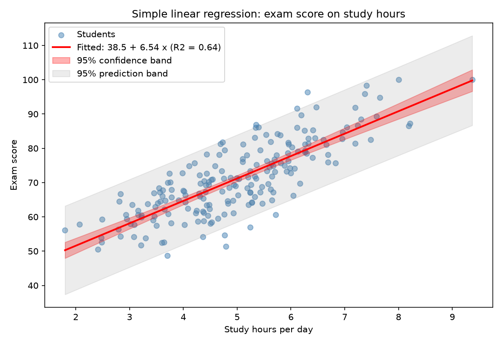
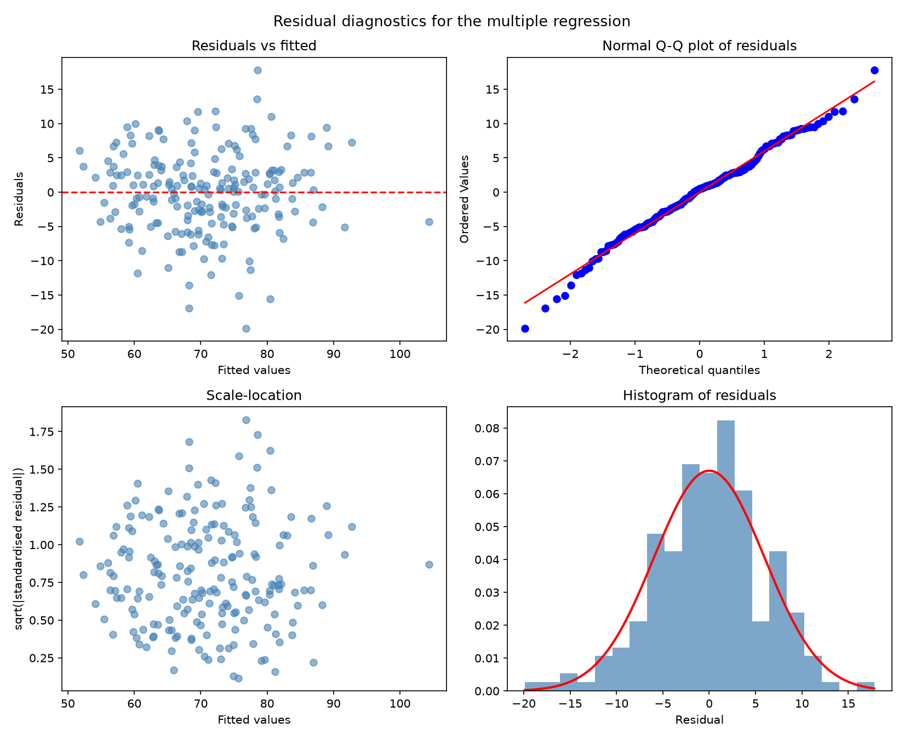
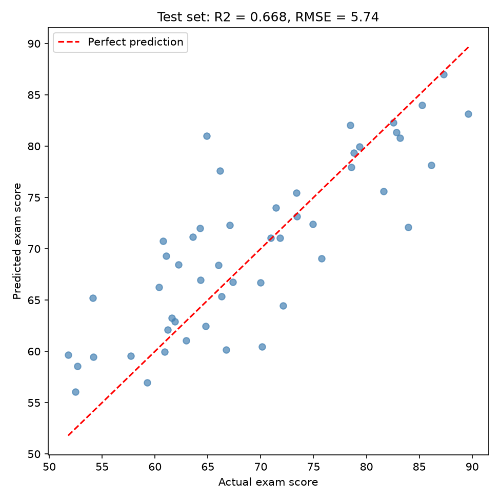
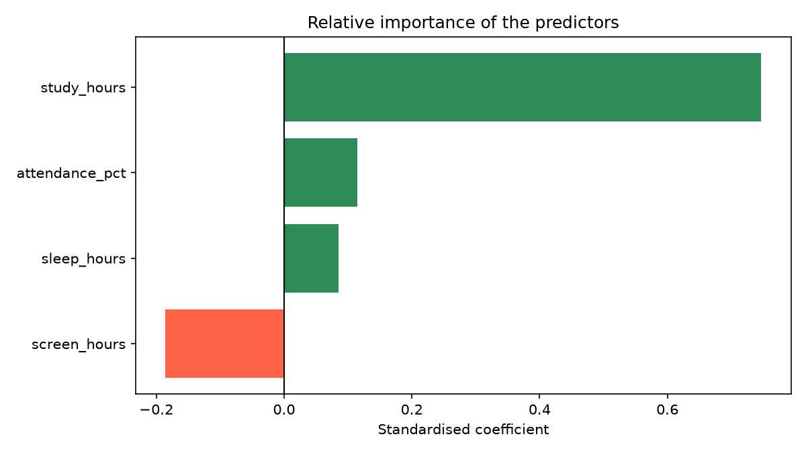

# Topic 8: Linear Regression and Least Squares

## Objective
Fit simple and multiple linear regression models by least squares, interpret the
coefficients, p-values and R-squared, check the model assumptions with residual
diagnostics, and assess prediction accuracy on unseen data.

## Dataset
The same synthetic data for 200 students as Topic 7 (random seed 42), generated in
`analysis.py` and saved as `data/student_data.csv`. The response is `exam_score`
and the predictors are `study_hours`, `sleep_hours`, `attendance_pct` and
`screen_hours`.

## How to run
```
python analysis.py
```

## Results

### Simple regression: exam_score on study_hours
The least squares formulas computed by hand match statsmodels exactly.

| Quantity | Value |
|----------|-------|
| Intercept | 38.511 |
| Slope | 6.538 |
| Equation | exam_score = 38.511 + 6.538 * study_hours |
| R-squared | 0.6445 |
| Slope p-value | 2.374e-46 |
| Residual standard error | 6.439 |

### Multiple regression coefficients
| Term | Coefficient | Std error | t | p-value | 95% CI |
|------|-------------|-----------|---|---------|--------|
| Intercept | 26.4976 | 5.4837 | 4.832 | < 0.0001 | (15.683, 37.313) |
| study_hours | 6.0805 | 0.3748 | 16.223 | < 0.0001 | (5.341, 6.820) |
| sleep_hours | 0.9028 | 0.4202 | 2.149 | 0.0329 | (0.074, 1.731) |
| attendance_pct | 0.1482 | 0.0593 | 2.498 | 0.0133 | (0.031, 0.265) |
| screen_hours | -1.3143 | 0.2820 | -4.660 | < 0.0001 | (-1.871, -0.758) |

Equation: exam_score = 26.498 + 6.081 * study_hours + 0.903 * sleep_hours
+ 0.148 * attendance_pct - 1.314 * screen_hours

### Model fit
| Quantity | Value |
|----------|-------|
| R-squared | 0.6947 |
| Adjusted R-squared | 0.6884 |
| Residual standard error | 6.014 on 195 degrees of freedom |
| F-statistic | 110.91 (p = 4.014e-49) |
| AIC / BIC | 1290.13 / 1306.63 |

The matrix formula (X'X)^-1 X'y gave the same coefficients as statsmodels (True).

### Simple against multiple model (partial F-test)
| Simple R-squared | Multiple R-squared | F | p-value |
|------------------|--------------------|---|---------|
| 0.6445 | 0.6947 | 10.669 | 1.587e-06 |

### Standardised coefficients
| Predictor | Standardised coefficient |
|-----------|--------------------------|
| study_hours | 0.7467 |
| screen_hours | -0.1855 |
| attendance_pct | 0.1150 |
| sleep_hours | 0.0854 |

### Diagnostics
| Check | Result |
|-------|--------|
| VIF (study, sleep, attendance, screen) | 1.353, 1.010, 1.352, 1.012 |
| Residual mean / sd | -0.000000 / 5.953 |
| Shapiro-Wilk (normality) | W = 0.9913, p = 0.2730 |
| Breusch-Pagan (constant variance) | LM = 1.231, p = 0.8730 |
| Durbin-Watson (autocorrelation) | 1.791 |
| Largest Cook's distance | 0.0535 (9 points above 4/n = 0.020) |

### Prediction performance
| Measure | R-squared | RMSE |
|---------|-----------|------|
| Training set (75%) | 0.6975 | 6.012 |
| Test set (25%) | 0.6681 | 5.745 |
| 5-fold cross-validation | mean 0.6683 (sd 0.1061) | |

### Prediction for a new student
(6 h study, 7 h sleep, 85% attendance, 3 h screen time)

| Quantity | Value |
|----------|-------|
| Predicted score | 77.96 |
| 95% confidence interval for the mean score | (76.55, 79.36) |
| 95% prediction interval for one student | (66.01, 89.90) |






Full tables: `outputs/regression_coefficients.csv`, `outputs/model_metrics.csv`.
Console record: `outputs/console_output.txt`.

## Interpretation
- **Least squares:** The slope and intercept calculated by hand
  (6.5381 and 38.5106) equal the statsmodels values, and the matrix formula
  reproduces all the multiple regression coefficients. Least squares chooses the
  line that minimises the sum of squared residuals.
- **Simple regression:** Each extra hour of daily study is associated with an
  increase of about 6.54 points in exam score. Study hours alone explain 64.5% of
  the variation in scores (R-squared = 0.6445), which matches the squared
  correlation from Topic 7 (0.803 squared).
- **Multiple regression:** Holding the other variables fixed, each extra study hour
  adds about 6.08 points, each extra hour of sleep adds 0.90 points, each extra
  percentage point of attendance adds 0.15 points, and each extra hour of screen
  time lowers the score by 1.31 points. All four coefficients are significant at the
  5% level, and none of the confidence intervals contains 0.
- **Coefficients change between models:** The study hours slope fell from 6.54 to
  6.08 once the other variables were included, because study hours and attendance
  are correlated (0.50). The multiple regression separates their effects.
- **Model fit:** R-squared is 0.6947 and adjusted R-squared is 0.6884, so the model
  explains about 69% of the variation in exam score. The adjusted value is only
  slightly lower, so the predictors are not padding the fit. The F-test
  (p =