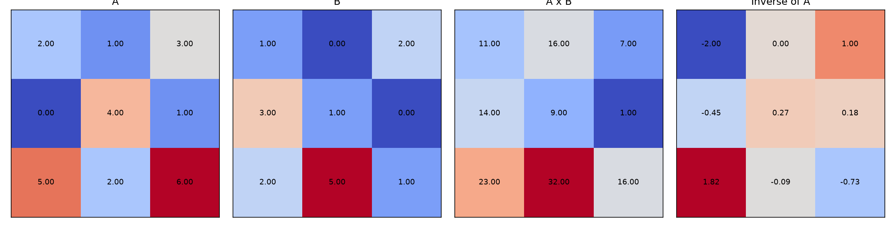
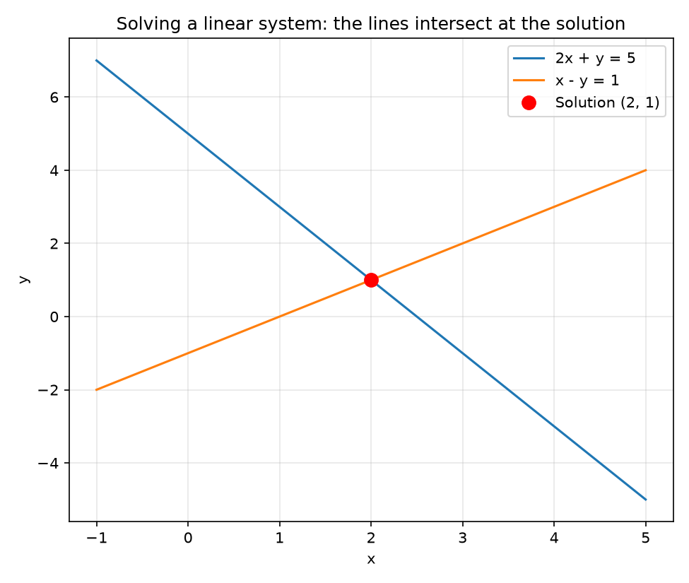
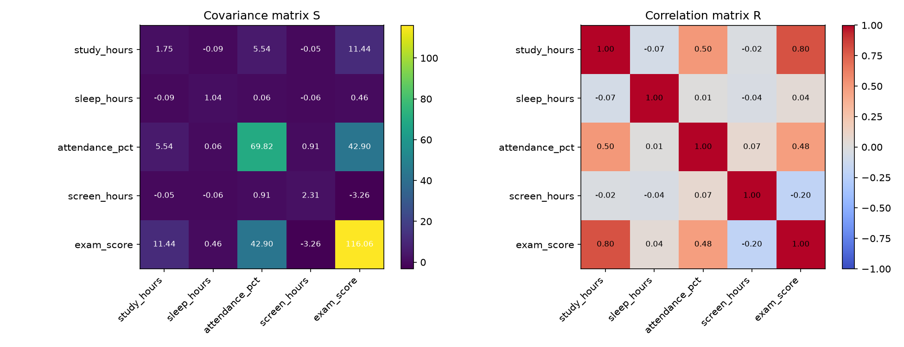
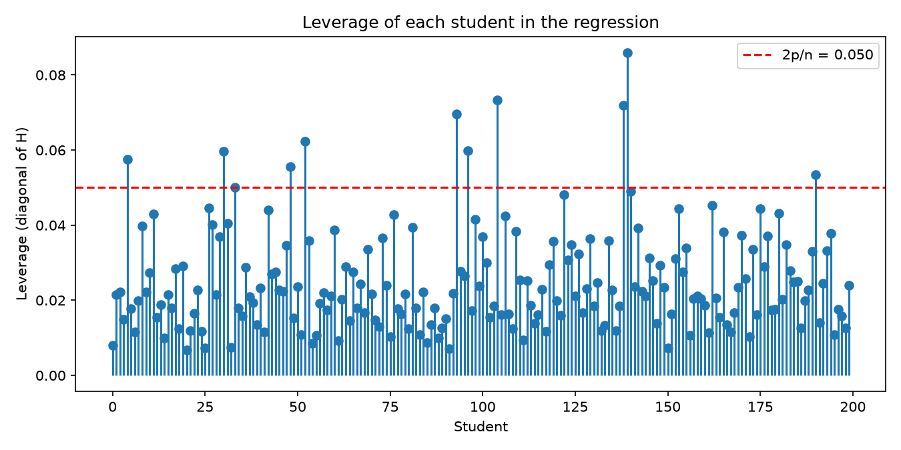
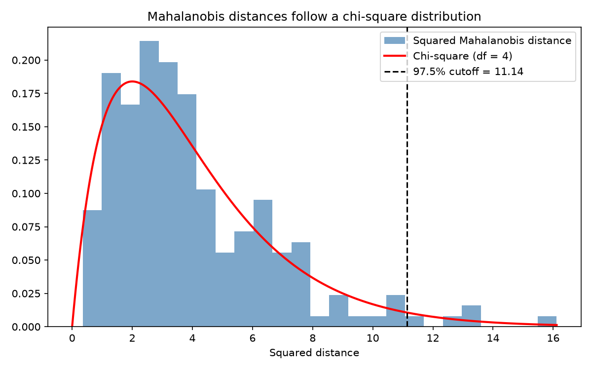

# Topic 9: Matrix Algebra in Statistics

## Objective
Apply the core matrix operations (addition, multiplication, transpose, determinant,
inverse, solving linear systems) and show how they produce standard statistical
results: the covariance matrix, regression coefficients, the hat matrix, leverage
and Mahalanobis distance.

## Dataset
Two parts, both generated in `analysis.py`:
- Small hand-sized matrices (3x3 and 2x2) used to demonstrate each operation.
- The same synthetic data for 200 students as Topics 7 and 8 (random seed 42),
  saved as `data/student_data.csv`, so the matrix results can be compared with
  results from earlier topics.

## How to run
```
python analysis.py
```

## Results

### Matrices used
```
A = [[2, 1, 3],      B = [[1, 0, 2],
     [0, 4, 1],           [3, 1, 0],
     [5, 2, 6]]           [2, 5, 1]]
```

### Basic operations
| Operation | Result |
|-----------|--------|
| A + B | [[3, 1, 5], [3, 5, 1], [7, 7, 7]] |
| A - B | [[1, 1, 1], [-3, 3, 1], [3, -3, 5]] |
| 3A | [[6, 3, 9], [0, 12, 3], [15, 6, 18]] |
| A x B (matrix product) | [[11, 16, 7], [14, 9, 1], [23, 32, 16]] |
| B x A | [[12, 5, 15], [6, 7, 10], [9, 24, 17]] |
| A * B (element-wise) | [[2, 0, 6], [0, 4, 0], [10, 10, 6]] |
| Transpose of A | [[2, 0, 5], [1, 4, 2], [3, 1, 6]] |

Checks: AB = BA is **False**; (AB)' = B'A' is **True**.

### Determinant, trace, rank and inverse
| Quantity | Value |
|----------|-------|
| det(A) | -11 |
| det(B) | 27 |
| det(AB) | -297 (equals det(A) x det(B): True) |
| trace(A) / rank(A) | 12 / 3 |

Inverse of A:
```
[[-2.0000,  0.0000,  1.0000],
 [-0.4545,  0.2727,  0.1818],
 [ 1.8182, -0.0909, -0.7273]]
```
Checks: A x A^-1 equals the identity (True); (AB)^-1 = B^-1 A^-1 (True).

Worked 2x2 example: M = [[4, 7], [2, 6]], det(M) = 4*6 - 7*2 = 10, and the formula
(1/det) * [[d, -b], [-c, a]] gives [[0.6, -0.7], [-0.2, 0.4]], which matches numpy.

### Solving linear equations
| System | Solution |
|--------|----------|
| 2x + y = 5, x - y = 1 | x = 2, y = 1 |
| A x = b, with b = (1, 2, 3) | x = (1.0000, 0.6364, -0.5455) |

`solve()`, A^-1 b and `scipy.linalg.solve` all agree. The largest residual
|Ax - b| is 8.88e-16.

LU decomposition (A = P L U):
```
L = [[1, 0, 0], [0, 1, 0], [0.4, 0.05, 1]]
U = [[5, 2, 6], [0, 4, 1], [0, 0, 0.55]]
```
P L U reproduces A (True).

### Singular and near-singular matrices
| Matrix | Result |
|--------|--------|
| C = [[1,2,3],[2,4,6],[1,0,1]] (row 2 = 2 x row 1) | det = 0, rank = 2 of 3, `inv` fails with "Singular matrix"; the pseudo-inverse still exists (C pinv(C) C = C: True) |
| Condition number of A | 27.37 |
| Condition number of a near-singular 2x2 matrix | 250,008 |

### Matrix algebra applied to the student data
**Covariance and correlation.** With Zc as the centred data matrix,
S = Zc'Zc / (n - 1) matches pandas `.cov()` (True), and
R = D^-1/2 S D^-1/2 matches pandas `.corr()` (True). The values are identical to the
Topic 7 matrices, for example cov(study_hours, exam_score) = 11.442 and
var(exam_score) = 116.063.

**Regression by the normal equations (X'X) beta = X'y.**
X is 200 x 5 and X'X is 5 x 5, with det(X'X) = 6.7625e+13.

| Term | Coefficient |
|------|-------------|
| Intercept | 26.4976 |
| study_hours | 6.0805 |
| sleep_hours | 0.9028 |
| attendance_pct | 0.1482 |
| screen_hours | -1.3143 |

These match numpy `lstsq` (True) and the Topic 8 statsmodels coefficients.
The condition number of X'X is 1,333,952.

**Hat matrix H = X (X'X)^-1 X'.**
| Property | Result |
|----------|--------|
| Size | 200 x 200 |
| Symmetric | True |
| Idempotent (HH = H) | True |
| trace(H) | 5.0000 (equals the number of parameters) |
| Fitted values Hy equal X beta | True |
| Mean of residuals | 7.82e-16 |
| Largest of X' times residuals | 5.72e-10 (residuals are orthogonal to X) |
| Largest leverage | 0.0860 |
| Points above 2p/n = 0.050 | 11 |

**Mahalanobis distance (squared).**
| Quantity | Value |
|----------|-------|
| Mean | 3.980 |
| Largest | 16.116 |
| Cutoff (chi-square 97.5%, df = 4) | 11.143 |
| Students above the cutoff | 5 of 200 (2.5%, expected about 2.5%) |







Tables: `outputs/product_AB.csv`, `outputs/inverse_A.csv`,
`outputs/covariance_by_matrix.csv`, `outputs/beta_normal_equations.csv`.
Console record: `outputs/console_output.txt`.

## Interpretation
- **Matrix multiplication is not commutative:** AB and BA are different matrices,
  and the element-wise product A * B is different again. In statistics the order
  matters, for example X'X is not the same as XX'.
- **Determinant:** det(AB) = -297 equals det(A) x det(B) = -11 x 27, confirming the
  product rule. A nonzero determinant means the matrix is invertible.
- **Inverse:** A x A^-1 returns the identity, and the reversal rule
  (AB)^-1 = B^-1 A^-1 holds. The 2x2 example shows the formula by hand: the inverse
  is the adjugate divided by the determinant.
- **Solving equations:** Three methods give the same solution for Ax = b, with a
  residual of about 1e-16 (rounding error). In practice `solve()` is preferred over
  computing A^-1 b, because it is faster and more numerically stable.
- **Singular matrices:** Matrix C has a row that is a multiple of another, so its
  determinant is 0, its rank is 2 and no inverse exists. In statistics this is
  perfect multicollinearity: if one predictor is an exact multiple of another,
  X'X is singular and regression coefficients cannot be uniquely determined.
- **Conditioning:** A condition number of 27 is well-conditioned, while 250,008
  signals a near-singular matrix whose inverse is highly sensitive to small errors.
  Nearly collinear predictors produce this situation.
- **Covariance and correlation from matrices:** The covariance matrix is
  Zc'Zc / (n - 1), and standardising with D^-1/2 S D^-1/2 gives the correlation
  matrix. Both match pandas, so the Topic 7 results are matrix products.
- **Regression:** Solving the normal equations (X'X) beta = X'y reproduces exactly
  the Topic 8 coefficients (for example 6.0805 for study hours). Least squares is
  linear algebra. The condition number of X'X (1.3 million) looks large, but it is
  mostly a scaling effect: the predictors are on very different scales (study hours
  against attendance percent) and are not centred. The VIFs in Topic 8 were all
  below 1.4, so the predictors are not collinear.
- **Hat matrix:** H is symmetric and idempotent, which makes it a projection matrix.
  It projects y onto the column space of X to give the fitted values, and (I - H)y
  gives residuals that are orthogonal to every predictor (the largest inner product
  is about 1e-10, which is rounding). Its trace equals the number of parameters (5).
- **Leverage:** The diagonal of H measures how far each student's predictor values
  are from the centre. The largest leverage is 0.086, and 11 students exceed the
  2p/n guideline of 0.050. High leverage means potential influence, not
  necessarily a problem, and Topic 8 showed that Cook's distances were small.
- **Mahalanobis distance:** The mean squared distance (3.98) is close to the
  chi-square mean of 4, and 2.5% of students exceed the 97.5% cutoff, exactly as
  expected for data that are approximately multivariate normal. Unlike plain
  distance, it accounts for the correlations between variables.
- **Conclusion:** Matrix algebra is the computational foundation of statistics.
  Covariance matrices, regression estimates, fitted values, leverage and outlier
  distances all come from a few matrix operations, and the results agree with the
  library functions used in earlier topics.