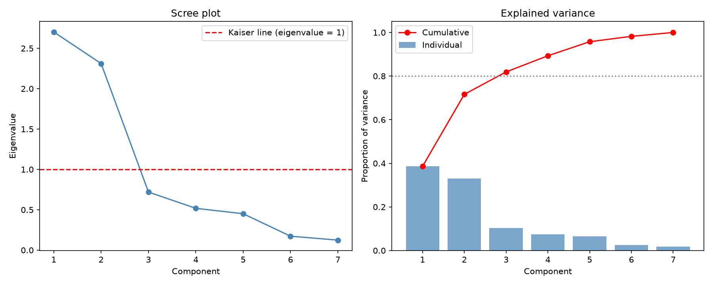
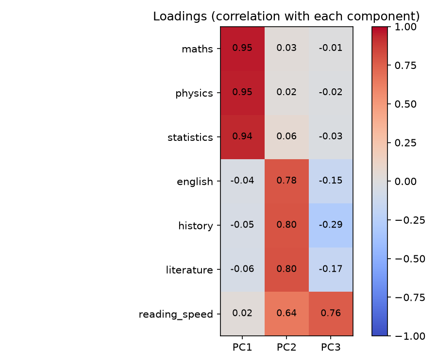
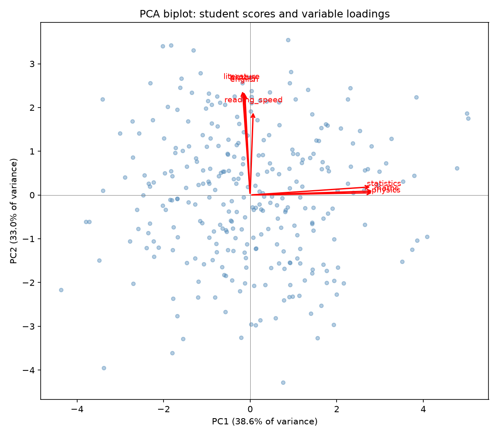
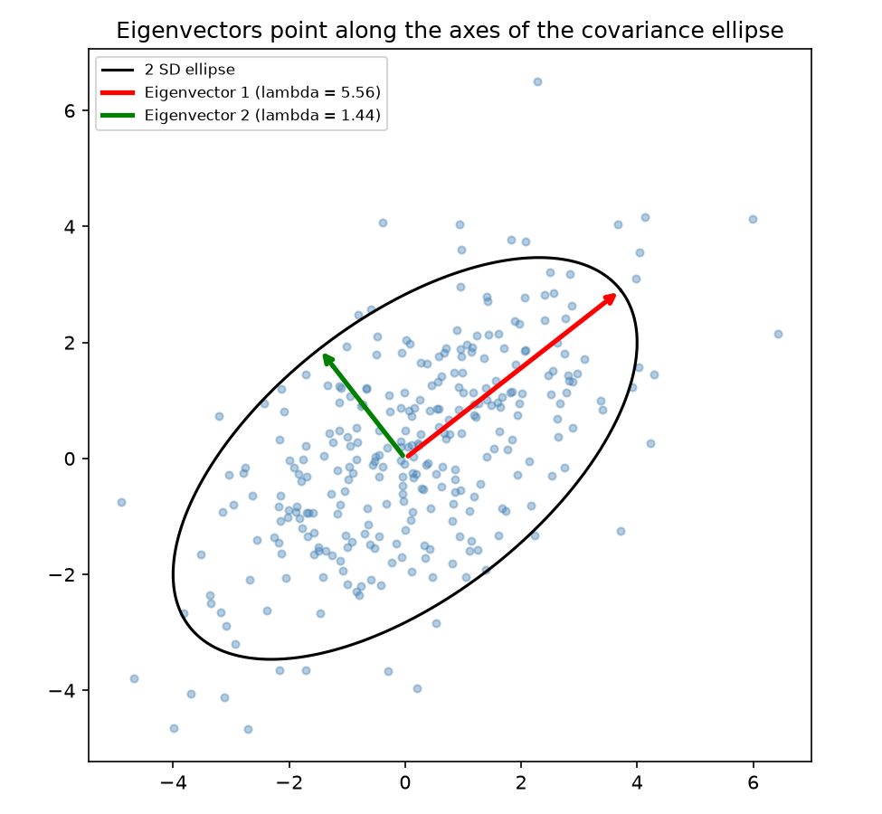
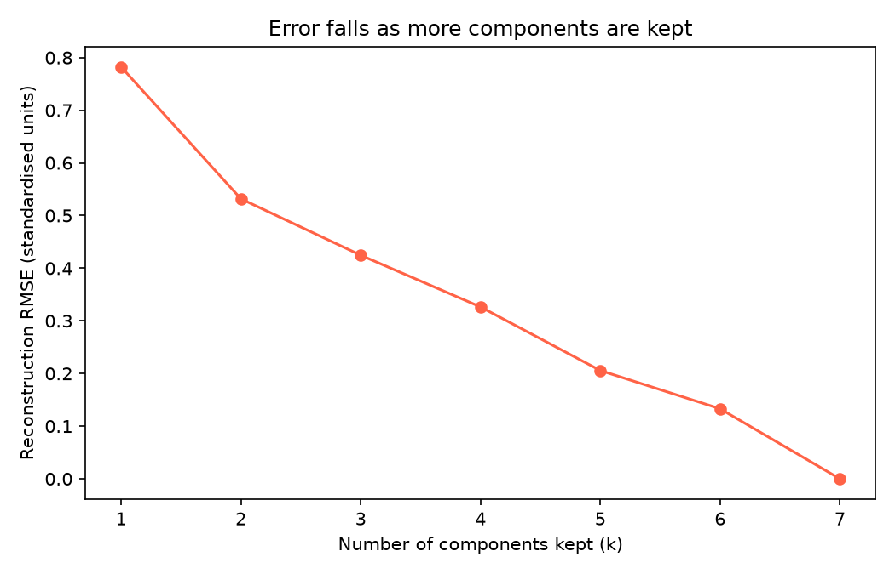

# Topic 10: Eigenvalues, Eigenvectors and PCA

## Objective
Compute eigenvalues and eigenvectors, use them to carry out principal component
analysis (PCA), decide how many components to keep, interpret the loadings, and show
why variables should be standardised first.

## Dataset
Synthetic assessment data for 300 students (random seed 42), generated in
`analysis.py` and saved as `data/student_assessment.csv`, with 7 variables:
- Quantitative subjects: `maths`, `physics`, `statistics`
- Verbal subjects: `english`, `history`, `literature`
- `reading_speed`: words per minute, on a much larger scale than the others

The data were built from two hidden abilities (quantitative and verbal), so PCA
should recover about two main components. Reading speed was linked to verbal ability.

## How to run
```
python analysis.py
```

## Results

### Worked example: S = [[4, 2], [2, 3]]
| Quantity | Value |
|----------|-------|
| Trace / determinant | 7 / 8 |
| Characteristic equation | lambda^2 - 7 lambda + 8 = 0 |
| Eigenvalues (formula) | 5.5616, 1.4384 |
| Eigenvalues (numpy) | 5.5616, 1.4384 |
| Eigenvector 1 | (0.7882, 0.6154) |
| Eigenvector 2 | (-0.6154, 0.7882) |

Checks (all True): S v = lambda v for both pairs; eigenvectors are orthogonal; the
sum of eigenvalues equals the trace; the product equals the determinant.

### Dataset summary
| Variable | Mean | Std dev |
|----------|------|---------|
| maths | 64.19 | 11.60 |
| physics | 59.68 | 13.17 |
| statistics | 61.44 | 12.29 |
| english | 66.74 | 11.69 |
| history | 62.74 | 12.57 |
| literature | 66.20 | 12.06 |
| reading_speed | 251.19 | 45.54 |

### Correlation matrix
| | maths | physics | statistics | english | history | literature | reading_speed |
|---|---|---|---|---|---|---|---|
| maths | 1.00 | 0.87 | 0.84 | -0.03 | -0.01 | -0.03 | 0.04 |
| physics | 0.87 | 1.00 | 0.83 | -0.01 | -0.03 | -0.05 | 0.02 |
| statistics | 0.84 | 0.83 | 1.00 | 0.01 | 0.00 | 0.01 | 0.04 |
| english | -0.03 | -0.01 | 0.01 | 1.00 | 0.51 | 0.49 | 0.36 |
| history | -0.01 | -0.03 | 0.00 | 0.51 | 1.00 | 0.54 | 0.33 |
| literature | -0.03 | -0.05 | 0.01 | 0.49 | 0.54 | 1.00 | 0.37 |
| reading_speed | 0.04 | 0.02 | 0.04 | 0.36 | 0.33 | 0.37 | 1.00 |

### Eigenvalues and explained variance (correlation matrix)
| Component | Eigenvalue | Proportion | Cumulative |
|-----------|-----------|------------|------------|
| PC1 | 2.7026 | 0.3861 | 0.3861 |
| PC2 | 2.3115 | 0.3302 | 0.7163 |
| PC3 | 0.7195 | 0.1028 | 0.8191 |
| PC4 | 0.5181 | 0.0740 | 0.8931 |
| PC5 | 0.4513 | 0.0645 | 0.9576 |
| PC6 | 0.1729 | 0.0247 | 0.9823 |
| PC7 | 0.1242 | 0.0177 | 1.0000 |

The eigenvalues sum to 7.0000, the trace of R. The Kaiser rule (eigenvalue > 1)
keeps 2 components, and 3 components are needed to reach 80% of the variance.

### Eigenvectors and loadings (first 3 components)
| Variable | PC1 vector | PC2 vector | PC3 vector | PC1 loading | PC2 loading | PC3 loading |
|----------|-----------|-----------|-----------|-------------|-------------|-------------|
| maths | 0.580 | 0.020 | -0.007 | 0.954 | 0.031 | -0.006 |
| physics | 0.579 | 0.011 | -0.020 | 0.952 | 0.017 | -0.017 |
| statistics | 0.570 | 0.041 | -0.034 | 0.937 | 0.062 | -0.029 |
| english | -0.025 | 0.516 | -0.177 | -0.042 | 0.784 | -0.150 |
| history | -0.030 | 0.524 | -0.345 | -0.049 | 0.796 | -0.292 |
| literature | -0.036 | 0.528 | -0.200 | -0.060 | 0.803 | -0.170 |
| reading_speed | 0.014 | 0.422 | 0.899 | 0.024 | 0.642 | 0.762 |

### Checks
| Check | Result |
|-------|--------|
| Variance of each score column equals its eigenvalue | True |
| Largest covariance between different components | 1.06e-15 (uncorrelated) |
| scikit-learn eigenvalues, variance ratios and components match | True |
| SVD: singular values squared / (n - 1) equal the eigenvalues | True |

### Covariance PCA without standardising
| Variable | Variance | PC1 eigenvector |
|----------|----------|-----------------|
| maths | 134.5 | 0.011 |
| physics | 173.4 | 0.007 |
| statistics | 150.9 | 0.012 |
| english | 136.6 | 0.102 |
| history | 158.1 | 0.102 |
| literature | 145.5 | 0.107 |
| reading_speed | 2074.0 | 0.984 |

Proportion of variance: PC1 = 0.7184, PC2 = 0.1391, PC3 = 0.0797.

### Reconstruction from the first k components (standardised data)
| k | Variance retained | RMSE |
|---|-------------------|------|
| 1 | 0.3861 | 0.7822 |
| 2 | 0.7163 | 0.5317 |
| 3 | 0.8191 | 0.4246 |
| 4 | 0.8931 | 0.3264 |
| 5 | 0.9576 | 0.2057 |
| 6 | 0.9823 | 0.1330 |
| 7 | 1.0000 | 0.0000 |







Tables: `outputs/eigenvalues.csv`, `outputs/loadings.csv`, `outputs/pc_scores.csv`,
`outputs/reconstruction_error.csv`. Console record: `outputs/console_output.txt`.

## Interpretation
- **Eigenvalues and eigenvectors:** An eigenvector of a matrix keeps its direction
  when the matrix is applied to it, and the eigenvalue is the scaling factor. For
  the 2x2 example, the formula and numpy give the same eigenvalues (5.5616 and
  1.4384). Their sum is the trace (7) and their product is the determinant (8). The
  eigenvectors are orthogonal, and they point along the axes of the covariance
  ellipse, with the larger eigenvalue along the direction of greatest spread.
- **Structure in the data:** The correlation matrix shows two blocks. Maths, physics
  and statistics correlate strongly with each other (0.83 to 0.87), and english,
  history and literature correlate moderately (0.49 to 0.54). There is almost no
  correlation between the blocks. Reading speed is correlated only with the verbal
  subjects (0.33 to 0.37).
- **How many components:** The first two eigenvalues (2.70 and 2.31) are above 1 and
  together explain 71.6% of the variance. The scree plot drops sharply after PC2
  and flattens out, so two components is the natural choice. Reaching 80% would
  need a third component (81.9%), which adds only 10.3%.
- **PC1 is a quantitative-ability component:** Maths, physics and statistics load
  0.94 to 0.95 on PC1, while the verbal variables load close to 0. A high PC1 score
  means a strong quantitative student.
- **PC2 is a verbal-ability component:** English, history and literature load about
  0.78 to 0.80 on PC2, and reading speed loads 0.64. A high PC2 score means a strong
  verbal student. The two hidden abilities used to build the data were recovered.
- **PC3:** It is mostly reading speed (loading 0.76), contrasted slightly with
  history. It explains only 10.3% of the variance and is probably the
  reading-speed noise that the verbal ability does not account for.
- **Eigenvectors against loadings:** Eigenvectors give the weights used to build the
  scores, while loadings (eigenvector times the square root of the eigenvalue) are
  the correlations between each variable and the component. Loadings are easier to
  interpret.
- **Components are uncorrelated:** The covariance between different component scores
  is about 1e-15, which is zero apart from rounding. The variance of each score
  column equals its eigenvalue. scikit-learn and the SVD give the same results, so
  all three methods agree.
- **Why standardise:** Reading speed has a variance of 2,074, more than 12 times the
  others (about 135 to 173). Without standardising, PC1 is almost entirely reading
  speed (weight 0.984) and explains 71.8% of the variance, and the quantitative
  subjects get weights near 0.01. That component reflects the units of measurement,
  not the structure of the data. Standardised PCA (the correlation matrix) puts
  every variable on an equal footing and finds the real two-ability structure.
- **Reconstruction:** Using 2 components keeps 71.6% of the variance and gives an
  RMSE of 0.53 standardised units, and 5 components keep 95.8%. With all 7 the
  reconstruction is exact (RMSE 0). The reduction from 7 variables to 2 loses about
  28% of the variance.
- **Conclusion:** PCA reduces 7 correlated scores to 2 interpretable components
  (quantitative and verbal ability) while keeping about 72% of the information. It
  rests on the eigendecomposition of the correlation matrix, and the variables must
  be standardised when they are measured on different scales.