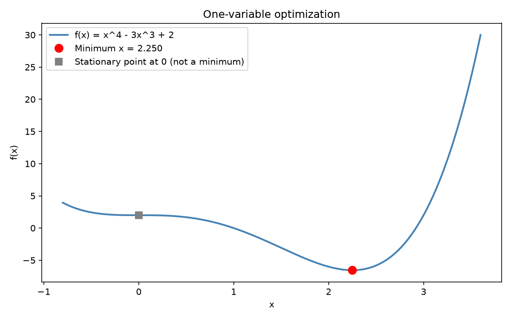
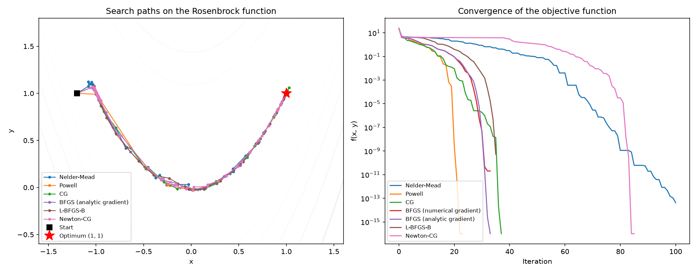
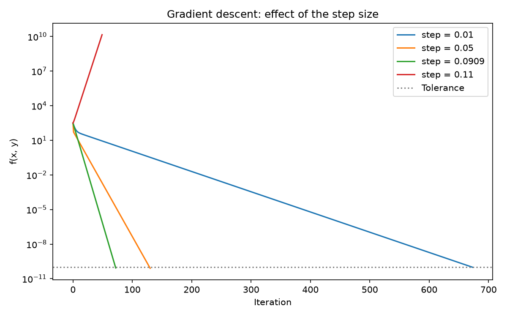
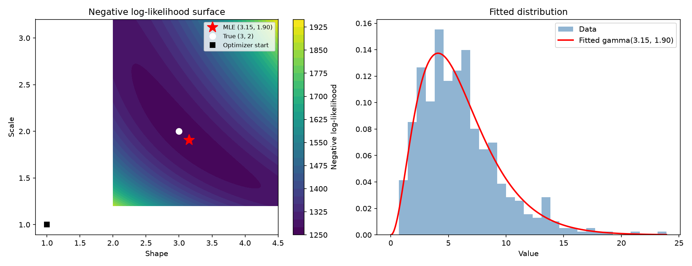
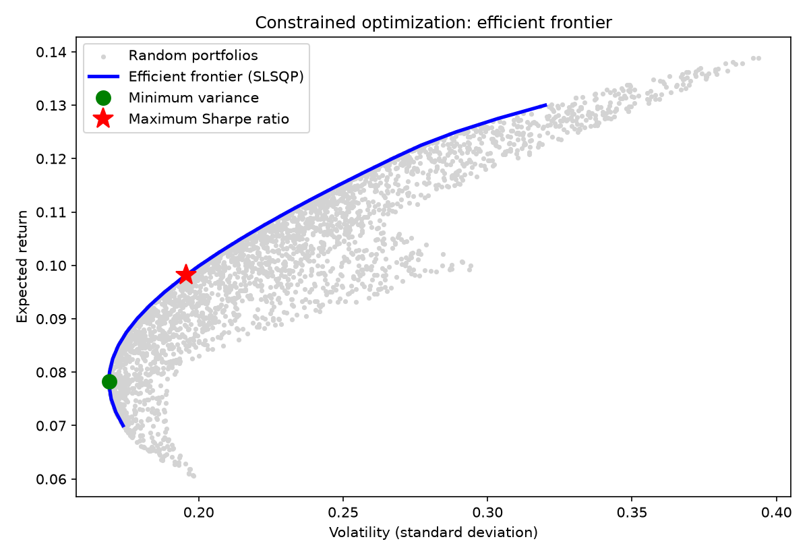
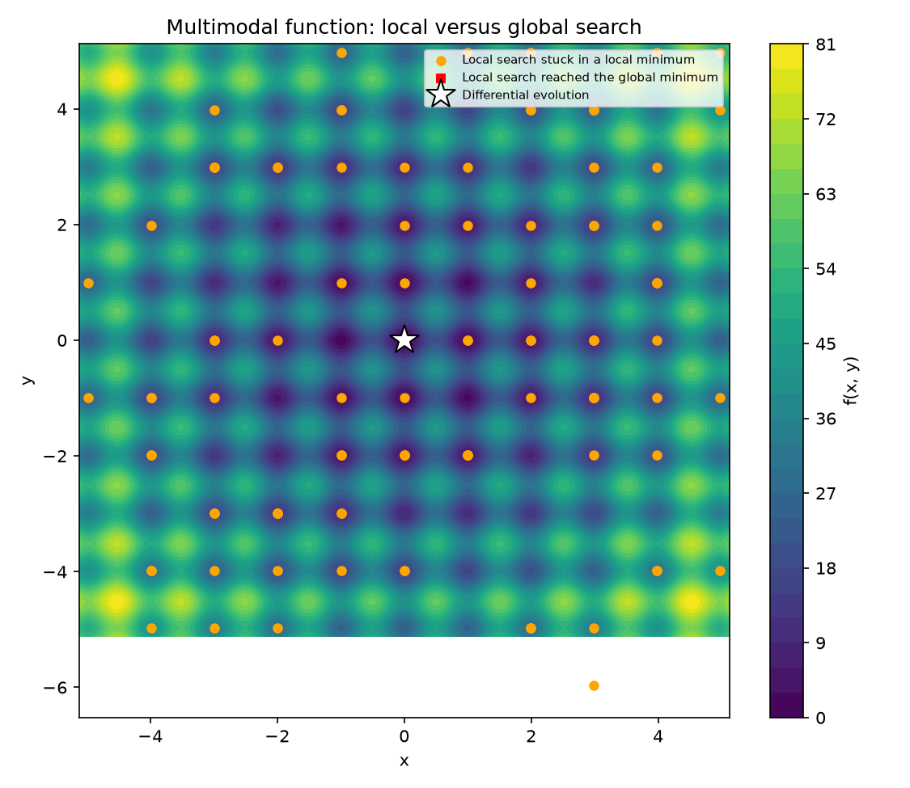

# Topic 11: Numerical Optimization

## Objective
Find the minimum of an objective function numerically, compare optimization
algorithms, apply optimization to maximum likelihood estimation and to a
constrained portfolio problem, and show why global optimization is needed for
functions with many local minima.

## Dataset
No external data is needed. The script uses standard test functions plus one
synthetic sample generated in `analysis.py` (random seed 42):
- `f(x) = x^4 - 3x^3 + 2` (one variable)
- The Rosenbrock function (two variables, a narrow curved valley)
- `f(x, y) = x^2 + 10 y^2` (gradient descent by hand)
- 500 values from a gamma distribution (true shape 3, true scale 2), saved as
  `data/gamma_sample.csv`
- A three-asset portfolio (bonds, shares, growth) with given expected returns and
  covariance matrix
- The Rastrigin function (many local minima)

## How to run
```
python analysis.py
```

## Results

### 1. One variable: f(x) = x^4 - 3x^3 + 2
Analytically, f'(x) = x^2 (4x - 9) = 0 gives x = 9/4 = 2.25, with f(x*) = -6.5430
and f''(x*) = 20.25 > 0, so it is a minimum.

| Method | x | f(x) | Iterations | Evaluations |
|--------|---|------|-----------|-------------|
| Brent | 2.250000 | -6.542969 | 12 | 15 |
| Bounded search on (0, 5) | 2.249999 | -6.542969 | 12 | 12 |
| Root of f'(x) (brentq) | 2.250000 | | 12 | |

Newton's method on f'(x) = 0, starting at x = 3:

| Iteration | x | Error |
|-----------|---|-------|
| 1 | 2.5000000000 | 2.50e-01 |
| 2 | 2.2916666667 | 4.17e-02 |
| 3 | 2.2514619883 | 1.46e-03 |
| 4 | 2.2500018962 | 1.90e-06 |
| 5 | 2.2500000000 | 3.20e-12 |

### 2. Rosenbrock function (start at (-1.2, 1), true minimum (1, 1) with f = 0)
| Method | Converged | Iterations | f evaluations | Gradient evaluations | Final f | Distance to optimum |
|--------|-----------|-----------|---------------|----------------------|---------|---------------------|
| Nelder-Mead | True | 101 | 189 | none | 4.19e-14 | 2.78e-07 |
| Powell | True | 23 | 701 | none | 7.56e-28 | 4.4e-14 |
| CG | True | 37 | 80 | 79 | 3.1e-21 | 1.25e-10 |
| BFGS (numerical gradient) | True | 33 | 120 | 40 | 2.01e-11 | 1e-05 |
| BFGS (analytic gradient) | True | 33 | 40 | 40 | 8.98e-19 | 1.68e-09 |
| L-BFGS-B | True | 35 | 43 | 43 | 5.3e-10 | 7.7e-06 |
| Newton-CG | True | 85 | 107 | 107 | 1.32e-19 | 8.12e-10 |

### 3. Gradient descent on f(x, y) = x^2 + 10 y^2 (start at (8, 5))
The curvatures are 2 and 20. The best fixed step size is 2 / (2 + 20) = 0.0909, and
any step above 2 / 20 = 0.1 diverges.

| Step size | Outcome | Iterations | Final f |
|-----------|---------|-----------|---------|
| 0.0100 | Converged | 673 | 9.919e-11 |
| 0.0500 | Converged | 130 | 8.114e-11 |
| 0.0909 | Converged | 72 | 8.641e-11 |
| 0.1100 | Diverged | 49 | 1.438e+10 |

### 4. Maximum likelihood for a gamma distribution (n = 500)
The optimizer started at shape = 1 and scale = 1 and worked on the log scale so both
parameters stay positive.

| Method | Shape | Scale |
|--------|-------|-------|
| True values | 3.0000 | 2.0000 |
| BFGS on the negative log-likelihood | 3.1539 | 1.9047 |
| scipy `gamma.fit` | 3.1539 | 1.9047 |
| Method of moments | 3.0378 | 1.9775 |

The minimum negative log-likelihood is 1261.635 (converged in 9 iterations and 39
function evaluations). The fitted mean, shape x scale = 6.0073, equals the sample
mean (6.0073). The closed-form likelihood formula used for the contour plot matches
the optimizer's objective (True).

### 5. Constrained portfolio optimization (weights >= 0, sum to 1)
Expected returns: bonds 6%, shares 10%, growth 14%. Risk-free rate 2%.

| Portfolio | Bonds | Shares | Growth | Return | Volatility | Sharpe ratio |
|-----------|-------|--------|--------|--------|------------|--------------|
| Minimum variance (SLSQP) | 0.6448 | 0.2538 | 0.1014 | 0.0783 | 0.1689 | |
| Maximum Sharpe ratio (SLSQP) | 0.3464 | 0.3518 | 0.3017 | 0.0982 | 0.1957 | 0.3996 |

The exact minimum-variance solution S^-1 1 / (1' S^-1 1) is (0.6448, 0.2538, 0.1014).
With a tight solver tolerance (`ftol = 1e-12`), the SLSQP weights agree with it to
within 7.48e-07, so the check printed **True**.

The efficient frontier was computed for 25 target returns from 0.07 to 0.13. All
converged, and the volatility ranges from 0.1690 to 0.3200.

### 6. Global optimization: Rastrigin function (global minimum 0 at (0, 0))
| Method | Result |
|--------|--------|
| 100 local BFGS searches from random starts | 0 reached the global minimum |
| Distinct local minima found | 20 (median final f = 16.914) |
| Differential evolution | x = (0, 0), f = 0, 1743 function evaluations, converged |








Tables: `outputs/rosenbrock_methods.csv`, `outputs/mle_gamma.csv`,
`outputs/efficient_frontier.csv`. Console record: `outputs/console_output.txt`.

## Interpretation
- **One variable:** The numerical methods (Brent, bounded search and root-finding on
  the derivative) all land on the analytic minimum x = 2.25, with f = -6.5430. The
  derivative also vanishes at x = 0, but that is a double root with f''(0) = 0, an
  inflection point and not a minimum, so setting the derivative to zero finds
  stationary points that still need checking.
- **Newton's method:** The error shrinks from 2.5e-01 to 4.2e-02, 1.5e-03, 1.9e-06
  and 3.2e-12. Each error is roughly the square of the previous one, which is
  quadratic convergence. Newton needs only 5 iterations, but it uses the second
  derivative and can fail from a poor starting point.
- **Rosenbrock, derivative-free methods:** Nelder-Mead (189 evaluations) and Powell
  (701) need no gradients and still converge, but Powell uses by far the most
  function evaluations. They are the choice when the gradient is unavailable.
- **Rosenbrock, gradient methods:** Supplying the analytic gradient makes BFGS cheaper
  and more accurate: 40 function evaluations and a distance to the optimum of
  1.7e-09, against 120 evaluations and 1e-05 with a numerical gradient. BFGS
  (analytic) and L-BFGS-B are the most economical (40 and 43 evaluations). Newton-CG
  needs more iterations (85) here despite using the Hessian. The best method depends
  on the problem and on whether derivatives are available, and all seven reached
  the minimum at (1, 1).
- **Gradient descent:** With step 0.01 the method converges but needs 673 iterations.
  The best step, 0.0909, needs only 72. A step of 0.11 is above 2/20 = 0.1 and the
  iterates diverge (f reaches 1.4e+10). The step size is limited by the steepest
  direction and the speed by the flattest, which is why ill-conditioned problems
  are slow.
- **Maximum likelihood:** Starting from (1, 1), BFGS finds shape 3.154 and scale
  1.905 in 9 iterations. This matches scipy's `gamma.fit` exactly, so fitting
  distributions is numerical optimization. The estimates differ from the true values
  (3 and 2) through sampling variability with n = 500. The fitted mean equals the
  sample mean, a property of gamma maximum likelihood. The method of moments is
  close (3.04 and 1.98) but is not the maximiser of the likelihood.
- **Constrained optimization:** The minimum-variance portfolio puts 64.5% in bonds,
  the least risky asset, and has volatility 0.1689. The maximum-Sharpe portfolio
  spreads weight almost equally and accepts higher risk (0.1957) for a higher return
  (0.0982), with a Sharpe ratio of 0.3996. The numerical minimum-variance weights
  (0.6448, 0.2538, 0.1014) match the exact formula S^-1 1 / (1' S^-1 1) to within
  7.48e-07. With SLSQP's default tolerance the weights were off by about 0.0006, so
  a tighter tolerance is worth setting when an exact answer is available to compare
  against. Because the exact weights are all positive, the non-negativity
  constraints are inactive at the optimum.
- **Efficient frontier:** The frontier traces the lowest risk for each target return.
  The minimum-variance portfolio returns 7.83%, so the part of the plotted curve
  for targets between 7% and 7.83% is the inefficient lower branch, since the
  same risk or less is available with a higher return. Only the part above 7.83%
  is efficient.
- **Local against global search:** None of 100 local BFGS searches reached the global
  minimum. Each one settled in the nearest of the 20 local minima found (median
  f = 16.914). This is expected, because the central basin around (0, 0) covers
  only about 1% of the search area. Differential evolution found (0, 0) with f = 0
  using 1743 evaluations. Local methods are fast but depend on the starting point,
  while global methods cost more evaluations and are needed for multimodal
  objectives.
- **Conclusion:** Optimization is the engine behind estimation (maximum likelihood),
  decision problems (portfolios) and model fitting. The choice of method depends on
  whether derivatives are available, whether there are constraints and whether the
  objective has several minima.