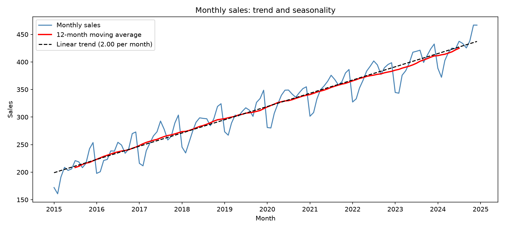
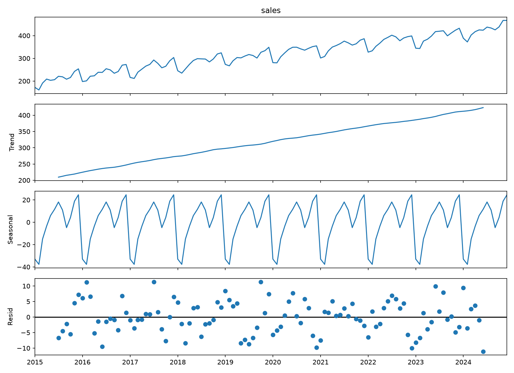
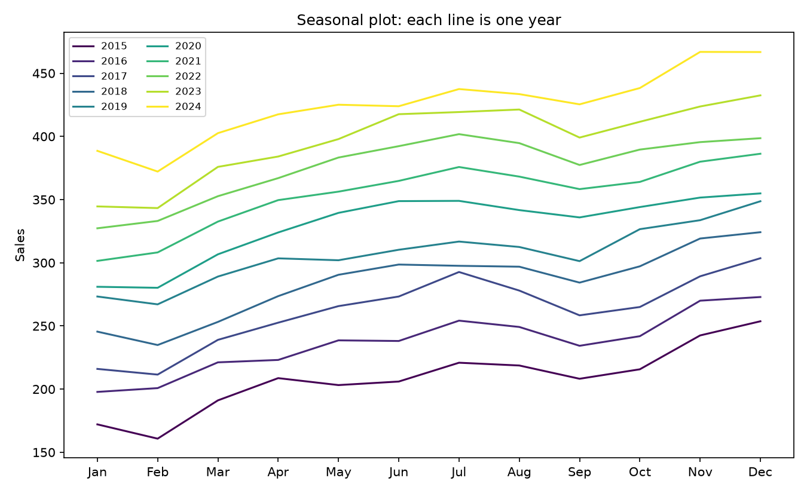
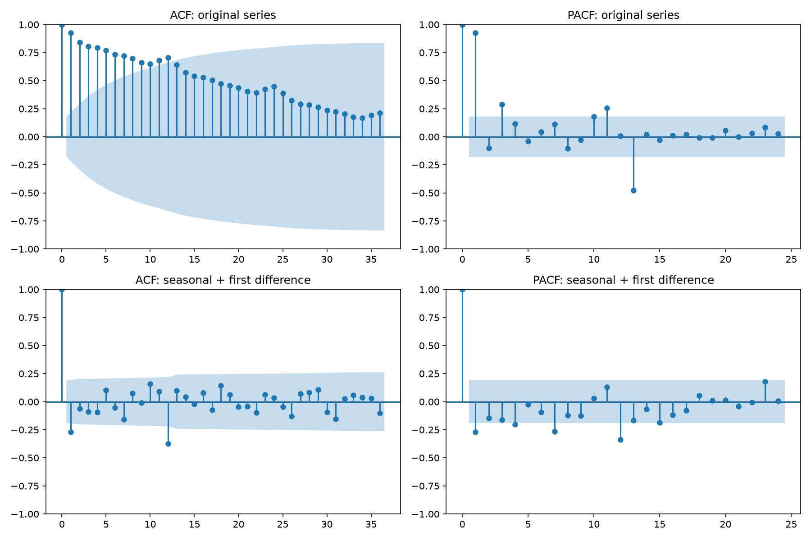
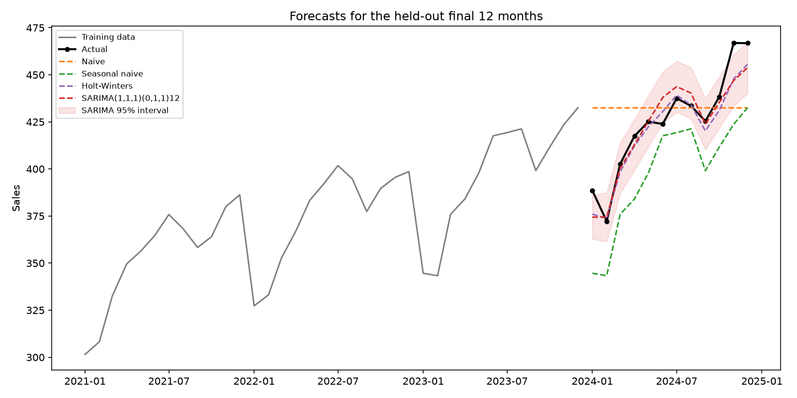
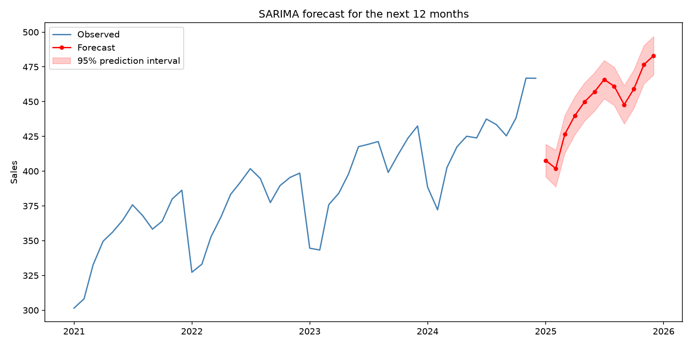
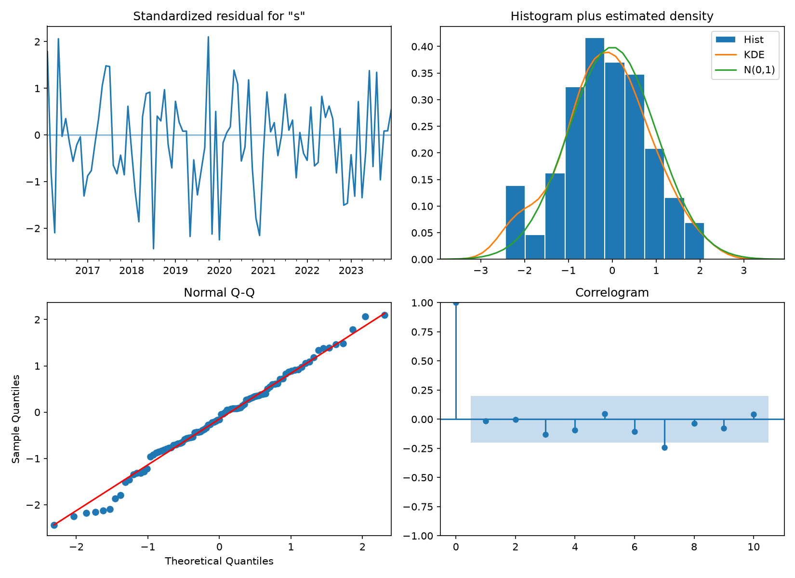

# Topic 13: Time-Series Analysis

## Objective
Describe a time series (trend and seasonality), test for stationarity, examine
autocorrelation, and build and compare forecasting models on a held-out period.

## Dataset
Synthetic monthly sales for 10 years (120 months, January 2015 to December 2024),
generated in `analysis.py` with random seed 42 and saved as `data/monthly_sales.csv`.
The series was built from:
- a linear trend of 2.0 per month,
- a known seasonal pattern (lowest in February at -35, highest in December at +25),
- autocorrelated noise (an AR(1) process with coefficient 0.5).

Because the true trend and seasonal effects are known, we can check whether the
analysis recovers them.

## How to run
```
python analysis.py
```

## Results

### Dataset summary
120 monthly observations. Mean = 318.12, sd = 72.46, minimum = 160.8,
maximum = 466.9.

### Yearly summary
| Year | Mean | Std dev | Min | Max | Growth (%) |
|------|------|---------|-----|-----|-----------|
| 2015 | 208.47 | 26.02 | 160.8 | 253.7 | |
| 2016 | 236.84 | 23.64 | 197.8 | 272.9 | 13.61 |
| 2017 | 262.09 | 28.80 | 211.5 | 303.6 | 10.66 |
| 2018 | 284.64 | 27.93 | 234.9 | 324.2 | 8.60 |
| 2019 | 307.08 | 23.53 | 267.1 | 348.7 | 7.88 |
| 2020 | 329.78 | 26.49 | 280.2 | 354.9 | 7.40 |
| 2021 | 353.80 | 26.91 | 301.5 | 386.3 | 7.28 |
| 2022 | 376.11 | 25.67 | 327.3 | 401.8 | 6.31 |
| 2023 | 397.58 | 30.06 | 343.3 | 432.5 | 5.71 |
| 2024 | 424.86 | 27.93 | 372.2 | 466.9 | 6.86 |

### Linear trend
| Quantity | Value |
|----------|-------|
| Intercept | 199.03 |
| Slope | 2.002 per month (24.0 per year) |
| R-squared | 0.9234 |
| True slope | 2.000 |

### Additive decomposition (observed = trend + seasonal + residual)
Strength of trend = 0.992, strength of seasonality = 0.930 (1 = very strong).
Residual mean = -0.028, residual sd = 5.266.

| Month | True effect | Estimated effect |
|-------|-------------|------------------|
| Jan | -30.0 | -32.99 |
| Feb | -35.0 | -37.69 |
| Mar | -15.0 | -15.05 |
| Apr | -5.0 | -3.53 |
| May | 5.0 | 5.94 |
| Jun | 10.0 | 11.56 |
| Jul | 15.0 | 18.10 |
| Aug | 10.0 | 10.91 |
| Sep | -5.0 | -4.82 |
| Oct | 5.0 | 4.18 |
| Nov | 20.0 | 18.83 |
| Dec | 25.0 | 24.56 |

### Stationarity: Augmented Dickey-Fuller tests (H0: unit root, non-stationary)
| Series | ADF statistic | p-value | Lags used | 5% critical value | Conclusion |
|--------|---------------|---------|-----------|-------------------|------------|
| Original | -0.379 | 0.9136 | 12 | -2.889 | Non-stationary |
| First difference | -5.883 | < 0.0001 | 11 | -2.889 | Stationary |
| Seasonal difference (lag 12) | -3.384 | 0.0115 | 12 | -2.892 | Stationary |
| Seasonal + first difference | -5.257 | < 0.0001 | 12 | -2.893 | Stationary |

### Autocorrelation
Approximate 95% bound for white noise: +/-0.179.

| Lag | Original series | Seasonal + first difference |
|-----|-----------------|------------------------------|
| 1 | 0.925 | -0.270 |
| 2 | 0.842 | -0.062 |
| 3 | 0.806 | -0.088 |
| 6 | 0.735 | -0.054 |
| 12 | 0.707 | -0.376 |
| 24 | 0.448 | 0.033 |

Ljung-Box test on the decomposition residuals (lag 12): Q = 54.26, p < 0.0001.

### Forecast accuracy on the held-out last 12 months (trained on Jan 2015 to Dec 2023)
| Method | MAE | RMSE | MAPE |
|--------|-----|------|------|
| Naive | 21.06 | 27.81 | 5.11% |
| Seasonal naive | 27.28 | 29.31 | 6.45% |
| Holt-Winters | 6.48 | 8.32 | 1.50% |
| SARIMA(1,1,1)(0,1,1)12 | 7.34 | 9.55 | 1.70% |

Best method by RMSE: Holt-Winters.

Holt-Winters parameters: level smoothing (alpha) = 0.6869, trend smoothing (beta) =
0.0000, seasonal smoothing (gamma) = 0.0000, AIC = 407.52.

### SARIMA(1,1,1)(0,1,1)12 coefficients
| Term | Coefficient | Std error | p-value |
|------|-------------|-----------|---------|
| ar.L1 | 0.4774 | 0.1024 | < 0.0001 |
| ma.L1 | -0.9755 | 0.0757 | < 0.0001 |
| ma.S.L12 | -0.6183 | 0.1142 | < 0.0001 |
| sigma2 | 35.0952 | 5.5896 | < 0.0001 |

AIC = 624.60, BIC = 634.81. The 95% prediction interval covered 75% of the 12
held-out months (average width 26.7).

### SARIMA residual diagnostics
| Check | Result |
|-------|--------|
| Residual mean / sd | -0.908 / 6.299 |
| Ljung-Box, lag 12 | Q = 10.97, p = 0.5313 |
| Ljung-Box, lag 24 | Q = 18.74, p = 0.7659 |
| Shapiro-Wilk (normality) | W = 0.9916, p = 0.8165 |

### Forecast for the next 12 months (SARIMA fitted on all 120 months)
| Month | Forecast | Lower 95% | Upper 95% |
|-------|----------|-----------|-----------|
| Jan 2025 | 407.7 | 396.0 | 419.4 |
| Feb 2025 | 401.9 | 388.8 | 415.1 |
| Mar 2025 | 426.5 | 413.0 | 440.1 |
| Apr 2025 | 439.9 | 426.3 | 453.6 |
| May 2025 | 449.8 | 436.1 | 463.5 |
| Jun 2025 | 457.1 | 443.4 | 470.8 |
| Jul 2025 | 465.9 | 452.2 | 479.7 |
| Aug 2025 | 461.1 | 447.3 | 474.8 |
| Sep 2025 | 447.8 | 434.1 | 461.6 |
| Oct 2025 | 459.1 | 445.4 | 472.9 |
| Nov 2025 | 476.6 | 462.9 | 490.4 |
| Dec 2025 | 483.1 | 469.4 | 496.9 |

Forecast total for 2025: 5377 (actual total for 2024: 5098).









Tables: `outputs/yearly_summary.csv`, `outputs/seasonal_effects.csv`,
`outputs/adf_tests.csv`, `outputs/acf_values.csv`, `outputs/forecast_accuracy.csv`,
`outputs/sarima_coefficients.csv`, `outputs/holdout_forecasts.csv`,
`outputs/future_forecast.csv`. Console record: `outputs/console_output.txt`.

## Interpretation
- **Trend:** Sales rise steadily. The fitted line gains 2.002 per month (24.0 per
  year), almost exactly the true slope of 2.0, and explains 92.3% of the variation.
  The decomposition gives a trend strength of 0.992.
- **Growth rate:** Percentage growth falls from 13.6% in 2016 to about 6 to 7% in
  recent years, even though the series gains about 24 units every year. This is
  because a straight-line trend adds a constant amount, which is a shrinking
  percentage of a growing base.
- **Seasonality:** Sales are lowest in January and February and peak in November and
  December. The estimated seasonal effects are close to the true ones (for example
  Feb -37.69 against -35 and Dec 24.56 against 25), with the largest error about 3
  units in July. The seasonal strength is 0.930, so the seasonal pattern is strong.
- **Residuals from the decomposition:** They have mean near 0 (-0.028) and sd 5.27,
  but the Ljung-Box test (p < 0.0001) shows they are autocorrelated. That is
  expected, since the noise was generated as an AR(1) process. It means a simple
  decomposition leaves some structure in the remainder that a model such as
  SARIMA can use.
- **Stationarity:** The original series is non-stationary (ADF p = 0.9136, so we
  cannot reject a unit root), which is what we expect with a trend. After first
  differencing, seasonal differencing, or both, the tests reject the unit root
  (p = 0.0115 or below), so each version is stationary. Seasonal differencing alone
  is the weakest of the three (p = 0.0115, only just below 0.05 after the trend
  remains partly).
- **Autocorrelation:** The original series has very high autocorrelation (0.925 at
  lag 1) that decays slowly, even at lag 24 (0.448), the usual sign of trend and
  seasonality. After seasonal and first differencing, the autocorrelation is
  mostly inside the +/-0.179 bounds, except at lag 1 (-0.270) and lag 12 (-0.376).
  These two spikes point to the moving-average terms at lag 1 and lag 12 that the
  SARIMA(1,1,1)(0,1,1)12 model includes.
- **Forecast accuracy:** On the held-out 12 months, Holt-Winters is best (RMSE
  8.32, MAPE 1.50%), followed by SARIMA (RMSE 9.55, MAPE 1.70%). The naive and
  seasonal naive methods are much worse (RMSE about 28 to 29, MAPE 5 to 6%). The
  seasonal naive forecast repeats last year's values, so it misses a full year of
  growth (about 24 units), which is why it does not beat the plain naive method here.
- **Why Holt-Winters wins here:** Its trend and seasonal smoothing parameters are
  both 0, meaning it treats the slope and seasonal pattern as fixed. That matches
  how the data were generated. SARIMA has to difference the data to remove a
  trend that is really a straight line, and its moving-average coefficient
  (-0.9755) sits very close to -1, a typical sign of over-differencing. With one
  12-month hold-out window, the gap between the two (8.32 against 9.55) is small and
  should not be over-interpreted.
- **Model comparison by AIC:** The Holt-Winters AIC (407.52) and the SARIMA AIC
  (624.60) should not be compared with each other, because SARIMA is fitted to the
  differenced series and the two likelihoods are calculated differently. The
  hold-out error is the fair comparison.
- **SARIMA model:** All coefficients are significant (p < 0.0001). The residuals
  look like white noise (Ljung-Box p = 0.5313 at lag 12 and 0.7659 at lag 24) and
  are consistent with normality (Shapiro p = 0.8165), so the model has captured the
  autocorrelation.
- **Prediction intervals:** The 95% interval contained only 9 of the 12 held-out
  months (75%), below the nominal 95%. With only 12 points, and forecast errors
  that are correlated across the horizon, this is weak evidence, but it suggests
  the intervals are somewhat too narrow and the forecasts should not be treated
  as more certain than they are.
- **Forecast for 2025:** The final model, refitted on all 120 months, forecasts a
  total of 5377 for 2025, against 5098 in 2024, an increase of about 5.5%. This
  agrees with the trend (2024 total plus 12 months x 24 = about 5386). The forecast
  keeps the seasonal shape, with a low in February (401.9) and a high in December
  (483.1). The intervals are about 23 to 28 units wide.
- **Conclusion:** The series has a clear linear trend and a strong seasonal pattern,
  both of which the analysis recovers accurately. Differencing makes it stationary,
  and both Holt-Winters and SARIMA forecast far better than the naive methods. The
  best model depends on the structure of the data, which is why forecasts should be
  compared on held-out data.