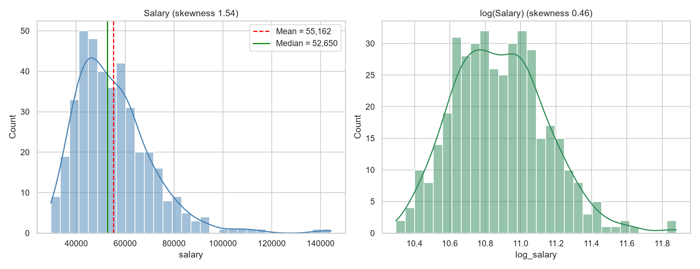
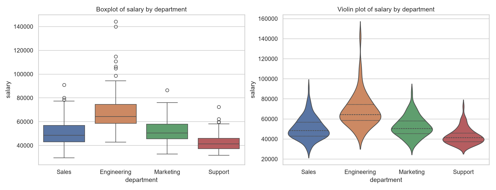
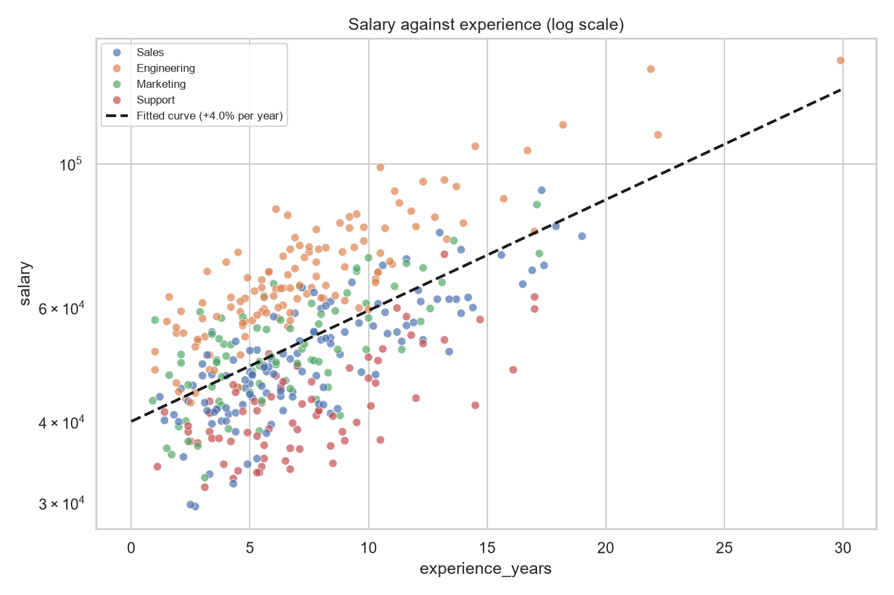
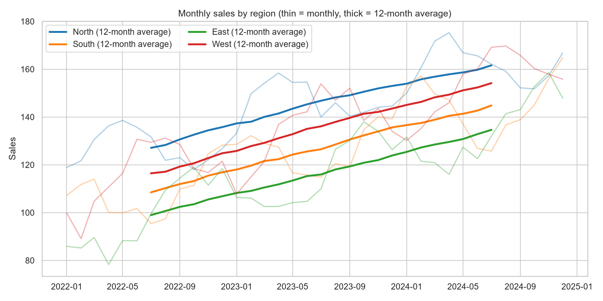
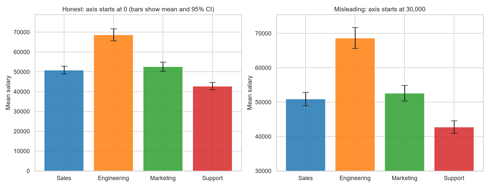
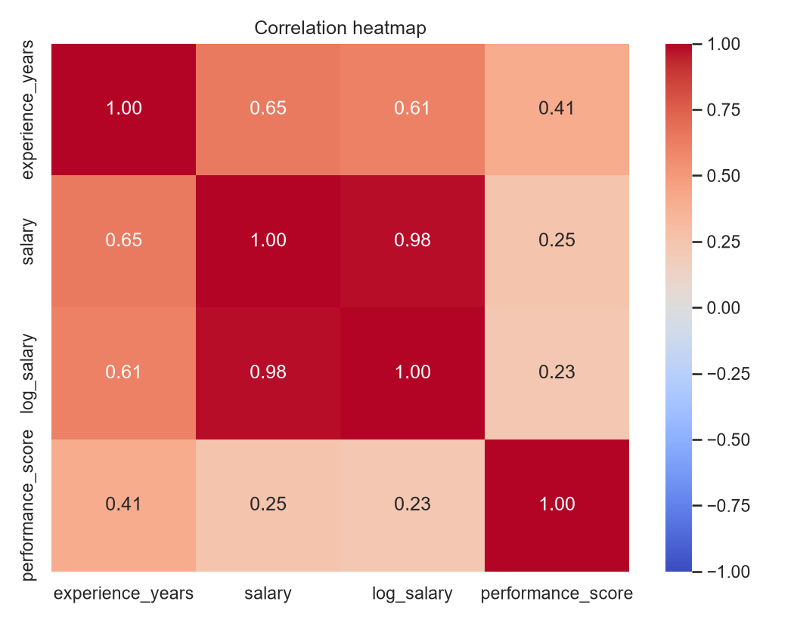
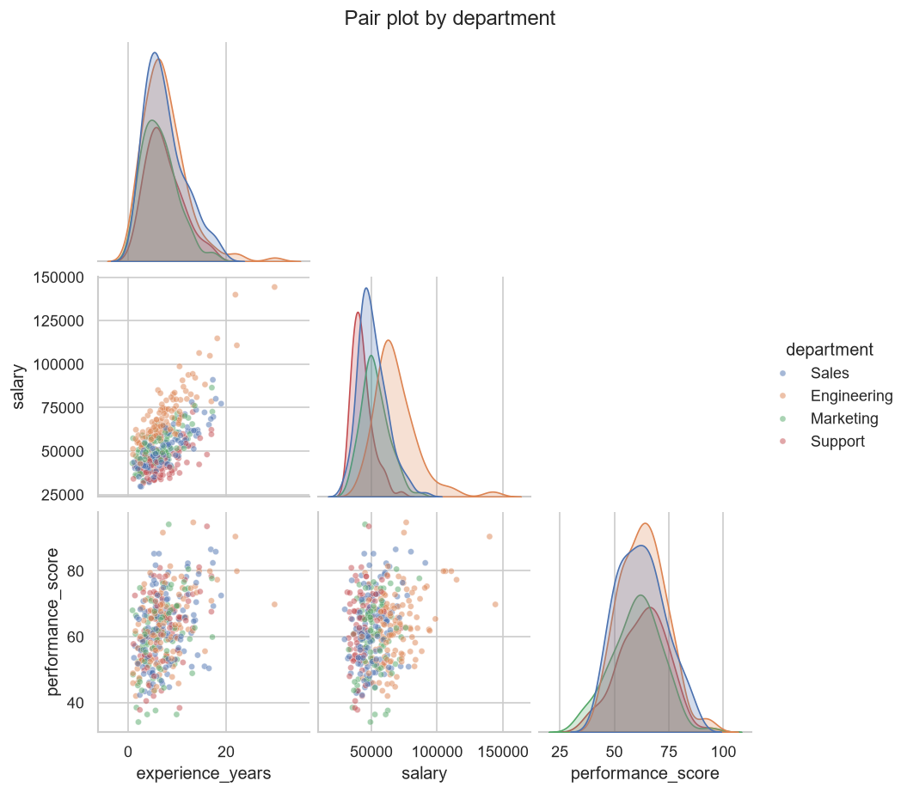
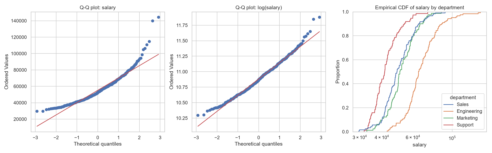
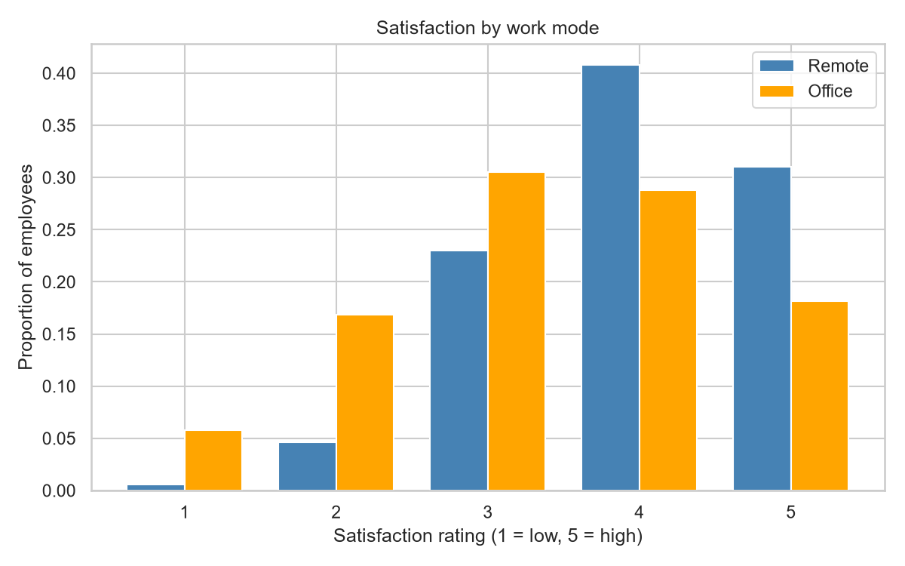

# Topic 14: Statistical Data Visualization

## Objective
Choose and build appropriate statistical charts (histogram, boxplot, violin plot,
scatter plot, line graph, bar chart, heatmap, Q-Q plot, ECDF), read what they show,
back the visual impressions with numbers, and recognise how a chart can mislead.

## Dataset
Synthetic data generated in `analysis.py` (random seed 42):
- `data/employees.csv`: 400 employees with `department` (Sales, Engineering,
  Marketing, Support), `experience_years`, `salary` (right-skewed),
  `performance_score`, `remote` (Yes/No) and `satisfaction` (rating 1 to 5).
- `data/regional_sales.csv`: monthly sales for 4 regions over 36 months (144 rows),
  built from a trend of 1.5 per month plus a seasonal cycle and noise.

Employee counts: Engineering 123, Sales 121, Marketing 81, Support 75.

## How to run
```
python analysis.py
```
Requires `plotly` for the interactive charts (`pip install plotly`).

## Results

### Summary statistics (employees)
| Statistic | Experience (years) | Salary | Performance score |
|-----------|--------------------|--------|-------------------|
| Count | 400 | 400 | 400 |
| Mean | 7.23 | 55,162.50 | 62.21 |
| Std dev | 4.07 | 15,724.08 | 10.89 |
| Min | 0.90 | 29,600 | 34.10 |
| 25% | 4.30 | 43,700 | 53.68 |
| Median | 6.45 | 52,650 | 62.05 |
| 75% | 9.43 | 62,500 | 69.32 |
| Max | 29.90 | 144,300 | 94.70 |

### Shape of the salary distribution
| Variable | Mean | Median | Skewness | Shapiro-Wilk p |
|----------|------|--------|----------|----------------|
| Salary | 55,162 | 52,650 | 1.542 | 3.369e-15 |
| log(Salary) | | | 0.457 | 0.0006 |

### Salary by department
| Department | n | Mean | Median | Std dev | 95% CI half-width |
|------------|---|------|--------|---------|-------------------|
| Sales | 121 | 50,874 | 48,600 | 10,904 | 1,963 |
| Engineering | 123 | 68,644 | 64,400 | 16,896 | 3,016 |
| Marketing | 81 | 52,579 | 50,500 | 10,198 | 2,255 |
| Support | 75 | 42,763 | 41,400 | 7,869 | 1,810 |

Kruskal-Wallis test of salary across departments: H = 169.29, p = 1.81e-36.

### Correlation matrix
| | experience_years | salary | log_salary | performance_score |
|---|---|---|---|---|
| experience_years | 1.000 | 0.646 | 0.611 | 0.406 |
| salary | 0.646 | 1.000 | 0.978 | 0.251 |
| log_salary | 0.611 | 0.978 | 1.000 | 0.234 |
| performance_score | 0.406 | 0.251 | 0.234 | 1.000 |

Fitted curve: log(salary) = 10.598 + 0.0394 * experience, so each extra year of
experience is associated with a 4.0% higher salary.

### Regional sales: first 12 months against last 12 months
| Region | First year mean | Last year mean | Growth |
|--------|-----------------|----------------|--------|
| North | 127.1 | 161.6 | 27.2% |
| South | 108.5 | 144.8 | 33.5% |
| East | 99.0 | 134.6 | 36.0% |
| West | 116.5 | 154.2 | 32.4% |

### Satisfaction by work mode (each row sums to 1)
| Work mode | 1 | 2 | 3 | 4 | 5 | Mean rating |
|-----------|---|---|---|---|---|-------------|
| Office | 0.058 | 0.168 | 0.305 | 0.288 | 0.181 | 3.367 |
| Remote | 0.006 | 0.046 | 0.230 | 0.408 | 0.310 | 3.971 |

Mann-Whitney test of remote against office ratings: p < 0.0001.

### Misleading axis demonstration
| Quantity | Value |
|----------|-------|
| Highest department mean salary | 68,644 |
| Lowest department mean salary | 42,763 |
| True ratio | 1.61 |
| Apparent ratio if the bar axis starts at 30,000 | 3.03 |

### Charts










Interactive versions (download and open in a browser; GitHub does not run them):
`outputs/interactive_scatter.html`, `outputs/interactive_boxplot.html`,
`outputs/interactive_line.html`.

Tables: `outputs/salary_by_department.csv`, `outputs/correlation_matrix.csv`,
`outputs/regional_growth.csv`, `outputs/satisfaction_by_remote.csv`.
Console record: `outputs/console_output.txt`.

### Which chart for which question
| Question | Chart used | Why |
|----------|-----------|-----|
| How is one numeric variable distributed? | Histogram with density curve, ECDF | Shows shape, centre, spread and skew |
| Is it close to normal? | Q-Q plot | Departures from a straight line show skew and heavy tails |
| How do groups compare? | Boxplot, violin plot | Medians, spread and outliers side by side |
| Are group means different, and how sure are we? | Bar chart with 95% CI | Shows uncertainty, not just the mean |
| How do two numeric variables relate? | Scatter plot with fitted curve | Shows direction, strength and form |
| How do many variables relate? | Pair plot, correlation heatmap | Overview of all pairs at once |
| How does a value change over time? | Line graph with rolling mean | Separates trend from seasonal noise |
| How do categorical ratings differ between groups? | Grouped bars of proportions | Compares distributions on a common scale |

## Interpretation
- **Salary is right-skewed:** The mean (55,162) is above the median (52,650), the
  skewness is 1.542, and the maximum (144,300) is far above the 75th percentile
  (62,500). The histogram and the Q-Q plot of raw salary should therefore show a
  long right tail. The median describes a typical employee better than the mean.
- **Log transform:** Taking logs cuts the skewness from 1.542 to 0.457, so the
  distribution is much closer to symmetric. It is still not exactly normal (Shapiro
  p = 0.0006). With 400 rows the test detects small departures, and the right-skewed
  experience variable likely contributes. Showing salary on a log scale is
  appropriate because pay tends to grow by percentages, not by fixed amounts.
- **Differences between departments:** Engineering has the highest mean (68,644) and
  Support the lowest (42,763). The Kruskal-Wallis test (p = 1.81e-36) shows that
  salaries differ across departments. The test is used because salary is skewed.
  Engineering is also the most spread out (sd 16,896, about 2.1 times Support's
  7,869), which the boxplot and violin plot show as a taller box and wider shape.
- **Confidence intervals on bars:** The intervals for Engineering (about 65,600 to
  71,700) and Support (about 41,000 to 44,600) are far apart from the others. Sales
  and Marketing intervals overlap, so the chart gives no clear evidence that those
  two differ. Error bars let the reader judge this, which a bare bar cannot.
- **Salary and experience:** Experience and salary are moderately to strongly
  correlated (0.646 on the raw scale, 0.611 on the log scale). The fitted curve
  implies that each extra year is associated with about a 4.0% higher salary. That
  is a little above the 3.5% (about 3.6%) used to build the data, which is
  plausible sampling variation. Drawing it as a straight line on the log scale
  makes a multiplicative relationship easy to read. The raw correlation is not
  higher on the log scale, so the log scale is chosen for the form of the
  relationship, not to raise r.
- **Performance:** Performance correlates 0.406 with experience, and only 0.251 with
  salary. Salary is more closely tied to experience and department than to
  performance in this dataset.
- **Trends in sales:** Every region's average sales in the last year are 27% to 36%
  above the first year. The absolute gain is similar everywhere (about 34 to 38
  units, close to the 36 expected from a trend of 1.5 per month over two years).
  East has the highest percentage growth (36.0%) because it starts from the lowest
  base (99.0), so percentage growth and absolute growth can rank regions
  differently. The 12-month rolling average smooths out the seasonal cycle to show
  the trend.
- **Satisfaction:** Remote employees rate their satisfaction higher (mean 3.971
  against 3.367), and 71.8% of them give a 4 or 5, against 46.9% in the office. The
  Mann-Whitney test (p < 0.0001) confirms the difference is unlikely to be due to
  chance. Comparing proportions within each work mode, instead of raw counts, is
  essential here because the two groups have different sizes.
- **A misleading chart:** The true ratio of the highest to the lowest department mean
  is 1.61. A bar chart whose axis starts at 30,000 makes it look 3.03 times as tall,
  nearly doubling the apparent gap. Bar charts should start at zero because bar
  length encodes the value. The zero-based chart and the truncated one use identical
  data, so the difference comes from the design alone.
- **Interactive charts:** The Plotly versions allow hovering to read exact values and
  zooming, which helps in exploration. Static charts are better for reports.
- **Conclusion:** Good statistical graphics match the chart to the question, show the
  shape and uncertainty of the data and keep the scales honest. Numbers (skewness,
  correlations, confidence intervals, tests) back up what the charts show, and the
  charts reveal what the numbers can hide.