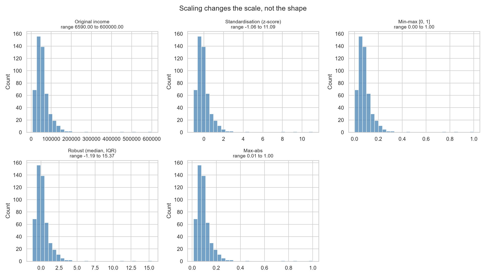
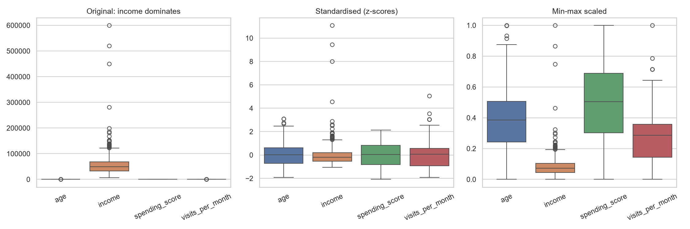
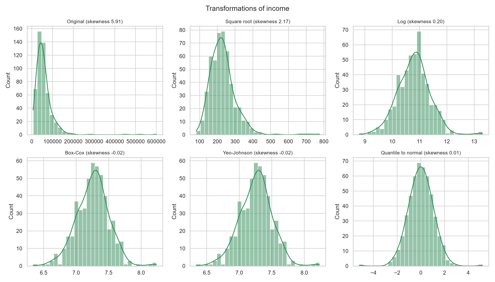
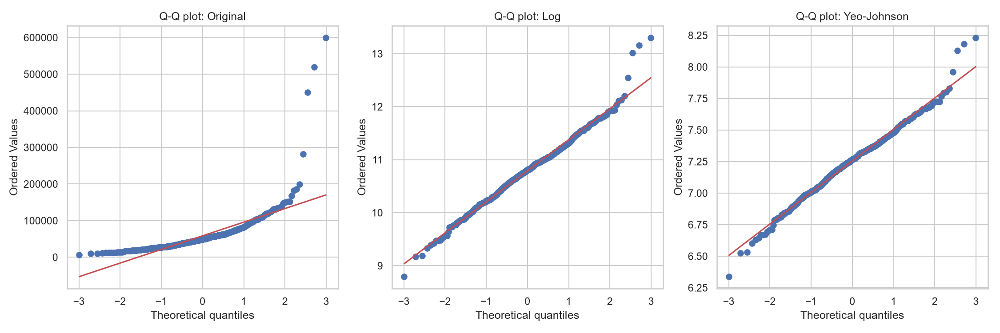
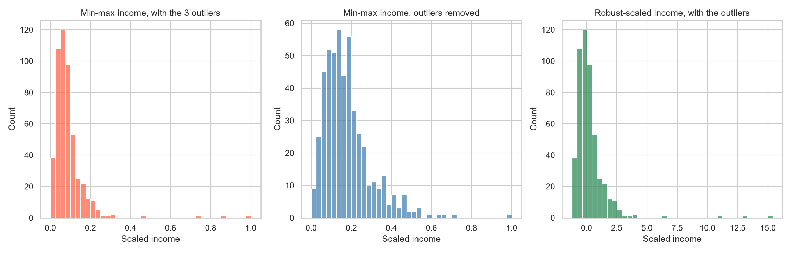
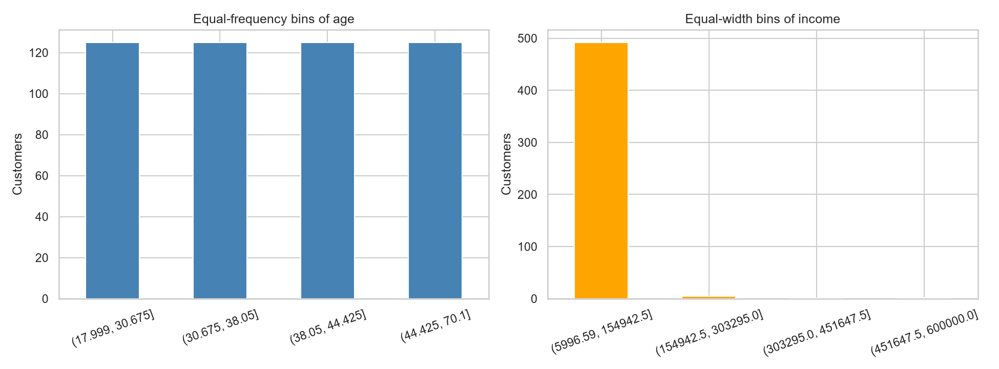
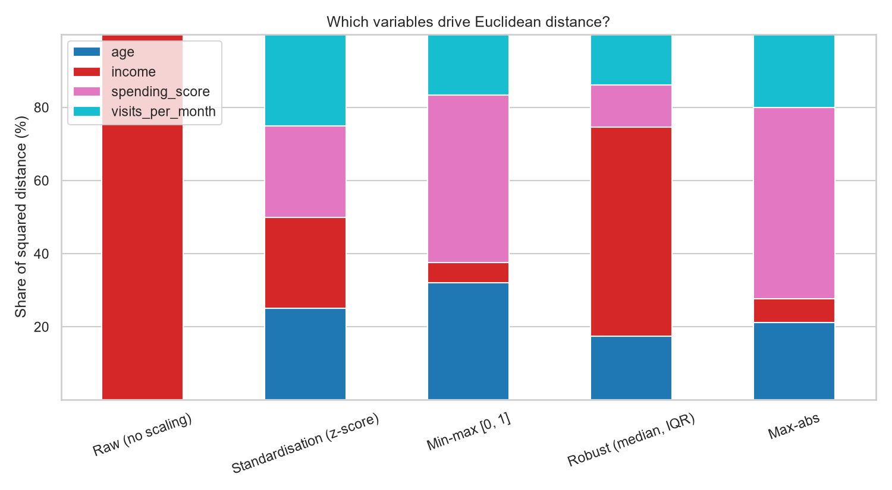
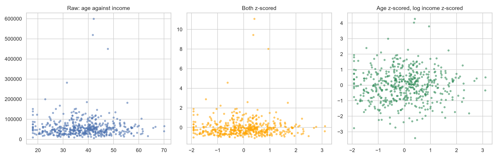

# Topic 15: Data Transformation and Normalization

## Objective
Put variables on comparable scales (standardisation, min-max, robust and max-abs
scaling), reduce skewness with transformations, encode and bin variables, see how
outliers and scaling choices affect results, and prepare a model-ready dataset
without leaking information from test data.

## Dataset
Synthetic data for 500 customers generated in `analysis.py` (random seed 42) and
saved as `data/customers.csv`:
- Numeric: `age`, `income` (right-skewed, with three deliberately extreme values of
  450,000, 520,000 and 600,000), `spending_score` (0 to 100) and `visits_per_month`
  (counts).
- Categorical: `city` (Nairobi 204, Mombasa 131, Kisumu 100, Nakuru 65, no order)
  and `membership` (Basic 232, Silver 167, Gold 101, ordered).

The model-ready dataset is saved as `data/model_ready.csv`.

## How to run
```
python analysis.py
```

## Results

### 1. Original data
| Variable | Mean | Std dev | Min | Median | Max | Skewness |
|----------|------|---------|-----|--------|-----|----------|
| age | 37.95 | 10.36 | 18.0 | 38.05 | 70.1 | 0.20 |
| income | 58,559.53 | 48,858.72 | 6,590 | 49,339 | 600,000 | 5.91 |
| spending_score | 49.69 | 22.79 | 2.2 | 50.55 | 98.0 | 0.06 |
| visits_per_month | 3.87 | 2.01 | 0 | 4.00 | 14 | 0.80 |

### 2. Scaling methods
Mean, standard deviation (divisor n), minimum and maximum of each variable after
scaling:

| Method | Variable | Mean | Sd | Min | Max |
|--------|----------|------|----|-----|-----|
| Original | age | 37.950 | 10.349 | 18.000 | 70.100 |
| Original | income | 58559.528 | 48809.835 | 6590.000 | 600000.000 |
| Original | spending_score | 49.691 | 22.765 | 2.200 | 98.000 |
| Original | visits_per_month | 3.870 | 2.006 | 0.000 | 14.000 |
| Standardisation (z-score) | age | -0.000 | 1.000 | -1.928 | 3.107 |
| Standardisation (z-score) | income | 0.000 | 1.000 | -1.065 | 11.093 |
| Standardisation (z-score) | spending_score | -0.000 | 1.000 | -2.086 | 2.122 |
| Standardisation (z-score) | visits_per_month | -0.000 | 1.000 | -1.929 | 5.049 |
| Min-max [0, 1] | age | 0.383 | 0.199 | 0.000 | 1.000 |
| Min-max [0, 1] | income | 0.088 | 0.082 | 0.000 | 1.000 |
| Min-max [0, 1] | spending_score | 0.496 | 0.238 | 0.000 | 1.000 |
| Min-max [0, 1] | visits_per_month | 0.276 | 0.143 | 0.000 | 1.000 |
| Robust (median, IQR) | age | -0.007 | 0.753 | -1.458 | 2.331 |
| Robust (median, IQR) | income | 0.257 | 1.363 | -1.193 | 15.373 |
| Robust (median, IQR) | spending_score | -0.023 | 0.613 | -1.302 | 1.278 |
| Robust (median, IQR) | visits_per_month | -0.043 | 0.669 | -1.333 | 3.333 |
| Max-abs | age | 0.541 | 0.148 | 0.257 | 1.000 |
| Max-abs | income | 0.098 | 0.081 | 0.011 | 1.000 |
| Max-abs | spending_score | 0.507 | 0.232 | 0.022 | 1.000 |
| Max-abs | visits_per_month | 0.276 | 0.143 | 0.000 | 1.000 |

Checks against hand calculations (all True): z = (x - mean) / sd matches
`StandardScaler`; (x - min) / (max - min) matches `MinMaxScaler`;
(x - median) / IQR matches `RobustScaler`; `inverse_transform` recovers the original
data.

### 3. Effect of the three extreme incomes
| Statistic | With outliers | Without outliers | Change |
|-----------|---------------|------------------|--------|
| Mean | 58,559.5 | 55,754.1 | +5.0% |
| Std dev | 48,858.7 | 32,626.2 | +49.8% |
| Median | 49,339.0 | 49,330.0 | 0.0% |
| IQR | 35,821.0 | 34,794.0 | +3.0% |

| Quantity | Value |
|----------|-------|
| Share of the [0, 1] range filled by the middle 50% of customers (min-max) | 0.060 with the outliers, 0.127 without |
| Largest income z-score | 11.09 |
| Customers with absolute z-score above 3 | 4 |
| Robust scaling: median / IQR of scaled income | 0.000 / 1.000 |
| Robust scaling: largest scaled value | 15.37 |

### 4. Transformations of income
| Transformation | Skewness | Excess kurtosis | Shapiro W | Shapiro p | Outliers (1.5 x IQR) |
|----------------|----------|-----------------|-----------|-----------|----------------------|
| Original | 5.9103 | 53.1886 | 0.5834 | < 0.0001 | 26 |
| Square root | 2.1721 | 11.2746 | 0.8689 | < 0.0001 | 13 |
| Log | 0.1989 | 1.2281 | 0.9879 | 0.0004 | 7 |
| Box-Cox | -0.0155 | 0.9632 | 0.9905 | 0.0026 | 8 |
| Yeo-Johnson | -0.0155 | 0.9631 | 0.9905 | 0.0026 | 8 |
| Quantile to normal | 0.0116 | 1.8096 | 0.9865 | 0.0001 | 4 |

Box-Cox lambda = -0.079 and Yeo-Johnson lambda = -0.079 (lambda = 0 is a log
transform).

Winsorising at the 1st and 99th percentiles (12,379 and 185,714): skewness
5.910 -> 1.510, maximum 600,000 -> 185,714.

Count variable (visits per month):

| Version | Skewness | Variance |
|---------|----------|----------|
| Original | 0.797 | 4.03 (mean 3.87) |
| Square root | -0.571 | 0.311 |
| log(1 + x) | -0.766 | |

### 5. Encoding and binning
| city | membership | city_Kisumu | city_Mombasa | city_Nairobi | city_Nakuru | membership_ordinal |
|------|------------|-------------|--------------|--------------|-------------|--------------------|
| Mombasa | Gold | 0 | 1 | 0 | 0 | 2 |
| Nairobi | Silver | 0 | 0 | 1 | 0 | 1 |
| Kisumu | Silver | 1 | 0 | 0 | 0 | 1 |
| Nakuru | Silver | 0 | 0 | 0 | 1 | 1 |
| Mombasa | Silver | 0 | 1 | 0 | 0 | 1 |

The mean of each one-hot column equals the category proportion (Kisumu 0.200,
Mombasa 0.262, Nairobi 0.408, Nakuru 0.130).

| Binning | Bin | Customers |
|---------|-----|-----------|
| Age, equal frequency | (17.999, 30.675] | 125 |
| | (30.675, 38.05] | 125 |
| | (38.05, 44.425] | 125 |
| | (44.425, 70.1] | 125 |
| Income, equal width | (5,996.59, 154,942.5] | 492 |
| | (154,942.5, 303,295.0] | 5 |
| | (303,295.0, 451,647.5] | 1 |
| | (451,647.5, 600,000.0] | 2 |

### 6. Share of squared Euclidean distance contributed by each variable (%)
| Scaling | age | income | spending_score | visits_per_month |
|---------|-----|--------|----------------|------------------|
| Raw (no scaling) | 0.0 | 100.0 | 0.0 | 0.0 |
| Standardisation (z-score) | 25.0 | 25.0 | 25.0 | 25.0 |
| Min-max [0, 1] | 32.0 | 5.5 | 45.8 | 16.7 |
| Robust (median, IQR) | 17.4 | 57.2 | 11.6 | 13.8 |
| Max-abs | 21.2 | 6.4 | 52.4 | 20.0 |

| Nearest-neighbour check | Result |
|-------------------------|--------|
| Raw nearest neighbour equals the nearest neighbour by income alone | 96.6% of customers |
| Nearest neighbour unchanged after z-scoring | 1.2% of customers |

### 7. Scaling train and test data (75% / 25% split)
| Variable | Train mean | Test z mean (fit on train) | Test z mean (fit on all data) | Test z sd (fit on train) |
|----------|-----------|----------------------------|-------------------------------|--------------------------|
| age | 38.067 | -0.045 | -0.034 | 0.983 |
| income | 60,013.051 | -0.109 | -0.089 | 0.581 |
| spending_score | 49.755 | -0.012 | -0.008 | 1.085 |
| visits_per_month | 3.904 | -0.065 | -0.051 | 0.845 |

### 8. Model-ready dataset
500 rows and 9 columns.

| Column | Mean | Std | Min | Max |
|--------|------|-----|-----|-----|
| age_z | -0.000 | 1.001 | -1.928 | 3.107 |
| log_income_z | -0.000 | 1.001 | -3.401 | 4.281 |
| spending_minmax | 0.496 | 0.238 | 0.000 | 1.000 |
| sqrt_visits_z | -0.000 | 1.001 | -3.387 | 3.330 |
| city_Kisumu | 0.200 | 0.400 | 0.000 | 1.000 |
| city_Mombasa | 0.262 | 0.440 | 0.000 | 1.000 |
| city_Nairobi | 0.408 | 0.492 | 0.000 | 1.000 |
| city_Nakuru | 0.130 | 0.337 | 0.000 | 1.000 |
| membership_ordinal | 0.738 | 0.774 | 0.000 | 2.000 |

The standard deviation shows 1.001 here because the summary table divides by n - 1,
while the scaler divides by n.










Tables: `outputs/scaling_summary.csv`, `outputs/transformation_comparison.csv`,
`outputs/distance_shares.csv`. Console record: `outputs/console_output.txt`.

### Which method for which situation
| Situation | Suitable method | Note |
|-----------|-----------------|------|
| Variables on different units, roughly symmetric | Standardisation (z-score) | Mean 0 and sd 1; the usual choice for PCA, regression penalties and distances |
| A fixed range is required | Min-max | Very sensitive to outliers |
| Outliers present and kept | Robust scaling | Centre and spread come from the median and IQR, but outliers stay extreme |
| Sparse data that must keep its zeros | Max-abs | Divides by the largest absolute value |
| Strong right skew | Log, Box-Cox, Yeo-Johnson | Yeo-Johnson also handles zeros and negatives |
| Skew caused by a few extreme values | Winsorising | Caps values at chosen percentiles |
| Unordered categories | One-hot encoding | One column per category |
| Ordered categories | Ordinal encoding | Keeps the order, but treats gaps as equal |

## Interpretation
- **Different scales:** Income (mean 58,560, sd 48,860) is thousands of times larger
  than age or the spending score. Without scaling, income would dominate any
  analysis that compares magnitudes.
- **Standardisation:** Every variable has mean 0 and sd 1, and the values match the
  formula (x - mean) / sd. The transformation is reversible, since
  `inverse_transform` recovers the original data. Scaling changes the scale, not
  the shape, so a skewed variable stays skewed. Income's largest z-score is 11.09.
- **Min-max scaling:** Values land exactly in [0, 1], but the extreme incomes
  squeeze everyone else into the bottom of the range. The middle 50% of customers
  fill only 0.060 of the range with the outliers present, against 0.127 without
  them, so the outliers halve the usable resolution.
- **Robust scaling:** It uses the median and IQR, so the typical customer sits at
  about 0 with an IQR of exactly 1. The outliers are not hidden: the largest scaled
  income is 15.37, which makes them easy to spot. Robust scaling resists outliers
  without removing them.
- **Effect of outliers on summary statistics:** Three extreme incomes out of 500
  raised the standard deviation by 49.8% (32,626 to 48,859) and the mean by 5.0%,
  but moved the median by 0.0% and the IQR by 3.0%. Z-scores and min-max scaling
  rely on the mean, sd, min and max, so they inherit this distortion. Four
  customers have an absolute z-score above 3, the three planted ones and one
  natural high earner.
- **Transformations for skew:** Income has skewness 5.91 and 26 boxplot outliers. The
  square root leaves it at 2.17, which is not enough. The log reduces it to 0.20,
  and Box-Cox and Yeo-Johnson to -0.02. The fitted lambda (-0.079) is very close to
  0, so a log transform is almost the optimal power transform. Box-Cox and
  Yeo-Johnson give identical results because income is positive and large.
- **Not normal even so:** Every Shapiro-Wilk p-value stays below 0.05, even after
  transforming. With 500 observations the test detects small departures, and the
  three extreme incomes remain about 4 standard deviations from the centre on the
  log scale (the largest log-income z-score is 4.28). The skewness is near 0, so the
  transformed variable is roughly symmetric, which is what most methods need.
  "Closer to normal" is accurate, "normal" is not. The quantile transform leaves
  the fewest outliers (4), but it is built from 200 quantiles, so its tails are only
  approximate.
- **Winsorising:** Capping income at the 1st and 99th percentiles (12,379 and
  185,714) lowers the skewness from 5.91 to 1.51 and the maximum from 600,000 to
  185,714. It tames outliers without changing the scale of the other values, but it
  alters real data, so it should be a documented decision.
- **Count variable:** Visits per month have mild skew (0.80). The square root and
  log(1 + x) overcorrect to -0.57 and -0.77. The square root's real benefit is
  stabilising the variance (4.03 to 0.311), which suits counts whose variance
  grows with the mean. For a variable this mild, no transformation is needed for
  skewness.
- **Encoding:** One-hot encoding gives each city its own 0/1 column with no implied
  order, and the column means equal the category proportions (for example Nairobi
  0.408). Ordinal encoding (Basic 0, Silver 1, Gold 2) suits membership because it
  has a natural order, but it assumes equal gaps between levels.
- **Binning:** Equal-frequency bins put exactly 125 customers in each age bin. Equal-
  width bins of income are useless here: 492 of 500 customers fall in the first bin,
  because the outliers stretch the range. Equal-frequency bins are the safer choice
  for skewed data.
- **Scaling and distances:** The distance shares show that scaling decides which
  variables matter. On raw data, income supplies about 100% of the squared distance,
  and the nearest neighbour is the same as the nearest neighbour by income alone for
  96.6% of customers. Standardisation gives each variable an equal 25% share and
  changes the nearest neighbour for all but 1.2% of customers. Min-max and max-abs
  scaling shrink income to 5.5% and 6.4% but let the spending score take 45.8%
  and 52.4%, a different imbalance caused by the outliers. Robust scaling leaves
  income with 57.2%, because the outliers inflate its scaled variance. Only
  z-scoring equalised the variables here, so the choice of scaler is a modelling
  decision.
- **Avoiding leakage:** The scaler should learn its mean and sd from the training
  data only, and then be applied to the test data. The test z-scores do not have
  mean 0 and sd 1 (for example income has sd 0.581), which is correct, because the
  test data are treated as unseen. Income's low value probably arises because the
  extreme incomes fell mostly in the training set and inflated its sd. The leaky
  version (fitted on all data) gives test means slightly closer to 0 only because it
  has seen the test data. The difference is small here, but the principle matters,
  and it can be large with small samples.
- **Model-ready dataset:** The final data apply the right treatment to each column:
  z-scored age, log then z-scored income, min-max scaled spending score, square root
  then z-scored visits, one-hot city and ordinal membership. After log
  transformation the largest income z-score falls from 11.09 to 4.28.
- **Conclusion:** There is no single best transformation. The method depends on the
  analysis: z-scores for distance- and penalty-based methods, robust scaling or
  winsorising when outliers are present, a log or power transform for skewed
  positive data, and the appropriate encoding for categories. Fit every
  transformation on the training data only.