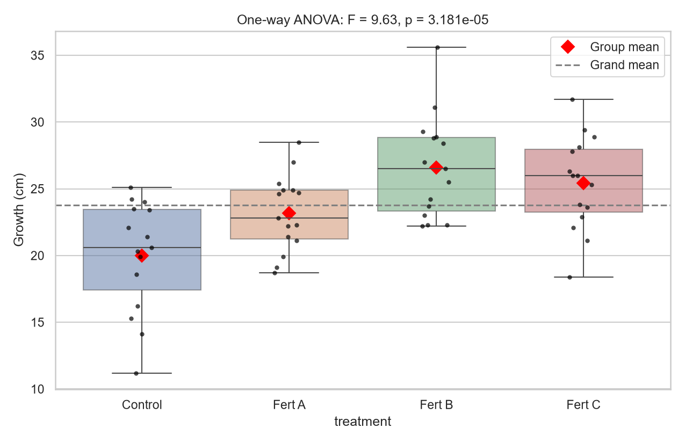
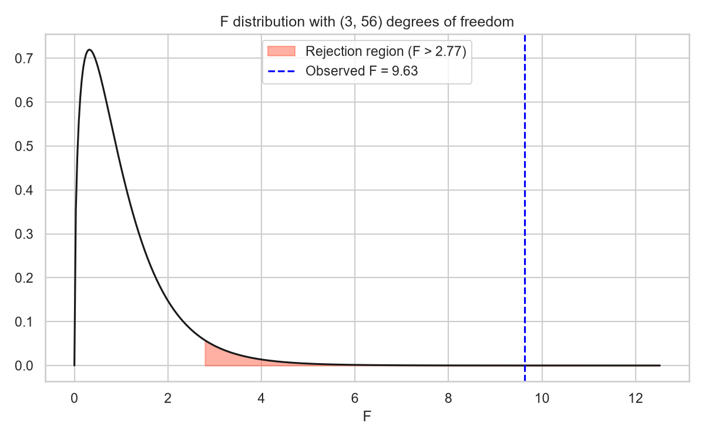
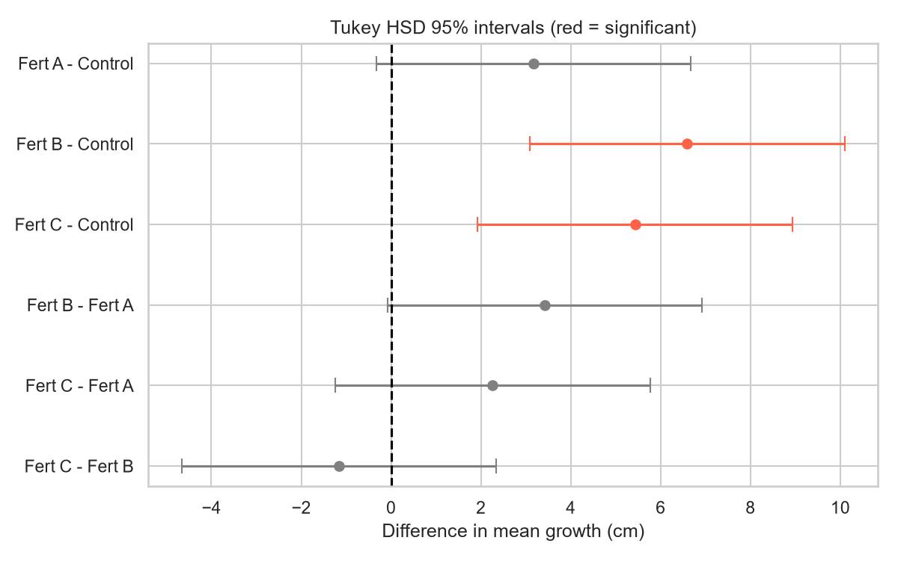
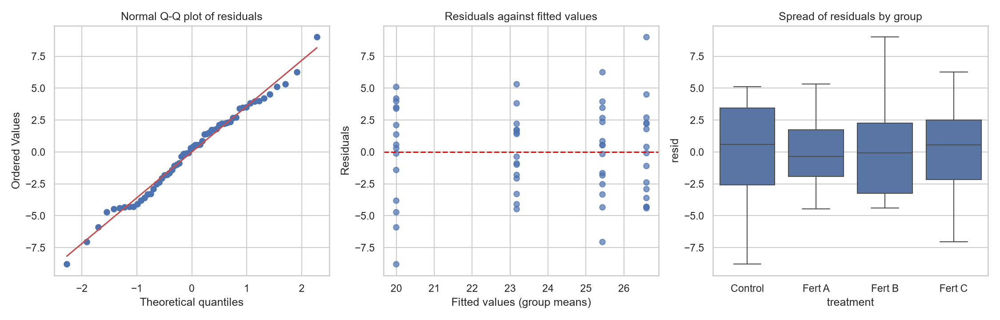
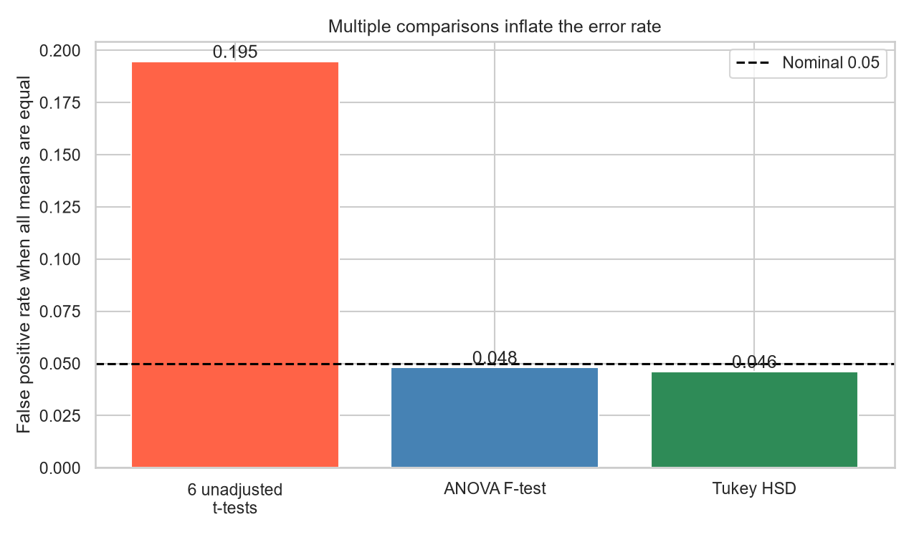
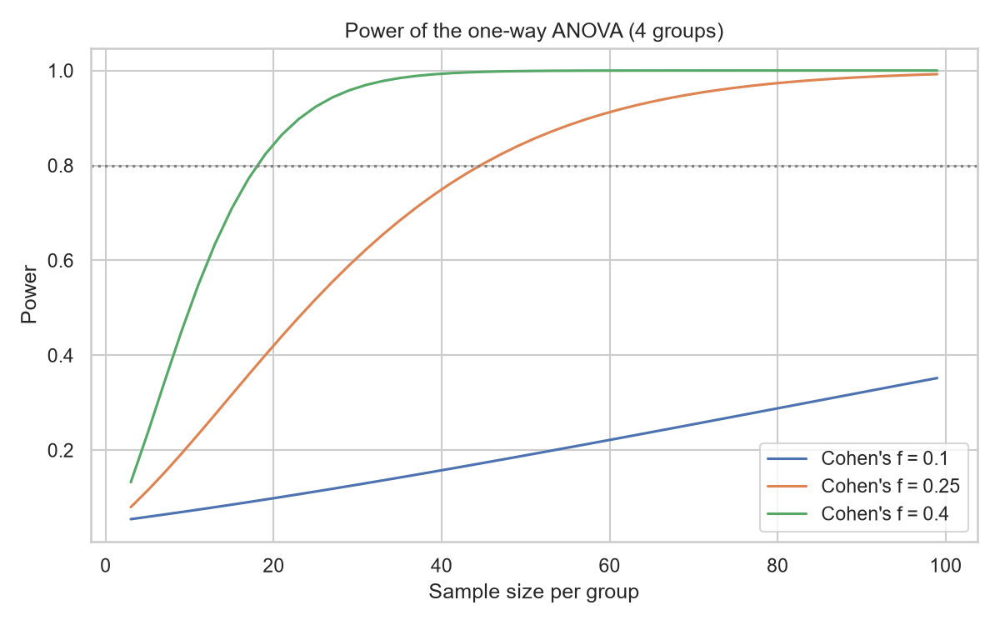
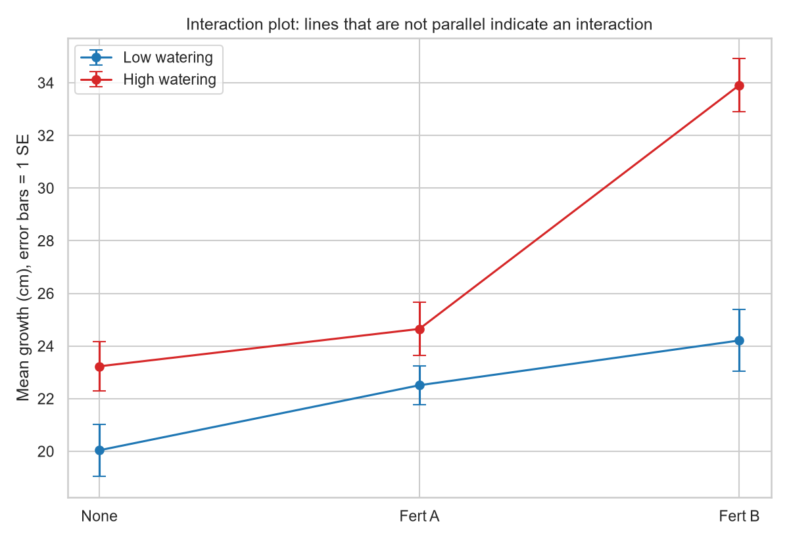
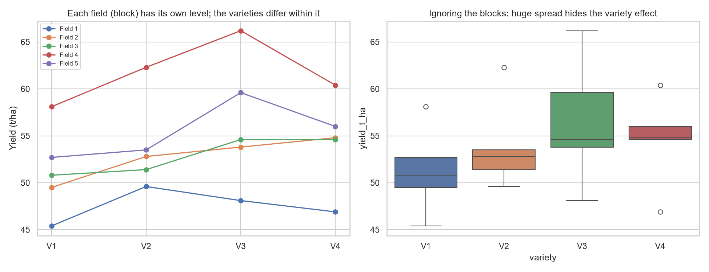

# Topic 16: ANOVA and Experimental Design

## Objective
Compare the means of several groups with analysis of variance (one-way, two-way
factorial and randomised block designs), check the assumptions, measure effect sizes
and power, and use post-hoc tests that control the error rate across many comparisons.

## Dataset
Three synthetic experiments generated in `analysis.py` (random seed 42):
- `data/plant_growth_oneway.csv`: plant growth (cm) under 4 treatments (Control,
  Fert A, Fert B, Fert C), 15 plants each (60 plants).
- `data/plant_growth_twoway.csv`: growth under 3 fertilisers (None, Fert A, Fert B)
  and 2 watering levels (Low, High), 10 plants per cell (60 plants), built with a
  deliberate interaction between Fert B and high watering.
- `data/crop_blocks.csv`: yield (t/ha) of 4 crop varieties in 5 fields (blocks) that
  differ a lot in fertility (20 plots).

## How to run
```
python analysis.py
```

## Results

### 1. One-way ANOVA: growth by treatment
| Treatment | n | Mean | Std dev | Min | Max |
|-----------|---|------|---------|-----|-----|
| Control | 15 | 19.99 | 4.15 | 11.2 | 25.1 |
| Fert A | 15 | 23.17 | 2.86 | 18.7 | 28.5 |
| Fert B | 15 | 26.59 | 3.84 | 22.2 | 35.6 |
| Fert C | 15 | 25.43 | 3.51 | 18.4 | 31.7 |

Grand mean = 23.793.

| Source | df | Sum of squares | Mean square | F | p-value |
|--------|----|----------------|-------------|---|---------|
| Between treatments | 3 | 379.5480 | 126.5160 | 9.6308 | 3.181e-05 |
| Within (error) | 56 | 735.6493 | 13.1366 | | |
| Total | 59 | 1115.1973 | | | |

Critical F at 5% = 2.769. The hand calculation matches statsmodels and scipy
`f_oneway` (True).

| Effect size | Value |
|-------------|-------|
| Eta squared | 0.3403 |
| Omega squared | 0.3015 |
| Cohen's f | 0.718 |
| Pooled standard deviation, sqrt(MSE) | 3.624 (true sd used to generate the data: 4.5) |

### 2. Assumption checks and robust alternatives
| Check | Result |
|-------|--------|
| Shapiro-Wilk, Control | W = 0.9248, p = 0.2279 |
| Shapiro-Wilk, Fert A | W = 0.9665, p = 0.8037 |
| Shapiro-Wilk, Fert B | W = 0.9198, p = 0.1913 |
| Shapiro-Wilk, Fert C | W = 0.9901, p = 0.9994 |
| Shapiro-Wilk on residuals | W = 0.9902, p = 0.9141 |
| Levene (equal variances) | W = 0.467, p = 0.7064 |
| Largest sd / smallest sd | 1.45 |
| Welch ANOVA | F = 7.808, p = 0.0005103 |
| Kruskal-Wallis | H = 19.097, p = 0.0002611 |

### 3. Post-hoc pairwise comparisons (6 pairs)
| Comparison | Difference | Unadjusted p | Bonferroni p | Tukey p | Tukey significant |
|------------|-----------|--------------|--------------|---------|-------------------|
| Fert A - Control | 3.1733 | 0.0199 | 0.1191 | 0.0892 | No |
| Fert B - Control | 6.5933 | < 0.0001 | < 0.0001 | < 0.0001 | Yes |
| Fert C - Control | 5.4333 | 0.0001 | 0.0008 | 0.0007 | Yes |
| Fert B - Fert A | 3.4200 | 0.0124 | 0.0744 | 0.0582 | No |
| Fert C - Fert A | 2.2600 | 0.0932 | 0.5594 | 0.3294 | No |
| Fert C - Fert B | -1.1600 | 0.3845 | 1.0000 | 0.8170 | No |

Tukey HSD with 95% simultaneous confidence intervals:

| Group 1 | Group 2 | Mean difference | Adjusted p | Lower | Upper | Reject H0 |
|---------|---------|-----------------|------------|-------|-------|-----------|
| Control | Fert A | 3.173 | 0.089 | -0.331 | 6.678 | No |
| Control | Fert B | 6.593 | 0.000 | 3.089 | 10.098 | Yes |
| Control | Fert C | 5.433 | 0.001 | 1.929 | 8.938 | Yes |
| Fert A | Fert B | 3.420 | 0.058 | -0.084 | 6.924 | No |
| Fert A | Fert C | 2.260 | 0.329 | -1.244 | 5.764 | No |
| Fert B | Fert C | -1.160 | 0.817 | -4.664 | 2.344 | No |

Tukey critical q = 3.745. The honestly significant difference is HSD = 3.504:
differences larger than this are significant.

Dunnett's test (each fertiliser against the control):

| Comparison | p-value |
|------------|---------|
| Fert A against Control | 0.05201 |
| Fert B against Control | 1.937e-05 |
| Fert C against Control | 0.0003779 |

### 4. Familywise error simulation (10,000 experiments, all means equal)
| Procedure | False positive rate |
|-----------|---------------------|
| 6 unadjusted t-tests (any significant) | 0.1946 |
| ANOVA F-test | 0.0480 |
| Tukey HSD (any significant) | 0.0460 |

The nominal rate is 0.05. If the 6 tests were independent, the rate would be 0.265.

### 5. Power and sample size (one-way ANOVA, 4 groups)
Power with the observed Cohen's f = 0.718 and 60 plants: 0.998.

| Effect size | Cohen's f | Per group | Total (80% power) |
|-------------|-----------|-----------|-------------------|
| Small | 0.10 | 274 | 1096 |
| Medium | 0.25 | 45 | 180 |
| Large | 0.40 | 19 | 76 |

### 6. Two-way ANOVA: growth by fertiliser and watering
Cell means:

| Fertiliser | Low watering | High watering | Row mean |
|------------|--------------|---------------|----------|
| None | 20.04 | 23.23 | 21.64 |
| Fert A | 22.51 | 24.65 | 23.58 |
| Fert B | 24.21 | 33.91 | 29.06 |

Column means: High = 27.26, Low = 22.25.

| Source | Sum of squares | df | F | p-value | Partial eta squared |
|--------|----------------|----|---|---------|---------------------|
| Fertiliser | 592.9603 | 2 | 30.6741 | < 0.0001 | 0.5319 |
| Watering | 376.5015 | 1 | 38.9531 | < 0.0001 | 0.4191 |
| Fertiliser x watering | 167.7270 | 2 | 8.6766 | 0.0005 | 0.2432 |
| Residual | 521.9370 | 54 | | | |

Interaction test (additive against full model): F = 8.677, p = 0.0005401.
Shapiro-Wilk on residuals p = 0.9231; Levene across the 6 cells p = 0.9314.

Simple effects (High minus Low watering within each fertiliser, Welch t-test):

| Fertiliser | Difference | t | p-value |
|------------|-----------|---|---------|
| None | +3.19 | 2.356 | 0.03006 |
| Fert A | +2.14 | 1.700 | 0.1079 |
| Fert B | +9.70 | 6.285 | 7.063e-06 |

### 7. Randomised block design: 4 varieties in 5 fields
Variety means: V1 = 51.30, V2 = 53.92, V3 = 56.46, V4 = 54.54.
Field means: Field 1 = 47.50, Field 2 = 52.72, Field 3 = 52.85, Field 4 = 61.75,
Field 5 = 55.45.

Block design ANOVA (variety + block):

| Source | Sum of squares | df | F | p-value |
|--------|----------------|----|---|---------|
| Variety | 68.1375 | 3 | 8.0541 | 0.0033 |
| Block | 429.3920 | 4 | 38.0667 | < 0.0001 |
| Residual | 33.8400 | 12 | | |

Ignoring the blocks (one-way ANOVA on variety):

| Source | Sum of squares | df | F | p-value |
|--------|----------------|----|---|---------|
| Variety | 68.1375 | 3 | 0.7845 | 0.5199 |
| Residual | 463.2320 | 16 | | |

Error mean square: 2.820 with blocks, 28.952 without (ratio 10.3).










Tables: `outputs/anova_oneway.csv`, `outputs/posthoc_comparisons.csv`,
`outputs/tukey_hsd.csv`, `outputs/familywise_error.csv`, `outputs/sample_size.csv`,
`outputs/anova_twoway.csv`, `outputs/simple_effects.csv`, `outputs/block_design.csv`.
Console record: `outputs/console_output.txt`.

## Interpretation
- **One-way ANOVA:** The F-statistic is 9.63 on (3, 56) degrees of freedom, well
  above the 5% critical value of 2.77, with p = 3.181e-05. We reject the hypothesis
  that all four treatment means are equal. ANOVA says at least one mean differs, but
  not which ones. F is the ratio of the between-group mean square (126.5) to the
  within-group mean square (13.1).
- **Effect size:** Treatment explains 34.0% of the variance in growth (eta squared
  0.3403). Omega squared (0.3015) is a less biased estimate of the population value.
  Cohen's f = 0.718 is far above the conventional 0.40 for a large effect. The
  observed effect is large, but the data were designed with large differences, so
  this size should not be expected in real experiments.
- **Pooled spread:** The within-group standard deviation is 3.62, below the 4.5 used
  to generate the data. This is sampling variation with 15 plants per group.
- **Assumptions:** Normality holds (every Shapiro-Wilk p-value is above 0.19, and
  0.9141 for the residuals), and equal variances are plausible (Levene p = 0.7064,
  with the largest group sd only 1.45 times the smallest). With only 15 per group
  these tests have low power, so the check is a screen, not proof. Both robust
  alternatives agree with the ANOVA: Welch ANOVA (p = 0.0005103) and Kruskal-Wallis
  (p = 0.0002611).
- **Post-hoc comparisons:** Only Fert B and Fert C differ significantly from the
  control (Tukey p = 0.0000 and 0.0007). Fert A against Control has an unadjusted p
  of 0.0199, which looks significant, but after adjustment it is not (Bonferroni
  0.1191, Tukey 0.0892, Dunnett 0.052). The same happens for Fert B against Fert A
  (unadjusted 0.0124, Tukey 0.0582). The adjusted tests ask for stronger evidence
  because six comparisons give six chances of a false alarm.
- **How to read the borderline results:** Fert A against Control is just short of
  significance, and its Tukey interval (-0.33 to 6.68) barely includes 0. This is
  not evidence that Fert A does nothing. The study may be too small to separate
  Fert A from the control with this much noise. Tukey, Bonferroni and Dunnett
  answer slightly different questions, and Dunnett's (control only, p = 0.052) is
  more powerful for the question of comparing each fertiliser with the control.
- **Fert B and Fert C:** Fert B grew 6.59 cm more than the control and Fert C 5.43 cm
  more, and they do not differ from each other (p = 0.817). The Tukey HSD of 3.504
  gives a quick rule: any pair of means further apart than 3.5 cm is significant.
- **Why not several t-tests:** When all four means are equal, running the six
  unadjusted t-tests gives at least one false positive in 19.5% of experiments,
  nearly four times the nominal 5%. The ANOVA F-test (4.8%) and Tukey HSD (4.6%)
  stay close to 5%. The simulated rate is below the 26.5% that independence would
  give, because the six tests share the same data and are positively dependent.
- **Power and sample size:** The experiment had a power of 0.998 for the observed
  effect. This is observed power, which is just a restatement of the p-value, so it
  should not be used to judge a finished study. It is more useful for planning: a
  medium effect (f = 0.25) needs 45 plants per group (180 in all) for 80% power, and
  a small effect (f = 0.10) needs 274 per group, about 1,100 in total.
- **Two-way ANOVA:** Fertiliser (F = 30.67), watering (F = 38.95) and their
  interaction (F = 8.68, p = 0.0005) are all significant. Because the interaction is
  significant, the main effects cannot be read on their own.
- **The interaction:** High watering raises growth by 9.70 cm with Fert B
  (p < 0.0001), but by only 3.19 cm with no fertiliser (p = 0.030) and 2.14 cm with
  Fert A (p = 0.108, not significant). In the interaction plot the Fert B lines
  diverge instead of staying parallel. The effect of watering depends on the
  fertiliser. The simple-effects tests are unadjusted, so the borderline result for
  no fertiliser (p = 0.030) should be treated cautiously.
- **Partial eta squared:** Fertiliser explains 53.2% of the variance left after
  removing the other terms, watering 41.9% and the interaction 24.3%. The residual
  assumptions hold (Shapiro p = 0.9231, Levene p = 0.9314).
- **Randomised block design:** The five fields differ greatly in fertility (field
  means from 47.5 to 61.75). Ignoring the blocks, the variety effect is hidden:
  F = 0.78, p = 0.5199. Including the blocks, the same variety sums of squares
  (68.14) give F = 8.05, p = 0.0033. Blocking removed the field-to-field variation
  (sum of squares 429.4) from the error term, cutting the error mean square from
  28.95 to 2.82, a factor of 10.3. Blocking raised the sensitivity of the test
  without needing more plots.
- **Design lessons:** Randomly assign treatments to units, compare groups with the
  same number of replicates, group similar units into blocks when a known source of
  variation exists, and use a factorial design to detect interactions that
  one-factor-at-a-time experiments miss.
- **Conclusion:** ANOVA tests whether group means differ while controlling the
  overall error rate. Post-hoc tests locate the differences, effect sizes show how
  large they are, and the design (blocking, factorial layout, sample size) decides
  how much the experiment can detect.