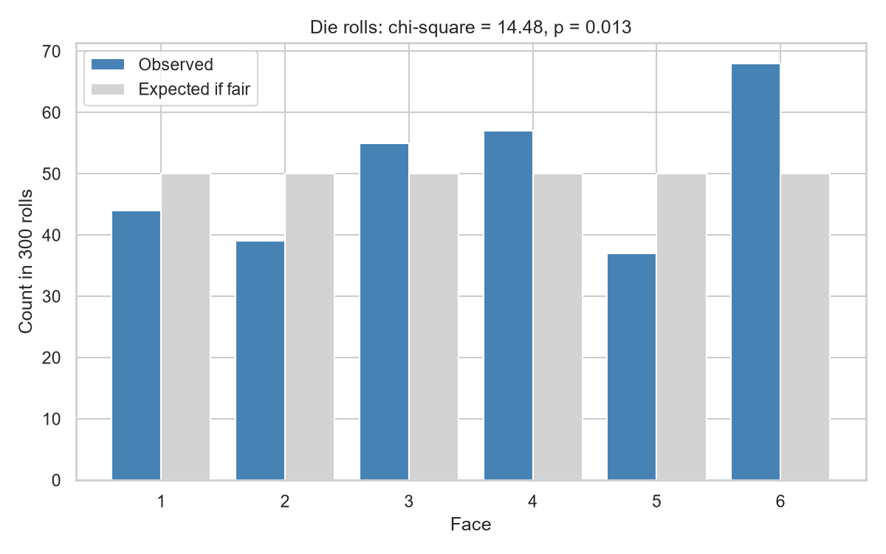
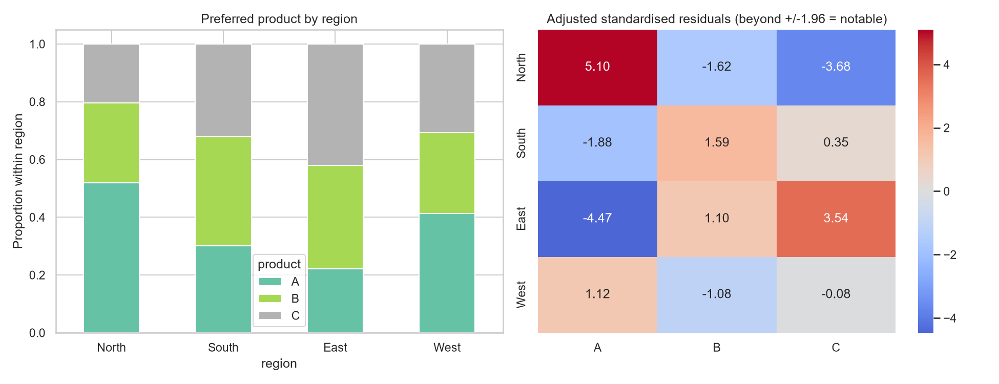
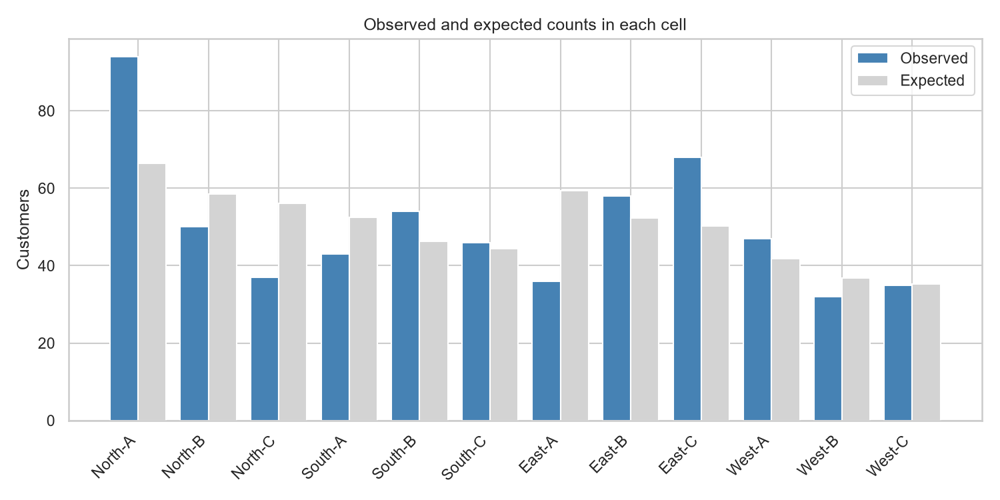
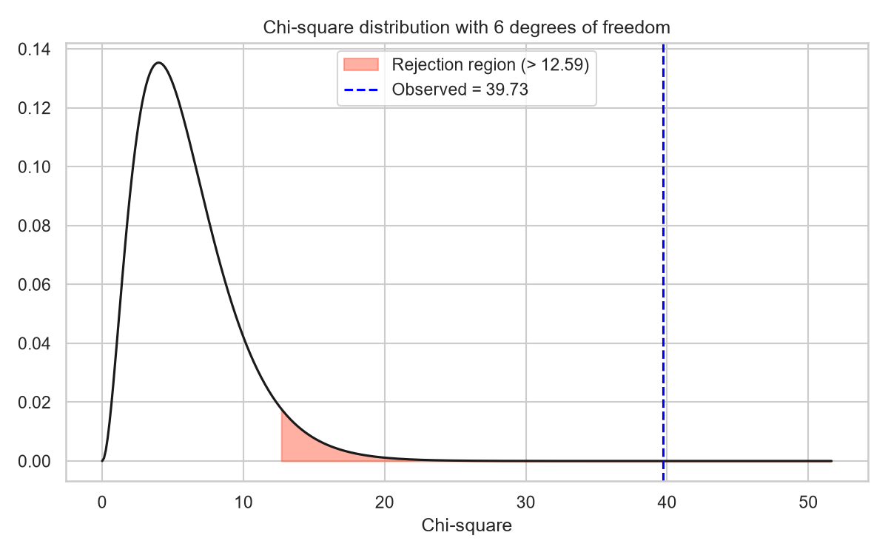
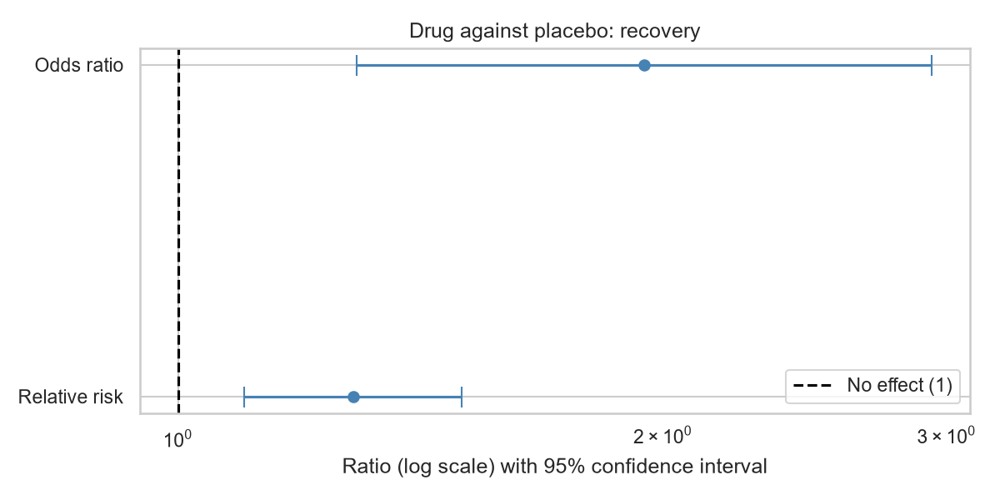
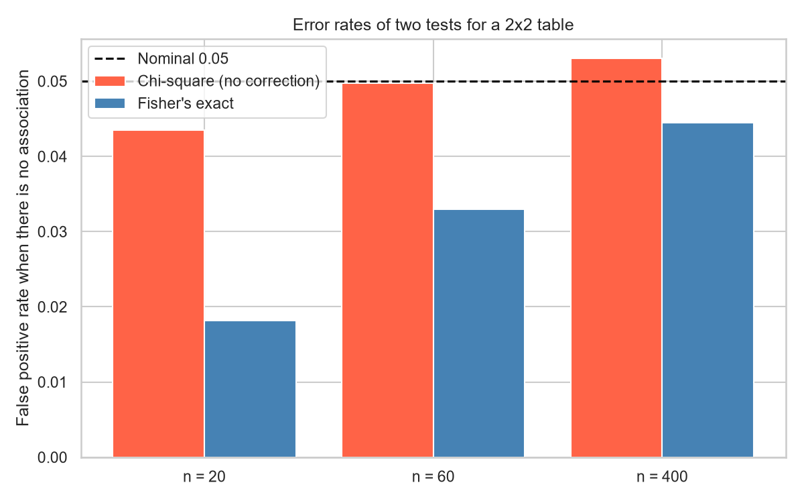

# Topic 17: Chi-Square and Categorical Data Analysis

## Objective
Analyse categorical data with chi-square tests (goodness of fit and independence),
measure the strength of an association, analyse 2x2 tables with risk difference,
relative risk and odds ratio, use exact and paired tests when the standard test does
not apply, and check the behaviour of the tests by simulation.

## Dataset
Synthetic data generated in `analysis.py` (random seed 42):
- `data/survey.csv`: 600 customers with `region` (North, South, East, West) and
  `product` (preferred product A, B or C). Preference was built to depend on region.
- `data/trial.csv`: a clinical trial with 200 patients on a drug and 200 on a
  placebo, and a recovered flag (1 = recovered).
- A die rolled 300 times and built to be slightly biased towards 6.
- A Mendel-style cross of 556 plants with an expected 3:1 ratio of round to wrinkled.
- 150 people asked for their opinion before and after a campaign (paired data).

The last three datasets are generated inside the script and are not saved as files.

## How to run
```
python analysis.py
```

## Results

### 1. Goodness of fit: is the die fair? (300 rolls)
| Face | 1 | 2 | 3 | 4 | 5 | 6 |
|------|---|---|---|---|---|---|
| Observed | 44 | 39 | 55 | 57 | 37 | 68 |
| Expected if fair | 50 | 50 | 50 | 50 | 50 | 50 |

| Test | Statistic | Degrees of freedom | p-value |
|------|-----------|--------------------|---------|
| Chi-square | 14.480 | 5 | 0.0128 |
| G-test (likelihood ratio) | 14.328 | 5 | 0.0137 |

The critical value at 5% is 11.070. The largest standardised residual is 2.546
(face 6: 68 observed against 50 expected).

### 2. Goodness of fit: Mendel-style 3:1 cross
| Outcome | Observed | Expected |
|---------|----------|----------|
| Round | 417 | 417 |
| Wrinkled | 139 | 139 |

Chi-square = 0.000 on 1 df, p = 1.0000.

### 3. Test of independence: region and preferred product
Observed counts:

| Region | A | B | C |
|--------|---|---|---|
| North | 94 | 50 | 37 |
| South | 43 | 54 | 46 |
| East | 36 | 58 | 68 |
| West | 47 | 32 | 35 |

Row percentages:

| Region | A | B | C |
|--------|---|---|---|
| North | 51.9 | 27.6 | 20.4 |
| South | 30.1 | 37.8 | 32.2 |
| East | 22.2 | 35.8 | 42.0 |
| West | 41.2 | 28.1 | 30.7 |

Expected counts under independence:

| Region | A | B | C |
|--------|---|---|---|
| North | 66.37 | 58.52 | 56.11 |
| South | 52.43 | 46.24 | 44.33 |
| East | 59.40 | 52.38 | 50.22 |
| West | 41.80 | 36.86 | 35.34 |

The smallest expected count is 35.34 (the rule of thumb is at least 5).

| Quantity | Value |
|----------|-------|
| Chi-square | 39.726 on 6 df |
| p-value | 5.156e-07 |
| Critical value at 5% | 12.592 |
| Hand calculation, sum of (O - E)^2 / E | 39.726 (matches scipy: True) |
| G-test | G = 40.280, p = 4.013e-07 |
| Cramér's V | 0.182 |

Adjusted standardised residuals (beyond +/-1.96 are notable cells):

| Region | A | B | C |
|--------|---|---|---|
| North | **5.10** | -1.62 | **-3.68** |
| South | -1.88 | 1.59 | 0.35 |
| East | **-4.47** | 1.10 | **3.54** |
| West | 1.12 | -1.08 | -0.08 |

### 4. Clinical trial: drug against placebo
| Group | Recovered | Not recovered | Recovery rate |
|-------|-----------|---------------|---------------|
| Drug | 140 | 60 | 0.700 |
| Placebo | 109 | 91 | 0.545 |

| Measure | Estimate | 95% interval |
|---------|----------|--------------|
| Risk difference | 0.155 | (0.061, 0.249) |
| Relative risk | 1.284 | (1.099, 1.501) |
| Odds ratio | 1.948 | (1.292, 2.938) |

Number needed to treat = 6.5.

| Test | Statistic | p-value |
|------|-----------|---------|
| Chi-square, no correction | 10.224 | 0.0014 |
| Chi-square, Yates correction | 9.575 | 0.0020 |
| Fisher's exact test | odds ratio 1.948 | 0.0019 |

### 5. Small sample (n = 20): the table [[8, 2], [3, 7]]
The smallest expected count is 4.5, below the rule-of-thumb minimum of 5.

| Test | p-value |
|------|---------|
| Chi-square, no correction | 0.0246 |
| Chi-square, Yates correction | 0.0722 |
| Fisher's exact test | 0.0698 |

### 6. McNemar's test: opinion before and after a campaign (150 people)
| | After: yes | After: no |
|---|-----------|-----------|
| Before: yes | 52 | 8 |
| Before: no | 36 | 54 |

Support rose from 0.400 before to 0.587 after. 8 people changed from yes to no, and
36 changed from no to yes.

| Test | Statistic | p-value |
|------|-----------|---------|
| McNemar chi-square (continuity correction) | 16.568 | < 0.0001 |
| Exact binomial | | < 0.0001 |

### 7. Simulation: 4,000 tables per sample size, rows and columns independent
| n | Tables with a smallest expected count below 5 | Chi-square rejects | Fisher rejects | Nominal |
|---|-----------------------------------------------|--------------------|----------------|---------|
| 20 | 99.9% | 0.0435 | 0.0182 | 0.05 |
| 60 | 39.6% | 0.0498 | 0.0330 | 0.05 |
| 400 | 0.0% | 0.0530 | 0.0445 | 0.05 |








Tables: `outputs/observed_counts.csv`, `outputs/expected_counts.csv`,
`outputs/standardised_residuals.csv`, `outputs/effect_measures.csv`,
`outputs/simulation_false_positives.csv`. Console record:
`outputs/console_output.txt`.

### Which test for which question
| Question | Test | Condition |
|----------|------|-----------|
| Do counts in one variable match a stated distribution? | Chi-square goodness of fit | Expected counts of at least 5 |
| Are two categorical variables associated? | Chi-square test of independence | Expected counts of at least 5; independent observations |
| Same, with a small 2x2 table | Fisher's exact test | No minimum count needed |
| Is the association strong? | Cramér's V, odds ratio, relative risk | Report alongside the p-value |
| Did a paired yes/no response change? | McNemar's test | Same people measured twice |

## Interpretation
- **Goodness of fit:** Under a fair die each face is expected 50 times in 300 rolls.
  The chi-square statistic is 14.48 on 5 degrees of freedom, above the critical value
  of 11.07, with p = 0.0128, so we reject the hypothesis that the die is fair. The
  G-test agrees (p = 0.0137). The standardised residuals show where the departure
  comes from: face 6 appeared 18 times more than expected (residual 2.55), while face
  5 (37) and face 2 (39) appeared less often. These residuals are exploratory, since
  with six faces one value near 2.5 can arise by chance, and the overall test is the
  evidence. The bias is modest (the die was built with P(6) = 0.20 instead of 0.167),
  and 300 rolls were enough to detect it, though only just.
- **A perfect fit:** The 3:1 cross gave exactly 417 round and 139 wrinkled plants, so
  the statistic is 0 and p = 1.0000. This is a coincidence of the random seed. It
  does not show that the 3:1 ratio is proven, since a non-significant result never
  proves the null hypothesis. For perspective, an exact match like this has a
  probability of about 4% when the true ratio is 3:1. Results that fit expectation
  too well are unusual in real data, which is why real experiments are expected to
  show some scatter.
- **Independence test:** The statistic 39.73 on 6 degrees of freedom is far above the
  critical value of 12.59 (p = 5.156e-07), so region and preferred product are not
  independent. All expected counts are at least 35.3, so the chi-square approximation
  is safe. The G-test gives the same conclusion (p = 4.013e-07), and the hand
  calculation matches scipy.
- **Where the association is:** The adjusted residuals identify four notable cells.
  North prefers product A far more than expected (51.9% against 39% overall, residual
  +5.10) and product C less (-3.68). East shows the reverse: product A is less
  popular (-4.47) and product C more popular (+3.54, 42.0%). South and West show no
  cell beyond +/-1.96, so they look like the overall pattern. A significant
  chi-square only says that some association exists, and the residuals say which
  cells drive it.
- **Strength of the association:** Cramér's V is 0.182. For a table with three
  columns, 0.07 is a small effect and 0.21 a medium one by Cohen's conventions, so
  the association is small to medium. It is statistically very clear with 600
  customers, but region explains only a modest part of the variation in preference.
  A tiny p-value is not the same as a large effect.
- **Clinical trial:** 70.0% of the drug group recovered against 54.5% on the
  placebo. The risk difference is 15.5 percentage points (95% interval 6.1 to 24.9),
  the relative risk is 1.28 (1.10 to 1.50) and the odds ratio is 1.95 (1.29 to
  2.94). The risk-difference interval excludes 0 and the ratio intervals exclude 1,
  and the three tests agree (p = 0.0014, 0.0020 and 0.0019). The odds ratio (1.95)
  looks much bigger than the relative risk (1.28) because recovery is a common
  outcome, and the odds ratio overstates the risk ratio in that case. The relative
  risk or risk difference describes the effect more intuitively.
- **Number needed to treat:** 1 / 0.155 = 6.5, so about 7 patients need the drug for
  one extra recovery (the usual rounding is upwards). From the interval for the risk
  difference, the number could plausibly lie between about 4 and 16, which shows how
  uncertain this figure is.
- **Yates correction:** The correction lowers the statistic from 10.22 to 9.58 and
  raises p from 0.0014 to 0.0020. Here the samples are large and the conclusion is
  unchanged. The correction is conservative, and it matters mainly for small tables.
- **Small samples:** For the 2x2 table with 20 observations, the smallest expected
  count is 4.5, so the chi-square approximation is not trustworthy. The uncorrected
  chi-square gives p = 0.0246 and would declare a significant association. The Yates
  correction (p = 0.0722) and Fisher's exact test (p = 0.0698) both give p above
  0.05. The conclusion depends on the method, which is a warning sign. When expected
  counts fall below 5, Fisher's exact test is the safer choice, since it does not
  rely on an approximation.
- **McNemar's test:** Support for the campaign rose from 40.0% to 58.7%.
  McNemar's test uses only the people who changed their answer: 36 moved from no to
  yes and only 8 from yes to no. The statistic 16.57 (p < 0.0001) and the exact
  binomial test agree that the shift is not random. The 106 people who kept the same
  answer carry no information about the change. An ordinary chi-square test would
  be wrong here because the same people appear in both columns, so the observations
  are not independent.
- **Simulation:** With no association, a 5% test should reject about 5% of the time.
  Chi-square was close to nominal at all three sizes (0.0435, 0.0498, 0.0530), even at
  n = 20, where 99.9% of tables had a smallest expected count below 5. Fisher's exact
  test was conservative: it rejected only 1.8% at n = 20, 3.3% at n = 60 and 4.5% at
  n = 400, which means it is safe against false positives but less powerful. This is
  expected, because exact tests on discrete data cannot reach exactly 5%. With 4,000
  tables the standard error of each rate is about 0.003, so 0.0435 and 0.0530 are
  within about two standard errors of 0.05. The result applies to this table layout
  (equal rows, 20% in the first column), and chi-square can be too liberal or too
  conservative for other layouts, which is why the small-sample rule of thumb exists.
- **Conclusion:** Chi-square tests compare observed counts with the counts expected
  under a hypothesis. Residuals show where a difference lies, effect sizes show how
  large it is, Fisher's exact test replaces chi-square for small tables, and McNemar's
  test handles paired data.