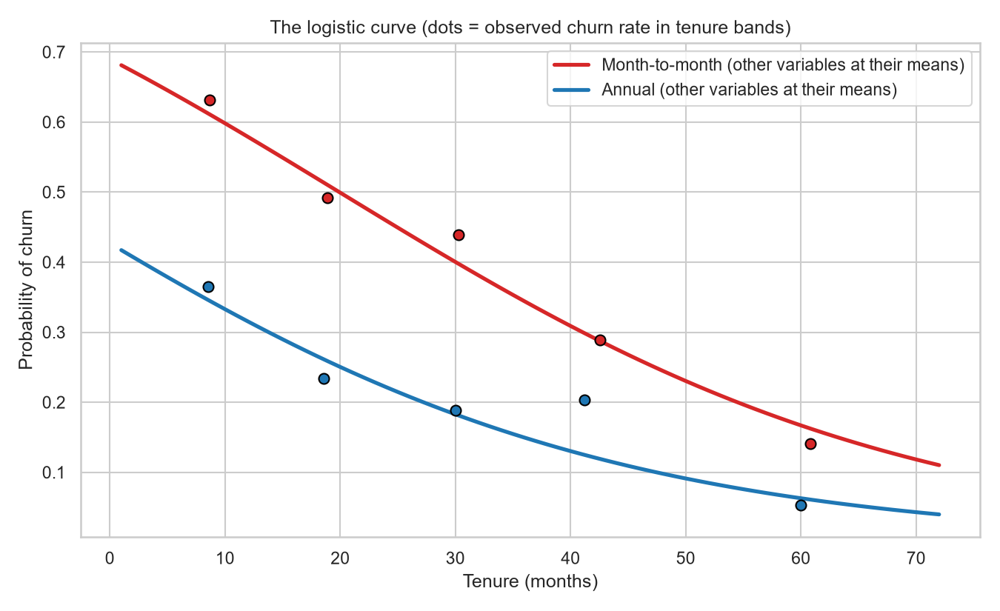
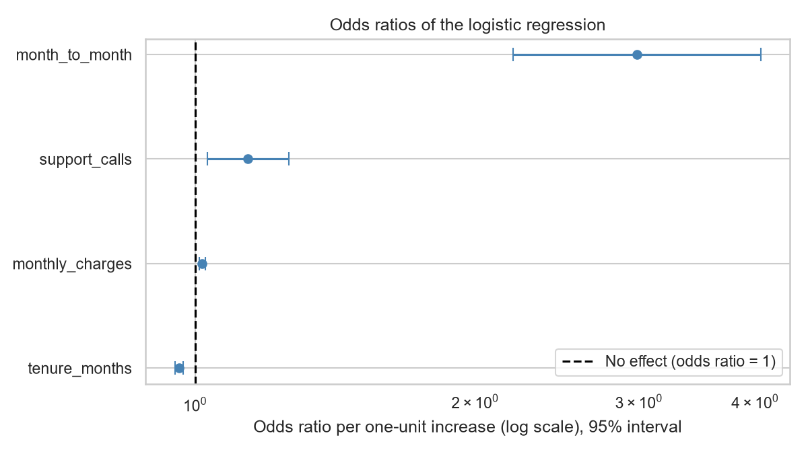
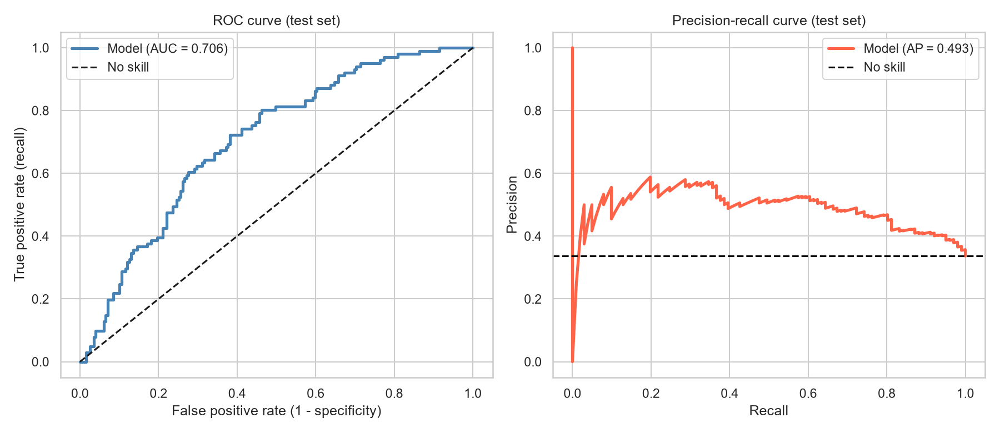
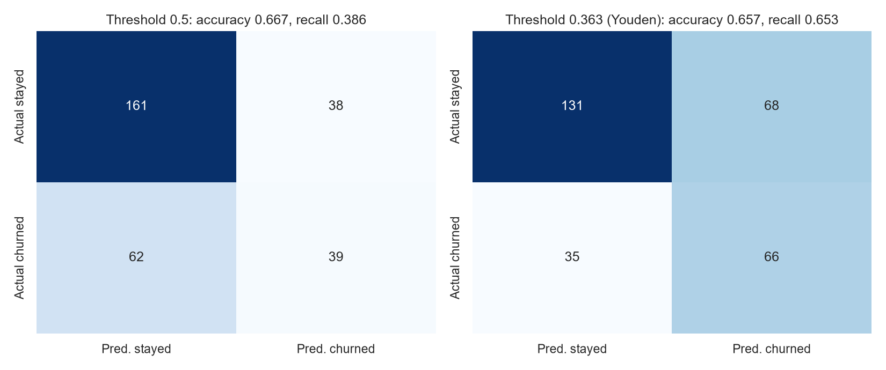
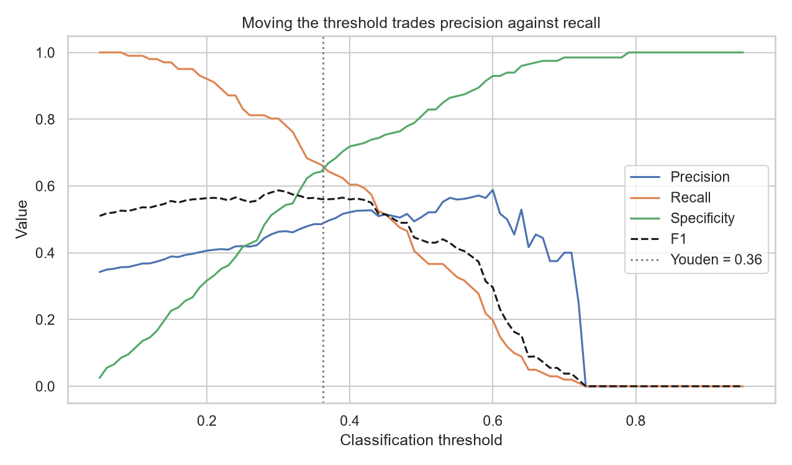
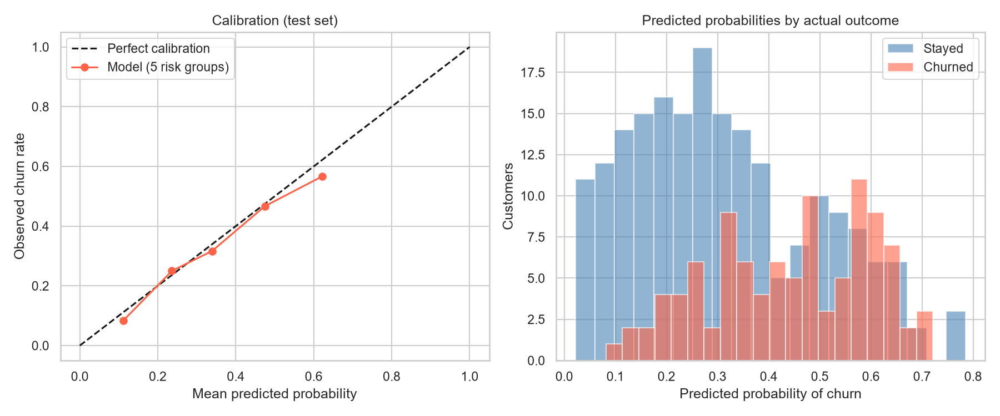

# Topic 18: Logistic Regression

## Objective
Model a binary outcome (customer churn) with logistic regression, interpret the
coefficients as odds ratios and probabilities, test the overall fit, and judge the
classification performance on unseen data with a confusion matrix, ROC analysis and
calibration.

## Dataset
Synthetic customer data for 1,000 customers generated in `analysis.py` (random seed
42) and saved as `data/churn.csv`. The outcome was drawn from a known logistic model,
so we can check whether the analysis recovers the true coefficients.
- `tenure_months`: months as a customer
- `monthly_charges`: monthly bill
- `support_calls`: number of support calls
- `month_to_month`: 1 = month-to-month contract, 0 = annual contract
- `churn`: 1 = left, 0 = stayed (338 churned, 662 stayed, a churn rate of 33.8%)

True log-odds used to generate the data:
-0.8 - 0.04 * tenure + 0.02 * (charges - 70) + 0.30 * calls + 0.9 * month_to_month.

## How to run
```
python analysis.py
```

## Results

### 1. The data
| Group | Tenure | Monthly charges | Support calls | Month-to-month share |
|-------|--------|-----------------|---------------|----------------------|
| Stayed (0) | 31.88 | 68.75 | 1.81 | 0.54 |
| Churned (1) | 24.07 | 74.60 | 2.07 | 0.75 |

Churn rate: 41.6% on month-to-month contracts, 21.6% on annual contracts.

### 2. Logistic regression coefficients
The model converged.

| Term | Coefficient | Std error | z | p-value | Odds ratio | 95% interval for the odds ratio | True coefficient | True value inside the 95% interval? |
|------|-------------|-----------|---|---------|------------|-------------------------------|------------------|--------------------------------------|
| Intercept | -1.7694 | 0.3296 | -5.368 | < 0.0001 | 0.1704 | (0.0893, 0.3252) | -2.20 | Yes |
| tenure_months | -0.0401 | 0.0052 | -7.737 | < 0.0001 | 0.9607 | (0.9510, 0.9705) | -0.04 | Yes |
| monthly_charges | 0.0174 | 0.0036 | 4.763 | < 0.0001 | 1.0175 | (1.0103, 1.0248) | 0.02 | Yes |
| support_calls | 0.1307 | 0.0515 | 2.535 | 0.0112 | 1.1396 | (1.0301, 1.2608) | 0.30 | **No** |
| month_to_month | 1.0935 | 0.1561 | 7.006 | < 0.0001 | 2.9847 | (2.1981, 4.0528) | 0.90 | Yes |

Fitted model:
log-odds of churn = -1.7694 - 0.0401 * tenure + 0.0174 * charges + 0.1307 * calls
+ 1.0935 * month_to_month.

Odds ratio for 12 more months of tenure = 0.618 (95% interval 0.547 to 0.698).

### 3. Model fit
| Quantity | Value |
|----------|-------|
| Log-likelihood / null log-likelihood | -569.44 / -639.70 |
| Likelihood ratio test | chi-square = 140.52 on 4 df, p = 2.185e-29 |
| McFadden pseudo R-squared | 0.1098 |
| AIC / BIC | 1148.88 / 1173.42 |
| Hosmer-Lemeshow test (10 groups) | chi-square = 3.237 on 8 df, p = 0.9186 |
| Variance inflation factors | tenure 1.008, charges 1.001, calls 1.004, contract 1.006 |

### 4. Marginal effects and example predictions
Average marginal effects (change in churn probability per one-unit increase):

| Variable | Marginal effect | p-value |
|----------|-----------------|---------|
| tenure_months | -0.00778 | < 0.0001 |
| monthly_charges | 0.00336 | < 0.0001 |
| support_calls | 0.02534 | 0.01032 |
| month_to_month | 0.21201 | < 0.0001 |

Predicted churn probability for three example customers:

| Customer | Tenure | Charges | Calls | Month-to-month | Log-odds | Odds | Probability |
|----------|--------|---------|-------|----------------|----------|------|-------------|
| High risk | 3 | 90.0 | 4 | 1 | 1.2881 | 3.6260 | 0.7838 |
| Average | 24 | 70.0 | 2 | 1 | -0.1626 | 0.8499 | 0.4594 |
| Low risk | 48 | 50.0 | 0 | 0 | -2.8272 | 0.0592 | 0.0559 |

The hand calculation 1 / (1 + exp(-log-odds)) matches the model's probabilities (True).

### 5. Classification performance on the test set
Stratified 70% / 30% split: 700 training customers (churn rate 0.339) and 300 test
customers (churn rate 0.337). The largest difference between statsmodels and
scikit-learn coefficients is 2.13e-06.

Thresholds chosen on the training data only: Youden's J = 0.363, best F1 = 0.230.

| Threshold | TN | FP | FN | TP | Accuracy | Precision | Recall | Specificity | F1 | Balanced accuracy |
|-----------|----|----|----|----|----------|-----------|--------|-------------|----|-------------------|
| 0.200 | 63 | 136 | 8 | 93 | 0.520 | 0.406 | 0.921 | 0.317 | 0.564 | 0.619 |
| 0.300 | 105 | 94 | 20 | 81 | 0.620 | 0.463 | 0.802 | 0.528 | 0.587 | 0.665 |
| 0.400 | 143 | 56 | 40 | 61 | 0.680 | 0.521 | 0.604 | 0.719 | 0.560 | 0.661 |
| 0.500 | 161 | 38 | 62 | 39 | 0.667 | 0.506 | 0.386 | 0.809 | 0.438 | 0.598 |
| 0.600 | 185 | 14 | 81 | 20 | 0.683 | 0.588 | 0.198 | 0.930 | 0.296 | 0.564 |
| 0.363 (Youden) | 131 | 68 | 35 | 66 | 0.657 | 0.493 | 0.653 | 0.658 | 0.562 | 0.656 |

Baseline accuracy (always predict "stayed") = 0.663.

Confusion matrix at threshold 0.5 (rows = actual, columns = predicted):

| | Predicted: stayed | Predicted: churned |
|---|-------------------|--------------------|
| Actual: stayed | 161 | 38 |
| Actual: churned | 62 | 39 |

Confusion matrix at the Youden threshold (0.363):

| | Predicted: stayed | Predicted: churned |
|---|-------------------|--------------------|
| Actual: stayed | 131 | 68 |
| Actual: churned | 35 | 66 |

### 6. Ranking quality and calibration
| Measure | Value |
|---------|-------|
| ROC AUC, training / test | 0.7240 / 0.7057 |
| Bootstrap 95% interval for test AUC | (0.649, 0.770) |
| 5-fold cross-validated AUC | mean 0.7147, sd 0.0532 |
| Average precision | 0.4929 (no-skill level is about 0.337) |
| Brier score | 0.2004 (always predicting the churn rate gives 0.2233) |

Calibration on the test set (5 groups of 60 customers ordered by predicted risk):

| Group | Mean predicted probability | Observed churn rate |
|-------|----------------------------|---------------------|
| 1 | 0.111 | 0.083 |
| 2 | 0.236 | 0.250 |
| 3 | 0.339 | 0.317 |
| 4 | 0.475 | 0.467 |
| 5 | 0.622 | 0.567 |








Tables: `outputs/coefficients.csv`, `outputs/hosmer_lemeshow.csv`,
`outputs/marginal_effects.csv`, `outputs/example_predictions.csv`,
`outputs/classification_metrics.csv`, `outputs/calibration.csv`.
Console record: `outputs/console_output.txt`.

## Interpretation
- **Why logistic regression:** The outcome is 0 or 1, so a straight-line model could
  predict probabilities below 0 or above 1. Logistic regression models the log-odds,
  log(p / (1 - p)), as a linear function of the predictors, and the sigmoid
  1 / (1 + exp(-x)) converts it back to a probability between 0 and 1. The hand
  calculation of the sigmoid matches the model's predictions.
- **Coefficients and odds ratios:** A coefficient is the change in log-odds per
  one-unit increase, and exp(coefficient) is the odds ratio. Month-to-month customers
  have 2.98 times the odds of churning compared with annual customers (95% interval
  2.20 to 4.05), holding the other variables fixed. Each extra month of tenure
  multiplies the odds by 0.961 (about 3.9% lower), which is 0.618 for 12 months, so a
  customer with a year more tenure has about 38% lower odds of leaving. Each
  additional $1 of monthly charges raises the odds by 1.75%, and each support call by
  14%. All four effects are significant at the 5% level.
- **Odds are not probabilities:** An odds ratio of 2.98 does not mean the churn
  probability is three times higher. The observed churn rates (41.6% against 21.6%)
  give a risk ratio of about 1.9. The odds ratio exaggerates the risk ratio when the
  outcome is common (here 34%). The marginal effects express the same finding in
  probability terms.
- **Marginal effects:** On average, month-to-month contracts raise the churn
  probability by about 21 percentage points (the observed difference is 20.0 points).
  This effect is a derivative-based approximation for a 0/1 variable, so treat it as
  approximate. Each extra month of tenure lowers the churn probability by about 0.8
  percentage points on average, and each support call raises it by about 2.5 points.
  Marginal effects depend on where the customer sits on the curve, because the
  sigmoid is steepest near 50% and flat in the tails.
- **Intercept:** The intercept (-1.77) is the log-odds for a customer with zero
  tenure, zero charges, no calls and an annual contract. That combination does not
  exist in the data, so the intercept has no practical meaning by itself.
- **Recovering the true model:** The estimates for tenure (-0.0401 against -0.04),
  charges (0.0174 against 0.02), contract (1.09 against 0.90) and the intercept all have
  95% intervals containing the true values. **Support calls does not:** the estimate
  (0.131) is far from the true 0.30, by about 3.3 standard errors. A miss that large
  is unusual if the model is right (roughly 1 in 1,000 for a single coefficient), so
  it should not be dismissed as the 5% of intervals that always miss. The most
  likely explanation is a chance draw with this seed, but I have not checked that.
  Running the script with other seeds would show whether it recurs. Whatever the
  cause, the conclusion about support calls is qualitative: the effect is positive and
  significant (p = 0.0112), but its size is poorly estimated, with an interval for the
  odds ratio of 1.03 to 1.26.
- **Overall fit:** The likelihood ratio test (chi-square 140.5 on 4 df, p = 2.2e-29)
  shows the predictors together explain churn far better than a model with only an
  intercept. McFadden's R-squared is only 0.11. Values for logistic models are
  usually much lower than R-squared in linear regression, and here a low value is
  expected, because each customer's outcome was drawn at random from the
  probability. The AIC and BIC are useful for comparing models and have no meaning on
  their own.
- **Goodness of fit and collinearity:** The Hosmer-Lemeshow test (p = 0.9186) finds no
  evidence of poor fit. This test has limited power, so it cannot prove the model is
  correct. All VIFs are about 1.00, so there is no multicollinearity.
- **Predicted probabilities:** A new customer with 3 months of tenure, $90 charges, 4
  calls and a month-to-month contract has a predicted churn probability of 78.4%. An
  average customer has 45.9%, and a loyal annual customer with 48 months of tenure
  has 5.6%. The model separates risk levels widely.
- **Accuracy is misleading here:** At the default 0.5 threshold, accuracy is 0.667,
  barely above the 0.663 obtained by predicting that nobody churns. The model finds
  only 39 of the 101 churners (recall 0.386), though 50.6% of the customers it flags
  do churn. Accuracy hides this, so recall, precision and AUC are more informative
  for an unbalanced outcome.
- **Choosing a threshold:** Lowering the threshold catches more churners and raises
  the false alarms. At 0.2 the model finds 92.1% of churners but only 31.7% of those who
  stay are correctly identified. At the Youden threshold (0.363), chosen on the
  training data, the model reaches recall 0.653 and specificity 0.658, with 66 of the
  101 churners caught at a cost of 68 false alarms. Which threshold is right depends on
  costs. If missing a churner is far costlier than contacting a loyal customer, a low
  threshold is sensible. The best F1 on the training data was at 0.230, which shows
  that F1 favours recall when the positive class is a third of the data. The
  thresholds were chosen on the training set and evaluated on the test set, so the test
  results are not inflated by the choice.
- **Ranking quality:** The test AUC is 0.706: a randomly chosen churner gets a higher
  predicted probability than a randomly chosen non-churner 70.6% of the time. The
  bootstrap interval (0.649 to 0.770) and the cross-validation spread (sd 0.053)
  show that, with 300 test customers, the AUC is only known to within about
  +/-0.06. The training AUC (0.724) is close to the test AUC, so there is little
  overfitting. This is fair, not strong, discrimination, which is expected when the
  outcome is random given the predictors.
- **Probability quality:** The Brier score (0.2004) beats the 0.2233 of a model that
  always predicts the overall churn rate, and the average precision (0.493) is well above
  the 0.337 no-skill level. The calibration table shows that predicted probabilities
  track observed rates closely in the middle groups (0.339 against 0.317, 0.475 against
  0.467), and the model slightly overestimates in the top group (0.622 against 0.567)
  and underestimates in the lowest (0.111 against 0.083). With only 60 customers per
  group, differences of a few percentage points are within noise.
- **Conclusion:** The model correctly identifies the drivers of churn (short tenure,
  high charges, month-to-month contracts, and more support calls), gives well
  calibrated probabilities, and ranks customers moderately well (AUC about 0.71). A
  hard yes/no prediction needs a threshold that reflects the costs of each kind of
  error, and accuracy alone is not a reliable guide when one class is more common.