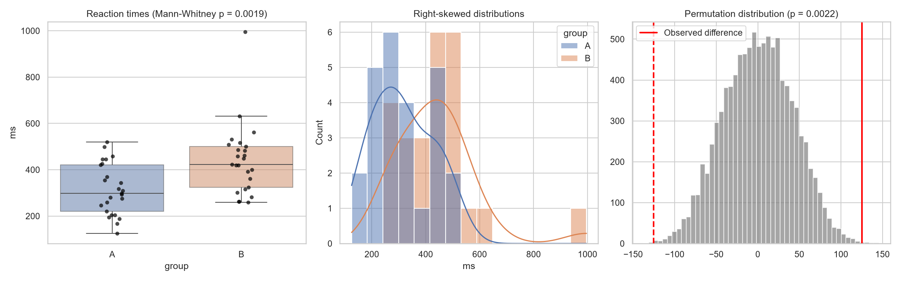
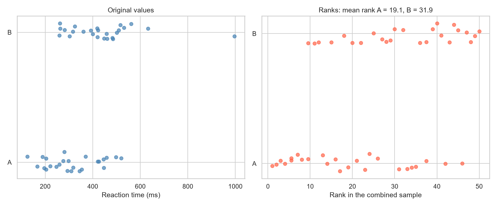
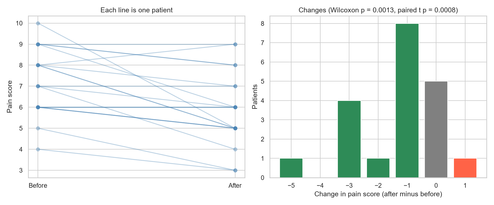
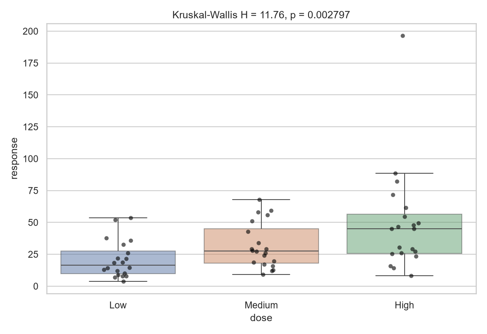
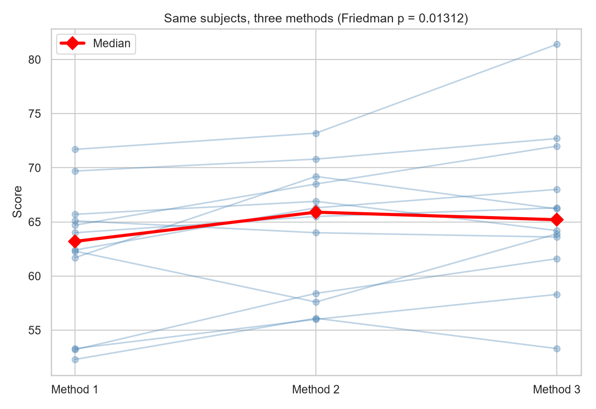
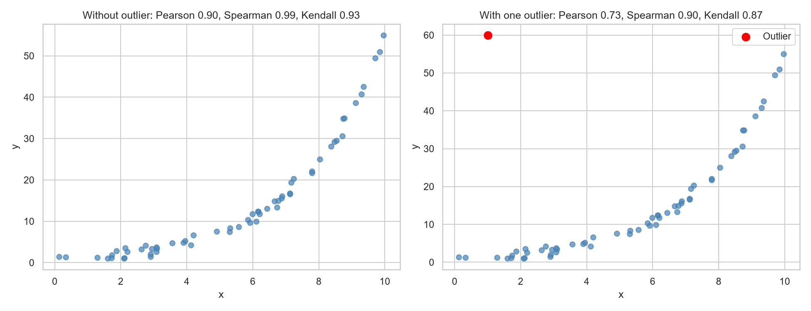
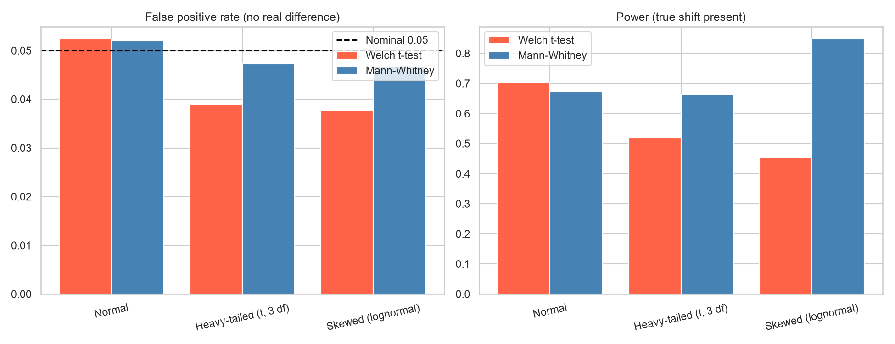

# Topic 19: Non-parametric Statistical Methods

## Objective
Use rank-based and resampling methods that make fewer assumptions than the usual
parametric tests, compare them with their parametric counterparts on the same data,
and use simulation to see when each approach works better.

## Dataset
Synthetic data generated in `analysis.py` (random seed 42):
- `data/reaction_times.csv`: reaction times in ms for two groups of 25, right-skewed
  (lognormal), with Group B built to be slower.
- `data/pain_scores.csv`: pain scores (whole numbers from 0 to 10) for 20 patients
  before and after treatment.
- `data/dose_response.csv`: a skewed response for three dose levels (Low, Medium,
  High), 20 subjects each.
- `data/repeated_measures.csv`: scores for 12 subjects under 3 methods, with large
  differences between subjects.
- Two further series (60 points with a curved but increasing relationship, with and
  without one outlier) and the simulation data are generated inside the script.

## How to run
```
python analysis.py
```

## Results

### 1. Worked example: Mann-Whitney U by hand (two samples of 5)
| | Values | Ranks in the combined sample |
|---|--------|------------------------------|
| Sample A | 12, 15, 9, 20, 17 | 6, 8, 3, 10, 9 |
| Sample B | 8, 14, 11, 7, 10 | 2, 7, 5, 1, 4 |

Rank sums: R_A = 36 and R_B = 19 (total 55 = 10 x 11 / 2). U_A = 36 - 15 = 21 and
U_B = 25 - 21 = 4. scipy gives U = 21 with an exact two-sided p = 0.0952, matching
the hand calculation.

### 2. Two independent samples: reaction times (n = 25 each)
| Group | Mean | Median | Std dev | Skewness | Shapiro-Wilk p |
|-------|------|--------|---------|----------|----------------|
| A | 314.68 | 298.0 | 110.338 | 0.227 | 0.496 |
| B | 440.20 | 422.0 | 153.797 | 1.807 | 0.001 |

Levene test for equal variances: p = 0.6122.

| Test | Statistic | p-value |
|------|-----------|---------|
| Welch t-test | t = 3.316 | 0.0019 |
| Mann-Whitney U | U = 473.0 | 0.0019 |
| Permutation test (difference in means, 9,999 resamples) | | 0.0022 |
| Kolmogorov-Smirnov, two-sample | D = 0.400 | 0.0356 |

| Effect measure | Value |
|----------------|-------|
| Cohen's d | 0.938 |
| Probability that a random Group B value exceeds a Group A value | 0.757 |
| Rank-biserial correlation | 0.514 |
| Difference in means / medians | 125.5 ms / 124.0 ms |
| Hodges-Lehmann shift estimate | 113.0 ms (bootstrap 95% interval 43.0 to 182.0) |

Effect of a log transform:

| Test | Raw scale | Log scale |
|------|-----------|-----------|
| Welch t-test | p = 0.0019 | p = 0.0008 |
| Mann-Whitney | U = 473.0, p = 0.0019 | U = 473.0, p = 0.0019 |

### 3. Paired data: pain scores before and after treatment (n = 20)
Mean pain fell from 7.20 to 5.90 and the median from 7.0 to 6.0. 14 patients
improved, 5 were unchanged and 1 worsened (median change -1.0). Shapiro-Wilk p on the
differences = 0.0234.

| Test | Statistic | p-value |
|------|-----------|---------|
| Wilcoxon signed-rank (zero differences dropped) | W+ = 5.0, W- = 115.0 | 0.0013 |
| Sign test | 14 of 15 non-zero changes were improvements | 0.0010 |
| Paired t-test | t = -3.997 | 0.0008 |

Matched-pairs rank-biserial correlation = -0.917.

### 4. Three independent groups: dose and response (20 each)
| Dose | Mean | Median | Std dev |
|------|------|--------|---------|
| Low | 20.89 | 16.45 | 14.58 |
| Medium | 31.83 | 27.55 | 17.83 |
| High | 49.44 | 45.05 | 41.12 |

Shapiro-Wilk on the ANOVA residuals: p < 0.0001 (skewness 2.852). Levene: p = 0.0853.

| Test | Statistic | p-value |
|------|-----------|---------|
| One-way ANOVA | F = 5.602 | 0.006008 |
| Kruskal-Wallis | H = 11.758 on 2 df | 0.002797 |

Epsilon squared (effect size for Kruskal-Wallis) = 0.199.

Pairwise Mann-Whitney tests with Bonferroni correction:

| Comparison | Median difference | Unadjusted p | Bonferroni p | Significant |
|------------|-------------------|--------------|--------------|-------------|
| Medium vs Low | 11.1 | 0.0265 | 0.0796 | No |
| High vs Low | 28.6 | 0.0013 | 0.0039 | Yes |
| High vs Medium | 17.5 | 0.1478 | 0.4435 | No |

### 5. Related groups: 12 subjects, 3 methods
Method means 62.17, 64.38 and 65.96; medians 63.2, 65.9 and 65.2. The standard
deviation of the subject means is 6.21.

| Test | Statistic | p-value |
|------|-----------|---------|
| Friedman | chi-square = 8.667 on 2 df | 0.01312 |
| Repeated-measures ANOVA | F = 7.365 | 0.003561 |
| Ordinary one-way ANOVA, ignoring the subjects | F = 1.020 | 0.3718 |

Kendall's W = 0.361.

Pairwise Wilcoxon signed-rank tests with Bonferroni correction:

| Comparison | Median difference | Unadjusted p | Bonferroni p |
|------------|-------------------|--------------|--------------|
| Method 2 vs Method 1 | 2.10 | 0.0278 | 0.0835 |
| Method 3 vs Method 1 | 3.75 | 0.0049 | 0.0146 |
| Method 3 vs Method 2 | 1.80 | 0.2036 | 0.6108 |

### 6. Correlation: a curved, increasing relationship (n = 60)
| Data | Pearson r | Spearman rho | Kendall tau |
|------|-----------|--------------|-------------|
| Without outlier | 0.898 (p = 2.556e-22) | 0.989 (p = 1.374e-49) | 0.934 (p = 5.129e-26) |
| With one outlier | 0.733 (p = 1.846e-11) | 0.898 (p = 9.691e-23) | 0.873 (p = 2.673e-23) |

Spearman equals the Pearson correlation of the ranks (True).

### 7. Simulation: 3,000 experiments per cell, 20 per group
| Distribution | Shift | False positives, t | False positives, Mann-Whitney | Power, t | Power, Mann-Whitney |
|--------------|-------|--------------------|-------------------------------|----------|---------------------|
| Normal | 0.8 | 0.0523 | 0.0520 | 0.7030 | 0.6723 |
| Heavy-tailed (t, 3 df) | 1.0 | 0.0390 | 0.0473 | 0.5193 | 0.6637 |
| Skewed (lognormal) | 1.0 | 0.0377 | 0.0467 | 0.4543 | 0.8470 |

The asymptotic efficiency of Mann-Whitney relative to the t-test for normal data is
3 / pi = 0.955.









Tables: `outputs/kruskal_posthoc.csv`, `outputs/friedman_posthoc.csv`,
`outputs/correlations.csv`, `outputs/simulation_results.csv`,
`outputs/test_summary.csv`. Console record: `outputs/console_output.txt`.

### Which test for which design
| Design | Parametric test | Non-parametric alternative |
|--------|-----------------|----------------------------|
| Two independent groups | Welch t-test | Mann-Whitney U (also permutation test, Kolmogorov-Smirnov) |
| Two paired measurements | Paired t-test | Wilcoxon signed-rank, sign test |
| Several independent groups | One-way ANOVA | Kruskal-Wallis |
| Several related groups | Repeated-measures ANOVA | Friedman |
| Association between two variables | Pearson correlation | Spearman, Kendall |

## Interpretation
- **How ranks work:** Rank-based tests replace each value by its position in the
  ordered data and analyse the ranks. In the worked example, sample A holds most of
  the high ranks (rank sum 36 against 19), giving U = 4 for B and 21 for A. Even so,
  the exact p-value is 0.0952, not significant. With only 5 per group, U has to be 2
  or below to reach significance at 5%, so small samples need very large differences.
  U_A and U_B always add up to n1 x n2 = 25.
- **Two groups, skewed data:** Group B is clearly right-skewed (skewness 1.81,
  Shapiro p = 0.001). Welch t-test and Mann-Whitney both give p = 0.0019, and the
  permutation test agrees (0.0022). When the parametric and non-parametric tests
  agree, the conclusion does not depend on the assumptions. The t-test held up here
  because n = 25 per group is large enough for the sampling distribution of the mean
  to be near-normal (the Central Limit Theorem from Topic 4).
- **Kolmogorov-Smirnov:** The two-sample K-S test is also significant but with a
  weaker p-value (0.0356). It looks for any difference in the shape of the
  distributions, so it spends its power on differences that are not just a shift.
  That makes it less sensitive when the main difference is location.
- **Effect sizes:** Cohen's d = 0.94 is a large standardised difference. The rank-
  based measure says the same thing in a more concrete way: a random Group B
  reaction is slower than a random Group A reaction 75.7% of the time (rank-biserial
  correlation 0.51). The Hodges-Lehmann estimate of the shift is 113 ms (interval 43
  to 182), a little below the difference in means (125.5 ms) because it is less
  affected by the long tail. It describes a pure shift, but here the spread also
  differs between the groups (sd 110 against 154) and the data were generated from a
  multiplicative model, so treat it as a summary of the typical difference.
- **Ranks ignore the scale:** A log transform changes the t-test p-value (0.0019 to
  0.0008) but leaves Mann-Whitney exactly unchanged (U = 473, p = 0.0019), because
  any increasing transformation keeps the ranks the same. The t-test result depends on
  the measurement scale, and the rank test does not.
- **Paired data:** Pain scores fell by a median of 1 point: 14 patients improved, 5
  were unchanged and 1 worsened. Wilcoxon (p = 0.0013), the sign test (p = 0.0010)
  and the paired t-test (p = 0.0008) all agree. The differences are not quite normal
  (Shapiro p = 0.0234) and the scores are integers with many ties, so the rank tests
  are the safer choice, and scipy uses a normal approximation for the p-value when
  there are ties or zero differences. Wilcoxon drops the 5 zero differences and uses
  15 pairs. The sign test uses only the direction of change, while Wilcoxon also uses
  the size, which is why Wilcoxon extracts more from the data when the sizes are
  informative.
- **Several groups:** The responses are strongly skewed (residual skewness 2.85) and
  the group spread grows with the mean (sd 14.6, 17.8 and 41.1), so the ANOVA
  assumptions are doubtful. Kruskal-Wallis (H = 11.76, p = 0.0028) and ANOVA
  (F = 5.60, p = 0.0060) both reject equal groups. Epsilon squared of 0.199 means
  that about a fifth of the variation in ranks is linked to dose.
- **Which doses differ:** After Bonferroni correction only High against Low is
  significant (p = 0.0039). Medium against Low (unadjusted p = 0.0265) does not
  survive the correction (0.0796). The same pattern appeared with ANOVA post-hoc tests
  in Topic 16. These pairwise Mann-Whitney tests are a simple follow-up, and Dunn's
  test is the dedicated procedure for Kruskal-Wallis.
- **Repeated measures:** The same 12 subjects were measured under three methods, and
  subjects differ a great deal (sd of subject means 6.21). Friedman (p = 0.0131) and
  repeated-measures ANOVA (p = 0.0036) both find a method effect. An ordinary
  one-way ANOVA that ignores the pairing misses it completely (F = 1.02,
  p = 0.37), because the differences between subjects swamp the differences between
  methods. This is the same lesson as blocking in Topic 16.
- **Friedman against ANOVA:** The Friedman test gives a weaker p-value than
  repeated-measures ANOVA. The scores here were generated from a normal model, so the
  parametric test is the more powerful one, and the rank test pays a small price for
  not assuming normality. Kendall's W = 0.361 means moderate agreement among subjects
  in how they rank the methods. After correction only Method 3 against Method 1 is
  significant (p = 0.0146). With 12 subjects the chi-square approximation for
  Friedman is rough.
- **Correlation:** For a curved but always increasing relationship, Spearman (0.989)
  and Kendall (0.934) are higher than Pearson (0.898), because the rank measures
  capture any monotonic relationship and Pearson measures only the straight-line part.
  One extreme point lowered Pearson from 0.898 to 0.733, Spearman from 0.989 to 0.898
  and Kendall from 0.934 to 0.873. The rank measures are more resistant but not
  immune. The outlier here is extreme in y, so it also changes ranks. Spearman equals
  the Pearson correlation of the ranks, which the check confirms.
- **Simulation, false positives:** For normal data both tests reject about 5% of the
  time when there is no difference (0.0523 and 0.0520). With 3,000 runs each rate has a
  standard error of about 0.004. The t-test is slightly conservative for heavy-tailed
  and skewed data (0.0390 and 0.0377, nearly 3 standard errors below 0.05), while
  Mann-Whitney stays closer to the nominal level (0.0473 and 0.0467).
- **Simulation, power:** For normal data the t-test has a small edge (0.703 against
  0.672), in line with the 3/pi = 0.955 efficiency (0.672 / 0.703 = 0.956). For