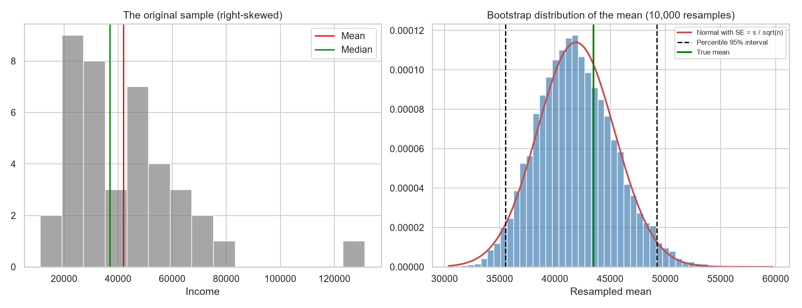
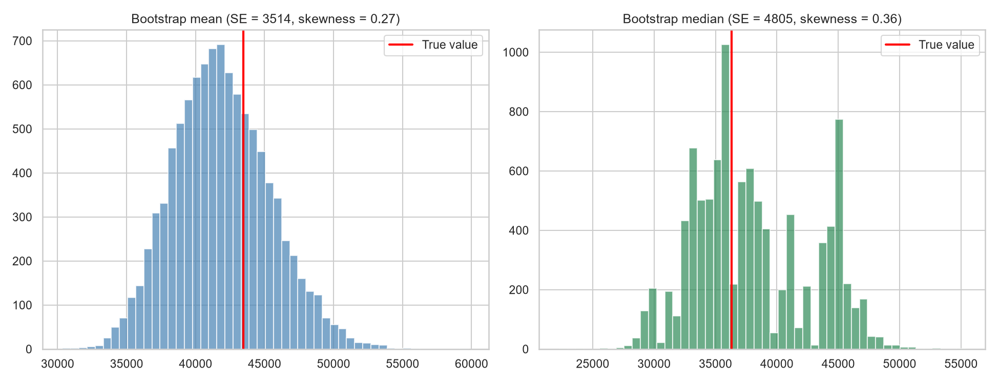
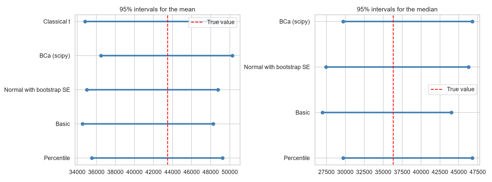
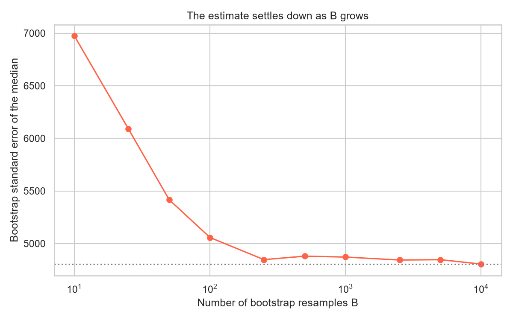
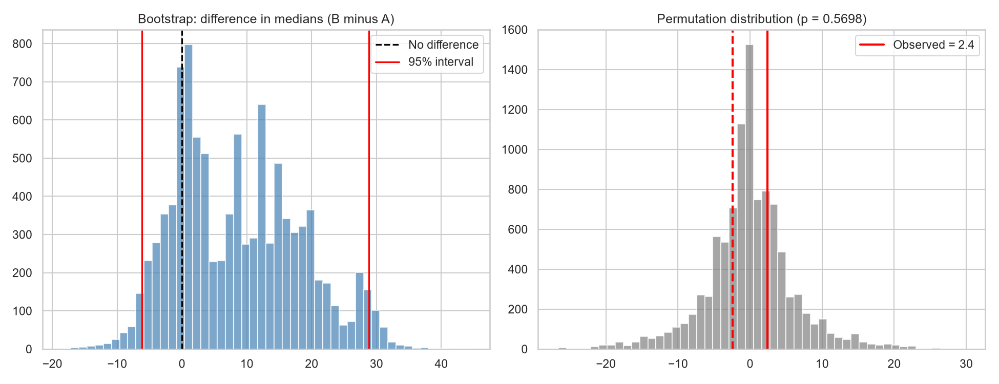
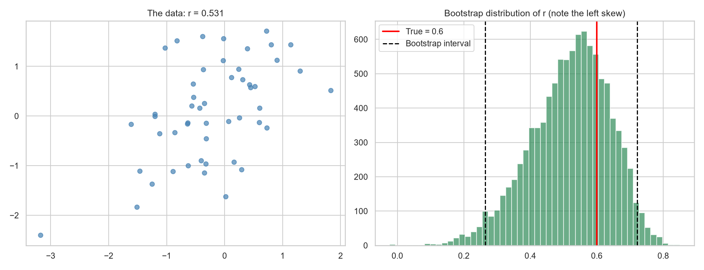
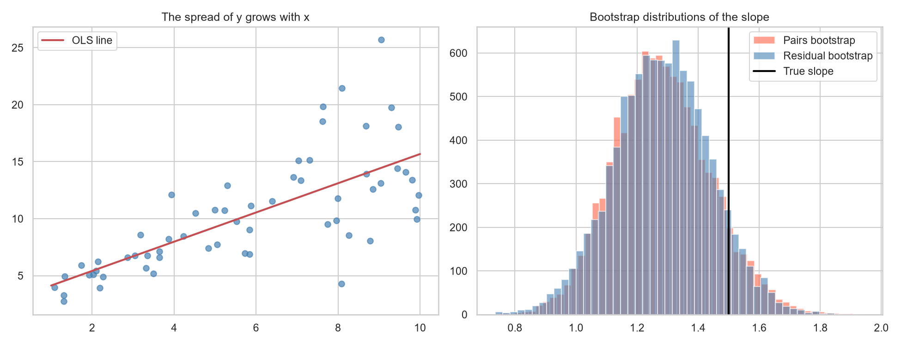
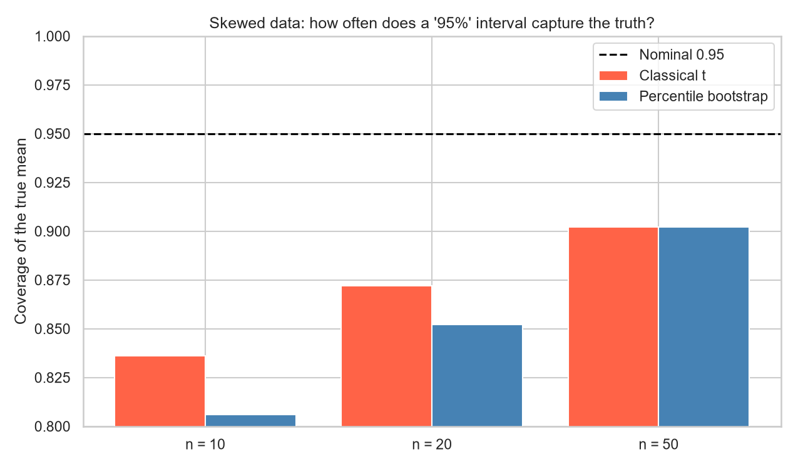
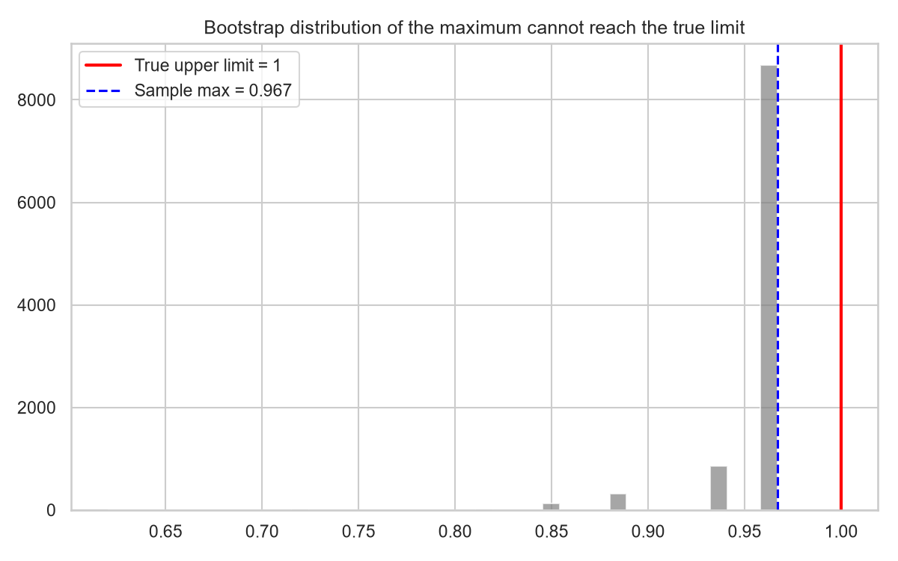

# Topic 20: Bootstrap and Resampling Methods

## Objective
Estimate the sampling distribution, standard error, bias and confidence interval of a
statistic by resampling the data, compare bootstrap intervals with classical ones,
use the jackknife and permutation tests, and learn when resampling works well and
when it does not.

## Dataset
Synthetic data generated in `analysis.py` (random seed 42):
- `data/incomes.csv`: incomes of 40 customers, right-skewed (lognormal). The true
  population mean is 43,478 and the true median is 36,316.
- `data/two_groups.csv`: two groups of 30 skewed measurements (true medians 50 and 65).
- `data/correlation_pairs.csv`: 50 pairs from a bivariate normal distribution with
  true correlation 0.6.
- `data/regression_data.csv`: 60 points on a line with true slope 1.5 and noise that
  grows with x.
- The coverage simulation and the maximum-of-uniform example are generated inside the
  script.

All bootstrap results use 10,000 resamples unless stated otherwise.

## How to run
```
python analysis.py
```

## Results

### 1. The sample
| Quantity | Sample | True population |
|----------|--------|-----------------|
| Mean | 41,892 | 43,478 |
| Median | 36,867 | 36,316 |
| Std dev | 22,138 | |
| Skewness | 1.712 | |

### 2. Bootstrap estimates (10,000 resamples of size 40)
| Statistic | Estimate | Bootstrap SE | Bootstrap bias | 95% percentile interval |
|-----------|----------|--------------|----------------|-------------------------|
| Mean | 41,891.9 | 3,514.4 | 18.9 | (35,521.6, 49,236.1) |
| Median | 36,867.0 | 4,804.9 | 1,153.4 | (29,719.0, 46,774.0) |
| 20% trimmed mean | 38,571.9 | 3,472.8 | 193.1 | (32,230.3, 45,857.6) |
| Standard deviation | 22,138.1 | 4,463.1 | -748.7 | (14,381.3, 30,242.3) |
| Coefficient of variation | 0.528 | 0.084 | -0.020 | (0.366, 0.665) |

Standard error of the mean: bootstrap 3,514.4 against the formula s / sqrt(n) =
3,500.3. The bootstrap standard error of the median is 4,804.9 (no simple formula).
A separate run with scikit-learn's `resample` (2,000 resamples) gave 4,551.8.

### 3. 95% confidence intervals by method
| Statistic | Method | Lower | Upper | Width |
|-----------|--------|-------|-------|-------|
| Mean | Percentile | 35,521.6 | 49,236.1 | 13,714.6 |
| Mean | Basic | 34,547.7 | 48,262.2 | 13,714.6 |
| Mean | Normal with bootstrap SE | 35,003.6 | 48,780.2 | 13,776.6 |
| Mean | BCa (scipy) | 36,471.3 | 50,276.2 | 13,804.9 |
| Mean | Classical t | 34,811.8 | 48,972.0 | 14,160.2 |
| Median | Percentile | 29,719.0 | 46,774.0 | 17,055.0 |
| Median | Basic | 26,960.0 | 44,015.0 | 17,055.0 |
| Median | Normal with bootstrap SE | 27,449.5 | 46,284.5 | 18,835.1 |
| Median | BCa (scipy) | 29,719.0 | 46,774.0 | 17,055.0 |

True mean = 43,478 and true median = 36,316. Every interval contains the true value.

### 4. Number of resamples needed (standard error of the median)
| B | 10 | 25 | 50 | 100 | 250 | 500 | 1,000 | 2,500 | 5,000 | 10,000 |
|---|----|----|----|-----|-----|-----|-------|-------|-------|--------|
| SE | 6,972.9 | 6,090.3 | 5,416.2 | 5,057.1 | 4,846.9 | 4,880.0 | 4,871.3 | 4,843.1 | 4,846.5 | 4,804.9 |

### 5. Jackknife (leave one out)
| Statistic | Jackknife SE | Jackknife bias | Bootstrap SE |
|-----------|--------------|----------------|--------------|
| Mean | 3,500.34 | 0.000 | 3,514.45 |
| Median | 5,720.42 | 0.000 | 4,804.86 |
| Standard deviation | 5,278.96 | -629.630 | 4,463.15 |

The jackknife standard error of the mean equals s / sqrt(n) exactly (True).

### 6. Two groups (30 each): difference in medians, B minus A
| Quantity | Value |
|----------|-------|
| Median A / median B | 47.2 / 49.5 |
| Observed difference | 2.40 |
| Bootstrap SE | 9.60 |
| 95% percentile interval | (-6.20, 28.80), contains 0 |
| Permutation test of the difference in medians (9,999 resamples) | p = 0.5698 |
| Mann-Whitney test | p = 0.2035 |

### 7. Correlation (n = 50, true correlation 0.6)
| Quantity | Value |
|----------|-------|
| Sample r | 0.531 |
| Bootstrap SE | 0.119 |
| Bootstrap skewness | -0.452 |
| Bootstrap percentile interval | (0.264, 0.722) |
| Fisher z interval | (0.297, 0.705) |

### 8. Regression slope when the noise grows with x (true slope 1.5)
OLS slope = 1.2817 and intercept = 2.8549. The residual standard deviation is 1.50 for
x < 5.5 and 4.48 for x >= 5.5.

| Method | SE of the slope | Lower 95% | Upper 95% |
|--------|-----------------|-----------|-----------|
| Classical OLS (t interval) | 0.1591 | 0.9632 | 1.6001 |
| Residual bootstrap | 0.1573 | 0.9728 | 1.5916 |
| Pairs bootstrap | 0.1580 | 0.9930 | 1.6096 |

### 9. Coverage of 95% intervals for the mean of lognormal data (500 samples, 500 resamples each)
| n | t-interval coverage | Mean width | Percentile bootstrap coverage | Mean width |
|---|---------------------|------------|-------------------------------|------------|
| 10 | 0.836 | 2.51 | 0.806 | 1.97 |
| 20 | 0.872 | 1.69 | 0.852 | 1.49 |
| 50 | 0.902 | 1.13 | 0.902 | 1.07 |

The standard error of each coverage figure is about 0.010.

### 10. When the bootstrap fails: the maximum of Uniform(0, 1), n = 50
| Quantity | Value |
|----------|-------|
| Sample maximum | 0.9669 (true upper limit 1) |
| Share of bootstrap maxima equal to the sample maximum | 0.633 (theory 0.636) |
| Largest bootstrap maximum | 0.9669 |











Tables: `outputs/bootstrap_estimates.csv`, `outputs/ci_comparison.csv`,
`outputs/jackknife.csv`, `outputs/regression_slope.csv`,
`outputs/coverage_simulation.csv`. Console record: `outputs/console_output.txt`.

### The bootstrap procedure
1. Draw n values from the sample with replacement (a bootstrap resample).
2. Compute the statistic on the resample.
3. Repeat B times (here 10,000). The collection of values is the bootstrap
   distribution, an estimate of the sampling distribution.
4. The standard deviation of the bootstrap values is the standard error, their mean
   minus the original estimate is the bias, and their percentiles give an interval.

## Interpretation
- **Bootstrap for the mean:** The bootstrap standard error of the mean (3,514) is almost
  the same as the formula s / sqrt(n) (3,500). For a statistic with a known formula the
  bootstrap reproduces it, which shows that the method works. The true mean (43,478)
  lies inside all five intervals.
- **Statistics without a formula:** The median, trimmed mean, standard deviation and
  coefficient of variation have no simple standard error formula, yet the bootstrap
  gives each one with the same code. The median is the least precise (SE 4,805 against
  3,514 for the mean), which is common for skewed data.
- **Bias:** The bootstrap bias estimates how far the resampled statistics sit from the
  original estimate. The mean is essentially unbiased (+19). The median has a bias of
  +1,153, about 24% of its standard error, because resampling from a right-skewed
  sample of 40 pulls the median up. The standard deviation shows -749, so the sample
  standard deviation tends to underestimate the spread, as expected for a skewed
  distribution. Bias estimates are themselves noisy, and correcting for bias often
  adds more variability than it removes, so they are most useful as a warning.
- **Interval methods:** For the mean, the five methods give similar intervals of width
  13,700 to 14,200, and the BCa interval (36,471 to 50,276) is shifted right of the
  others. BCa corrects for bias and skewness and tends to move the interval toward the
  long tail. The classical t-interval is slightly the widest of the mean intervals. For
  the median, the basic interval (26,960 to 44,015) is shifted left because it reflects
  the positive bias, and the normal interval (27,450 to 46,285) is wider and symmetric,
  although the bootstrap distribution is not symmetric. The BCa and percentile
  intervals for the median are identical (29,719 to 46,774). I did not investigate why.
  A sample median of 40 values takes a limited set of values, so the bootstrap
  distribution of the median is lumpy. A single sample cannot tell us which method is
  best, since all intervals contain the true value, which is why the coverage
  simulation below is needed.
- **How many resamples:** The standard error of the median is unstable for a small B
  (6,973 at B = 10, 5,057 at B = 100) and settles near 4,850 from about B = 250. The
  remaining differences from 250 to 10,000 resamples (4,847 down to 4,805) are
  resampling noise. A few hundred resamples suffice for a standard error, and
  intervals need more (at least 1,000 to 10,000) because they depend on the tails.
  The scikit-learn run (2,000 resamples, SE 4,552) is about 5% below the main result.
  Different random draws are the likely reason, but I did not check this.
- **Jackknife:** Leaving out one observation at a time gives exactly the classical
  standard error for the mean (3,500.34) and a bias of 0 for the mean. For the median
  the jackknife SE (5,720) is well above the bootstrap SE (4,805). The jackknife is
  known to perform badly for the median and other non-smooth statistics, because
  deleting one observation barely changes a median. For smooth statistics such as the
  mean it works well, and the standard deviation values (5,279 against 4,463, bias
  -630 against -749) are in the same range.
- **Two groups:** The sample medians (47.2 and 49.5) differ by only 2.4, although the
  true medians (50 and 65) differ by 15. With 30 per group and skewed data this sample
  did not show the real difference. The bootstrap interval for the difference (-6.2 to
  28.8) is wide and contains 0, and it also contains the true difference of 15. The
  permutation test finds no evidence of a difference in medians (p = 0.57). The
  Mann-Whitney test (p = 0.20) is also not significant, though it asks a different
  question (whether one group tends to give larger values), which is why the two
  p-values differ. A non-significant result here reflects low power and does not show
  that the groups are equal.
- **Correlation:** The sample correlation is 0.531, below the true 0.6, within sampling
  error. The bootstrap distribution of r is skewed to the left (skewness -0.45), because
  r cannot exceed 1, so the bootstrap interval (0.264 to 0.722) reaches further down
  than the Fisher z interval (0.297 to 0.705). Both contain the true value, and the
  bootstrap needed no normality assumption.
- **Regression:** The noise is about three times larger for x >= 5.5 than for x < 5.5
  (residual sd 4.48 against 1.50), so the constant-variance assumption behind the classical
  standard error is violated. The pairs bootstrap resamples whole (x, y) points and does
  not assume constant variance. The residual bootstrap resamples residuals and implicitly
  assumes constant variance. The three standard errors came out almost the same (0.159,
  0.157 and 0.158), so in this sample the unequal variance changed the slope's standard
  error very little, and the pairs bootstrap offered no visible advantage. A different
  sample, or a stronger imbalance in the x values, could differ. The estimated slope
  (1.28) is 1.4 standard errors below the true 1.5, and all three intervals contain
  1.5. The residual bootstrap would be misleading for predictions at specific x values,
  since it ignores that the noise varies.
- **Coverage on skewed data:** A 95% interval should capture the true mean 95% of the time.
  For lognormal data with a long right tail, neither method does at these sample sizes.
  The t-interval covers 83.6%, 87.2% and 90.2% at n = 10, 20 and 50, and the percentile
  bootstrap covers 80.6%, 85.2% and 90.2%. The bootstrap is no better, and at small n
  it is slightly worse, with intervals that are also narrower (1.97 against 2.51 at
  n = 10). The bootstrap can only reuse the values in the sample, and a small sample of
  skewed data often contains no extreme values, so the resampled means understate the
  uncertainty. With 500 samples each coverage figure has a standard error of about
  0.010, so the gaps between the two methods at n = 10 and 20 (0.03 and 0.02) are small
  relative to the noise, and the shortfall from 95% is not. The bootstrap is not a fix
  for a small sample, and BCa or bootstrap-t intervals would do better but were not
  tested here.
- **When the bootstrap fails:** For the maximum of a Uniform(0, 1) sample, 63.3% of the
  bootstrap maxima equal the sample maximum (0.9669), against 63.6% from theory. Resampling
  can never produce a value above the sample maximum, so the bootstrap distribution is a
  spike at 0.9669 and cannot reach the true limit of 1. Extremes such as the maximum and
  minimum are the standard example of a statistic the bootstrap cannot handle. Other
  cases include very small samples and data with strong dependence, such as time series,
  which need modified resampling.
- **Conclusion:** The bootstrap estimates standard errors, bias and confidence intervals
  for almost any statistic with one simple recipe and few assumptions. It agrees with
  classical formulas where those exist, handles statistics such as the median and the
  coefficient of variation where no formula is available, and is easy to check by
  simulation. It still depends on the sample being representative, it cannot fix small
  samples or extreme-value statistics, and its intervals should be checked, for instance
  by a coverage simulation, before being trusted.