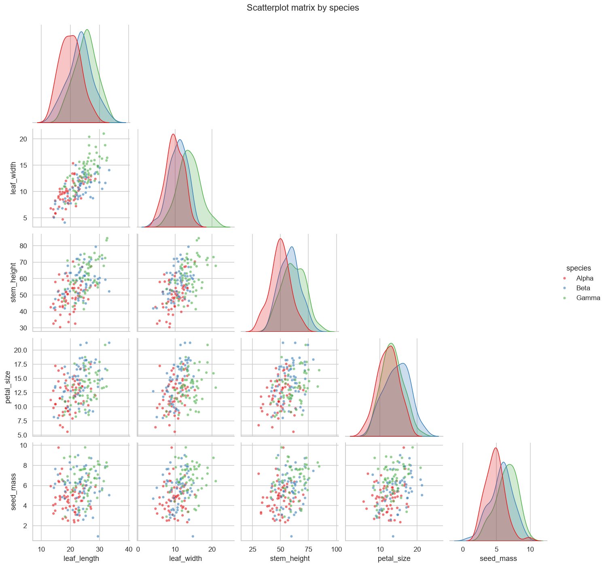
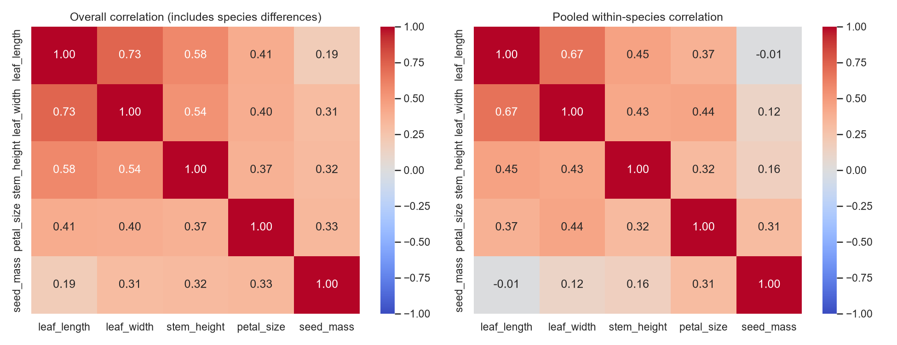
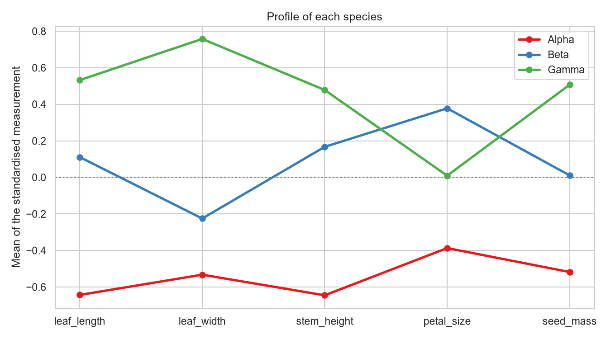
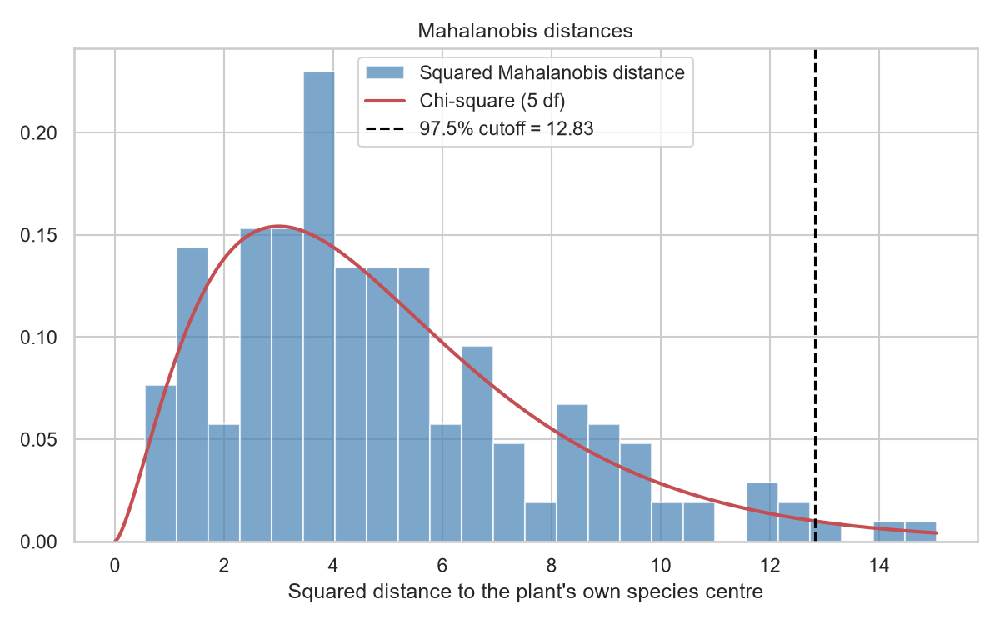
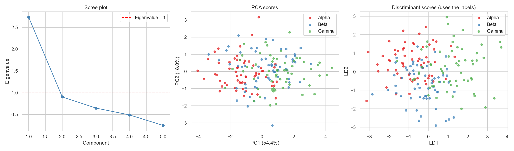
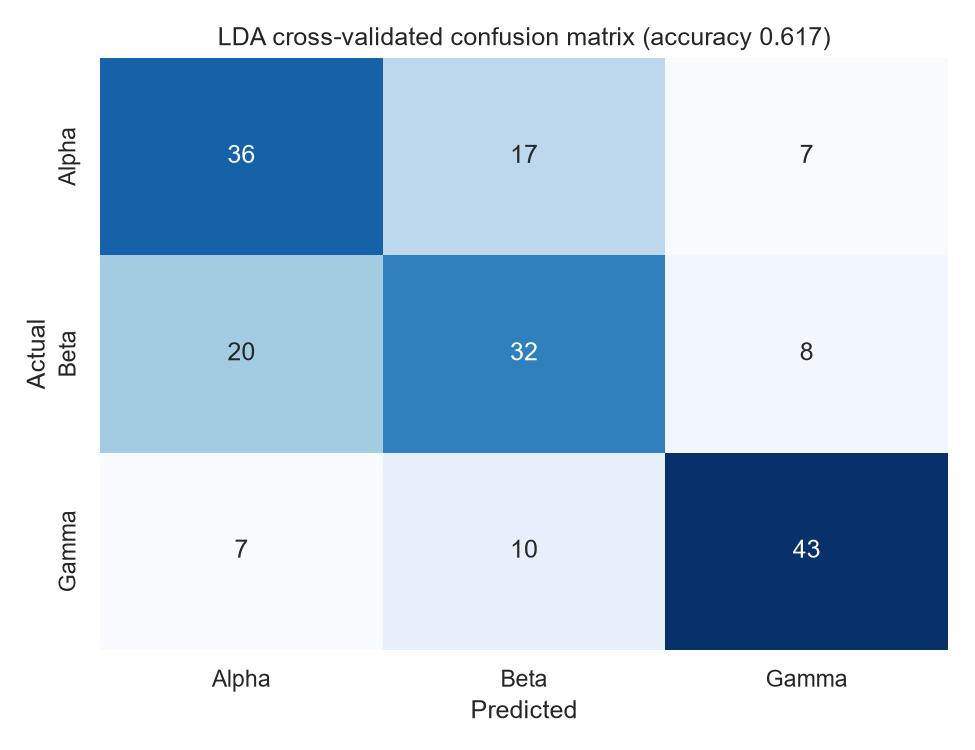
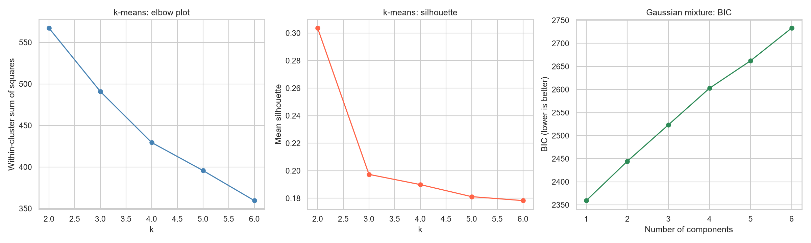
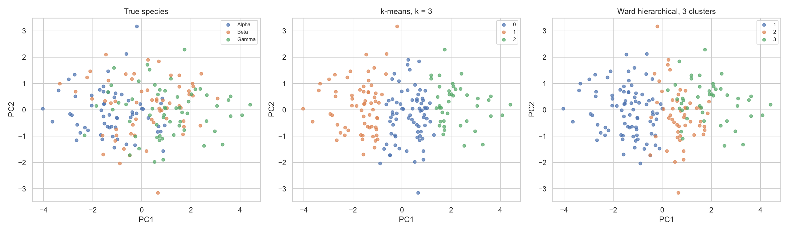
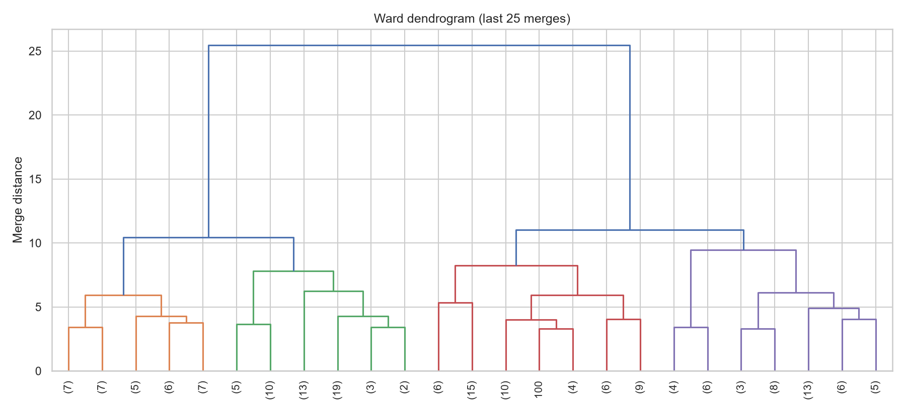

# Topic 21: Multivariate Statistical Analysis

## Objective
Analyse several correlated measurements at once: summarise their means and covariance
structure, measure multivariate distance, test whether groups differ (Hotelling's T²
and MANOVA), classify observations (linear discriminant analysis), reduce dimension
(PCA) and look for groups without using the labels (clustering).

## Dataset
Synthetic measurements of 180 plants generated in `analysis.py` (random seed 42) and
saved as `data/plant_measurements.csv`: 60 plants from each of three species (Alpha,
Beta, Gamma) with five correlated measurements: `leaf_length`, `leaf_width`,
`stem_height`, `petal_size` and `seed_mass`. All species share one covariance matrix
and differ in their mean vectors.

## How to run
```
python analysis.py
```

## Results

### 1. Group mean vectors
| Species | leaf_length | leaf_width | stem_height | petal_size | seed_mass |
|---------|-------------|------------|-------------|------------|-----------|
| Alpha | 20.00 | 9.88 | 49.63 | 12.10 | 4.75 |
| Beta | 23.30 | 10.80 | 58.08 | 14.49 | 5.64 |
| Gamma | 25.14 | 13.78 | 61.32 | 13.34 | 6.48 |

### 2. Covariance structure
Overall covariance matrix:

| | leaf_length | leaf_width | stem_height | petal_size | seed_mass |
|---|---|---|---|---|---|
| leaf_length | 19.28 | 9.75 | 26.52 | 5.56 | 1.42 |
| leaf_width | 9.75 | 9.18 | 16.95 | 3.74 | 1.61 |
| stem_height | 26.52 | 16.95 | 108.77 | 12.11 | 5.67 |
| petal_size | 5.56 | 3.74 | 12.11 | 9.75 | 1.77 |
| seed_mass | 1.42 | 1.61 | 5.67 | 1.77 | 2.89 |

Overall correlation matrix:

| | leaf_length | leaf_width | stem_height | petal_size | seed_mass |
|---|---|---|---|---|---|
| leaf_length | 1.000 | 0.732 | 0.579 | 0.405 | 0.191 |
| leaf_width | 0.732 | 1.000 | 0.536 | 0.395 | 0.312 |
| stem_height | 0.579 | 0.536 | 1.000 | 0.372 | 0.320 |
| petal_size | 0.405 | 0.395 | 0.372 | 1.000 | 0.333 |
| seed_mass | 0.191 | 0.312 | 0.320 | 0.333 | 1.000 |

Pooled within-species correlation matrix:

| | leaf_length | leaf_width | stem_height | petal_size | seed_mass |
|---|---|---|---|---|---|
| leaf_length | 1.000 | 0.675 | 0.454 | 0.369 | -0.014 |
| leaf_width | 0.675 | 1.000 | 0.426 | 0.445 | 0.122 |
| stem_height | 0.454 | 0.426 | 1.000 | 0.318 | 0.159 |
| petal_size | 0.369 | 0.445 | 0.318 | 1.000 | 0.306 |
| seed_mass | -0.014 | 0.122 | 0.159 | 0.306 | 1.000 |

| Quantity | Overall | Pooled within species |
|----------|---------|-----------------------|
| Total variance (trace) | 149.87 | 117.97 |
| Generalised variance (determinant) | 103,165.5 | 49,728.8 |

Eigenvalues of the overall covariance matrix: 121.29, 15.53, 7.47, 3.47, 2.11.

### 3. Mahalanobis distances
| Quantity | Value |
|----------|-------|
| Mean squared distance to the plant's own species centre | 4.917 (chi-square mean = 5) |
| Largest squared distance | 15.05 |
| Cutoff (chi-square 97.5%, 5 df) | 12.833 |
| Plants above the cutoff | 3 of 180 (1.7%; about 2.5% expected) |
| Plants above the cutoff relative to the overall centre | 2 |

Squared Mahalanobis distance between species centres (pooled covariance):

| | Alpha | Beta | Gamma |
|---|-------|------|-------|
| Alpha | 0.000 | 1.712 | 4.233 |
| Beta | 1.712 | 0.000 | 2.936 |
| Gamma | 4.233 | 2.936 | 0.000 |

### 4. Mardia's tests of multivariate normality (within-species residuals)
| Test | Statistic | p-value |
|------|-----------|---------|
| Skewness | b1 = 0.9392; statistic 28.18 on 35 df | 0.7865 |
| Kurtosis | b2 = 34.061 (expected 35); z = -0.753 | 0.4515 |

Univariate Shapiro-Wilk p-values of the residuals: leaf_length 0.634, leaf_width
0.891, stem_height 0.503, petal_size 0.572, seed_mass 0.650.

### 5. Comparing the species
Hotelling's T² for each pair:

| Comparison | T² | F (5, 114 df) | p-value | Bonferroni p | Variables significant alone |
|------------|----|----------------|---------|--------------|------------------------------|
| Alpha vs Beta | 57.30 | 11.07 | < 0.0001 | < 0.0001 | 4 of 5 |
| Alpha vs Gamma | 118.87 | 22.97 | < 0.0001 | < 0.0001 | 4 of 5 |
| Beta vs Gamma | 89.23 | 17.24 | < 0.0001 | < 0.0001 | 2 of 5 |

"Variables significant alone" counts the separate t-tests that remain significant
after a Bonferroni correction over the 5 variables.

MANOVA (five measurements by species):

| Statistic | Value | Num df | Den df | F | p-value |
|-----------|-------|--------|--------|---|---------|
| Wilks' lambda | 0.455695 | 10 | 346.0 | 16.655 | < 0.0001 |
| Pillai's trace | 0.631292 | 10 | 348.0 | 16.051 | < 0.0001 |
| Hotelling-Lawley trace | 1.003558 | 10 | 256.8 | 17.296 | < 0.0001 |
| Roy's greatest root | 0.748543 | 5 | 174 | 26.049 | < 0.0001 |

Wilks' lambda by hand, det(W) / det(T) = 0.45570, matches statsmodels (True). The exact
F for three groups is 16.655 on (10, 346) df, p = 1.38e-24. The multivariate effect size,
1 - Wilks^(1/s), is 0.325.

Univariate one-way ANOVAs:

| Measurement | F | p-value |
|-------------|---|---------|
| leaf_length | 27.42 | 4.22e-11 |
| leaf_width | 38.47 | 1.34e-14 |
| stem_height | 25.62 | 1.69e-10 |
| petal_size | 9.57 | 0.000113 |
| seed_mass | 18.81 | 3.9e-08 |

### 6. Linear discriminant analysis (standardised measurements)
| Measure | Value |
|---------|-------|
| Resubstitution accuracy | 0.6500 |
| 5-fold cross-validated accuracy | 0.6167 (sd 0.0569) |
| Accuracy of random guessing | 0.333 |
| Share of between-group variance on LD1 / LD2 | 0.7459 / 0.2541 |

Cross-validated confusion matrix (rows = actual, columns = predicted):

| | Alpha | Beta | Gamma |
|---|-------|------|-------|
| Alpha | 36 | 17 | 7 |
| Beta | 20 | 32 | 8 |
| Gamma | 7 | 10 | 43 |

Discriminant coefficients on standardised variables (signs are arbitrary):

| Variable | LD1 | LD2 |
|----------|-----|-----|
| leaf_length | 0.265 | -0.798 |
| leaf_width | 0.802 | 1.191 |
| stem_height | 0.261 | -0.454 |
| petal_size | -0.544 | -0.681 |
| seed_mass | 0.612 | -0.127 |

### 7. Principal components (standardised data)
| Component | PC1 | PC2 | PC3 | PC4 | PC5 |
|-----------|-----|-----|-----|-----|-----|
| Explained variance | 0.5444 | 0.1798 | 0.1288 | 0.0975 | 0.0495 |
| Cumulative | 0.5444 | 0.7242 | 0.8530 | 0.9505 | 1.0000 |

Loadings (correlation with the component):

| Variable | PC1 | PC2 | PC3 |
|----------|-----|-----|-----|
| leaf_length | 0.837 | -0.387 | -0.012 |
| leaf_width | 0.846 | -0.236 | -0.117 |
| stem_height | 0.784 | -0.103 | -0.212 |
| petal_size | 0.661 | 0.307 | 0.686 |
| seed_mass | 0.520 | 0.771 | -0.343 |

Mean PC1 score by species: Alpha -1.22, Beta 0.17, Gamma 1.05. Mean PC2 score:
Alpha -0.08, Beta 0.12, Gamma -0.04.

### 8. Clustering without using the species labels
k-means on the standardised data:

| k | Within-cluster sum of squares | Silhouette |
|---|-------------------------------|------------|
| 2 | 567.2 | 0.304 |
| 3 | 490.9 | 0.197 |
| 4 | 429.5 | 0.190 |
| 5 | 395.7 | 0.181 |
| 6 | 359.5 | 0.178 |

Best k by silhouette = 2. With k = 3 the adjusted Rand index against the true species is
0.134.

Species (rows) against k-means cluster (columns), k = 3:

| | 0 | 1 | 2 |
|---|---|---|---|
| Alpha | 18 | 42 | 0 |
| Beta | 28 | 16 | 16 |
| Gamma | 28 | 7 | 25 |

Ward hierarchical clustering: cophenetic correlation = 0.519. The last five merge
heights are 8.24, 9.47, 10.43, 11.02 and 25.45. Cut into 3 clusters, the adjusted Rand
index is 0.154.

| | Cluster 1 | Cluster 2 | Cluster 3 |
|---|-----------|-----------|-----------|
| Alpha | 49 | 8 | 3 |
| Beta | 24 | 14 | 22 |
| Gamma | 11 | 29 | 20 |

Gaussian mixture model:

| k | BIC | AIC |
|---|-----|-----|
| 1 | 2359.2 | 2295.3 |
| 2 | 2444.5 | 2313.6 |
| 3 | 2523.5 | 2325.5 |
| 4 | 2602.7 | 2337.7 |
| 5 | 2662.2 | 2330.2 |
| 6 | 2733.1 | 2333.9 |

Best k by BIC = 1. With k = 3 the adjusted Rand index is 0.093.

| Method | Adjusted Rand index (3 clusters) |
|--------|----------------------------------|
| k-means | 0.134 |
| Ward hierarchical | 0.154 |
| Gaussian mixture | 0.093 |











Tables: `outputs/group_means.csv`, `outputs/covariance_matrix.csv`,
`outputs/pooled_within_covariance.csv`, `outputs/centroid_distances.csv`,
`outputs/hotelling_pairs.csv`, `outputs/manova.csv`, `outputs/lda_coefficients.csv`,
`outputs/pca_loadings.csv`, `outputs/clustering_summary.csv`,
`outputs/kmeans_selection.csv`, `outputs/gmm_selection.csv`. Console record:
`outputs/console_output.txt`.

### Which method for which question
| Question | Method |
|----------|--------|
| What do the means, spread and correlations look like jointly? | Mean vector, covariance and correlation matrices |
| How far is an observation from a group centre, allowing for correlation? | Mahalanobis distance |
| Do the mean vectors of two groups differ? | Hotelling's T² |
| Do the mean vectors of several groups differ? | MANOVA |
| Can group membership be predicted from the measurements? | Linear discriminant analysis |
| Can many variables be summarised by a few axes? | PCA |
| Are there groups in the data when no labels are used? | k-means, hierarchical clustering, Gaussian mixture |

## Interpretation
- **Covariance structure:** The covariance matrix shows variances on the diagonal and
  co-movement off it. Stem height has by far the largest variance (108.77), so on raw
  covariances it dominates. The correlation matrix removes the units. Leaf length and
  width are the most strongly related pair (0.73).
- **Between and within correlations differ:** The overall correlations are generally
  higher than the pooled within-species ones (for example leaf_length with seed_mass is
  0.191 overall and -0.014 within species). Part of the overall correlation comes from
  species having different means: a species with larger leaves also has heavier seeds.
  Ignoring the groups overstates how strongly the traits go together within a species.
  Total variance falls from 149.87 to 117.97 once species differences are removed, so
  species explain about 21% of the total variance.
- **Mahalanobis distance:** Unlike straight-line distance, it accounts for the
  correlations and scales. The mean squared distance to the plant's own species centre
  (4.92) is close to the chi-square mean of 5, and only 1.7% of plants exceed the 97.5%
  cutoff (about 2.5% is expected). No plant is an outlier beyond what chance gives.
- **Distances between species:** Alpha and Beta are the closest pair (squared distance
  1.71) and Alpha and Gamma the farthest (4.23). Beta and Gamma are in between (2.94).
  I had expected Beta and Gamma to be closest, but the data show otherwise. Even the
  largest squared distance (4.23, about 2.1 standard deviations) means substantial
  overlap between species.
- **Multivariate normality:** Mardia's skewness (p = 0.7865) and kurtosis (p = 0.4515)
  tests show no departure from multivariate normality, and the univariate Shapiro-Wilk
  p-values are all above 0.5. The assumptions of Hotelling's T², MANOVA and LDA are
  reasonable here. The data were generated from a multivariate normal model, so this is
  expected.
- **Hotelling's T²:** All three pairs differ significantly (F = 11.1, 23.0 and 17.2 on
  5 and 114 df, all p < 0.0001, also after Bonferroni correction). Testing all five
  variables together protects the overall error rate. In the separate t-tests, Alpha
  against Beta and Alpha against Gamma each have 4 variables significant, and Beta against
  Gamma only 2, so the Beta and Gamma comparison depends on a few variables.
- **MANOVA:** Wilks' lambda is 0.456, so about 54% of the multivariate variation is
  associated with species, and the hand calculation matches statsmodels. All four test
  statistics agree (p < 0.0001, exact F p = 1.4e-24). The effect size 1 - lambda^(1/s) =
  0.325 is moderate to large. Every one of the five measurements also differs by
  species in a separate ANOVA, with leaf width strongest (F = 38.5).
- **Significant does not mean separable:** The tests only show that the species mean
  vectors differ. They say nothing about how well an individual plant can be assigned to
  a species. The next two sections show that the answer is: only moderately well.
- **Linear discriminant analysis:** The cross-validated accuracy is 61.7%, well above the
  33.3% from guessing, but 38% of plants are misclassified. The resubstitution accuracy
  (65.0%) is optimistic because it classifies the same plants used to fit the model, and
  cross-validation gives the honest figure (the fold-to-fold sd is 0.057). Gamma is
  recognised best (43 of 60), and Beta worst (32 of 60). Beta plants are mistaken for
  Alpha 20 times and for Gamma 8 times, in line with the distances: Beta lies close to
  Alpha. LD1 carries 74.6% of the between-group variation, and the largest coefficients
  are for leaf_width (0.80 on LD1 and 1.19 on LD2) and seed_mass (0.61 on LD1).
  Because the variables are standardised, the coefficients are comparable in size, and
  the signs are arbitrary.
- **PCA:** The first component explains 54.4% of the variance and all five variables load
  positively (0.52 to 0.85), so it is a general size component. The mean PC1 scores rise
  from Alpha (-1.22) through Beta (0.17) to Gamma (1.05), so PC1 captures a good part of
  the species difference. PC2 (18.0%) contrasts seed mass (+0.77) with leaf length
  (-0.39), but the species means on PC2 are all near 0 (-0.08, 0.12, -0.04), so it does
  not separate species. PC3 is mostly petal size (0.69). Three components keep 85% of the
  variance. PCA ignores the labels, so the directions of greatest variance need not be the
  directions that separate groups, and here most of the variance within species is
  similar to the spread between them.
- **Clustering fails to find the species:** With the labels hidden, k-means (adjusted Rand
  index 0.134), Ward clustering (0.154) and the Gaussian mixture (0.093) all recover little
  of the species structure (0 is chance and 1 is perfect agreement). The k-means table shows
  why: Alpha mostly falls in one cluster (42 of 60) but Beta and Gamma are spread across
  all three. Clustering needs groups that are more compact and separated than the
  within-group spread, and these species overlap too much.
- **Choosing the number of clusters:** The silhouette is highest at k = 2 (0.304) and falls
  to 0.197 at k = 3, with no value above 0.31, which indicates weak cluster structure. The
  Ward dendrogram has a much larger last merge (25.45) than the earlier ones (11.02 and
  below), which also hints at a two-group split. I did not check what that split is. The
  Gaussian mixture chose k = 1 by both BIC and AIC, which means the data are described
  well by a single multivariate normal distribution, and the three species are not
  detected as separate components. The cophenetic correlation (0.519) shows that the
  hierarchical tree is only a moderate summary of the distances.
- **Supervised against unsupervised:** LDA uses the labels and reaches 61.7% accuracy,
  while clustering without labels reaches an adjusted Rand index of about 0.1. When groups
  overlap, labels make a large difference, and cluster analysis should not be assumed to
  find known categories.
- **Conclusion:** Multivariate methods work on all variables together and use their
  correlations. Here they show that the three species differ clearly in their mean
  vectors (MANOVA, Hotelling), but that the groups overlap enough for individual
  classification to be only moderately accurate and for clustering to fail. A small
  p-value, a measure of effect, and a measure of predictive accuracy answer three
  different questions and should be reported together.