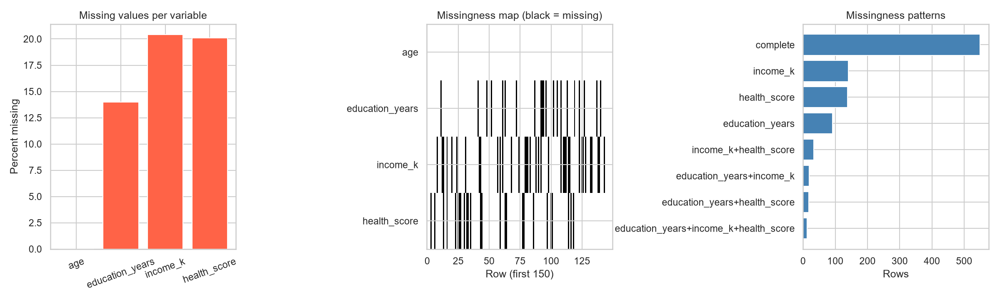
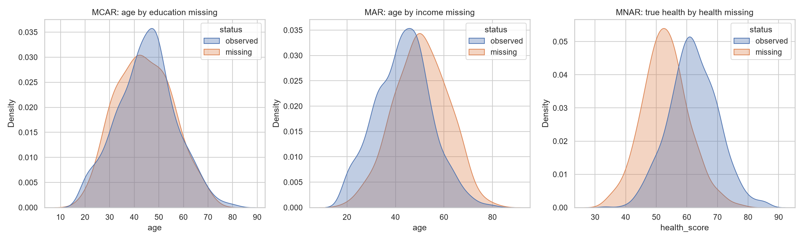
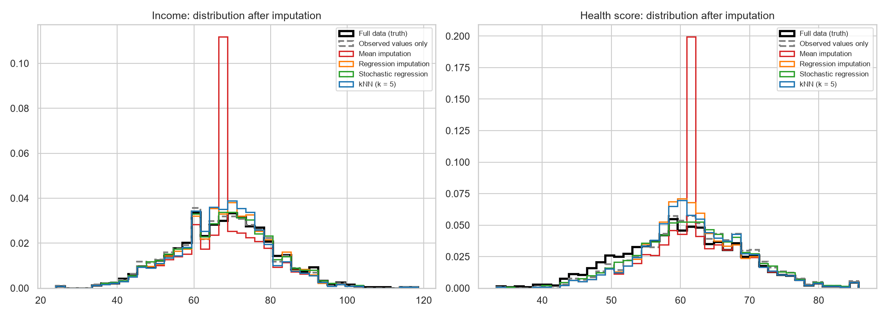
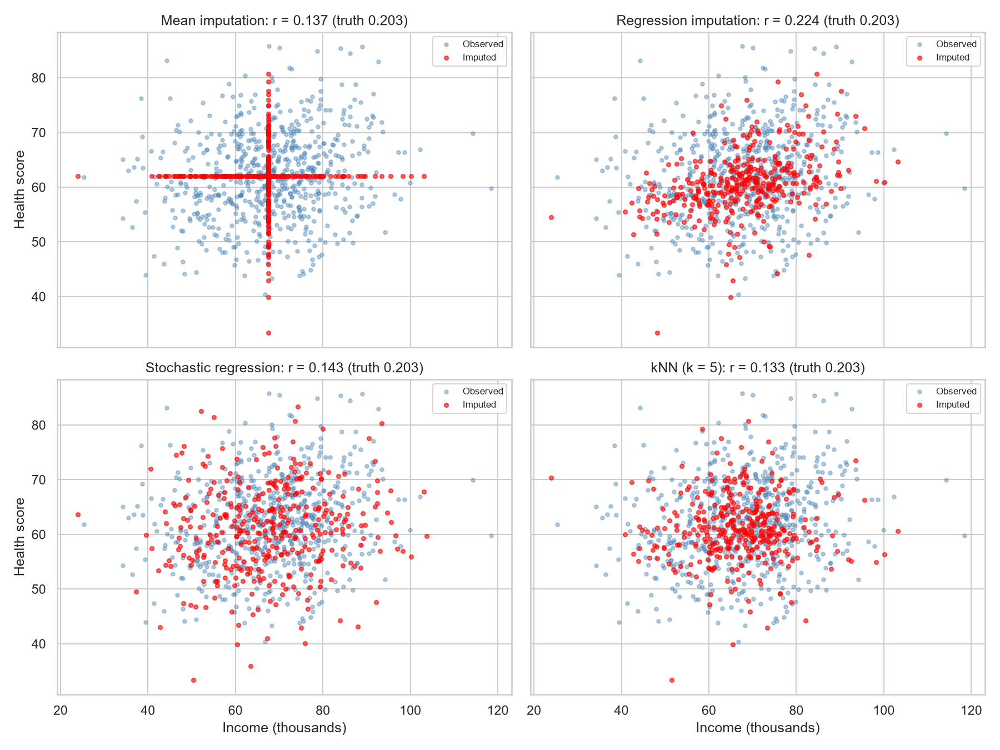
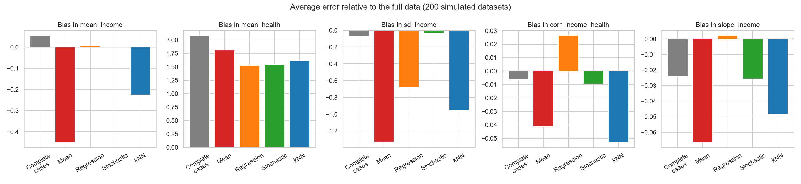
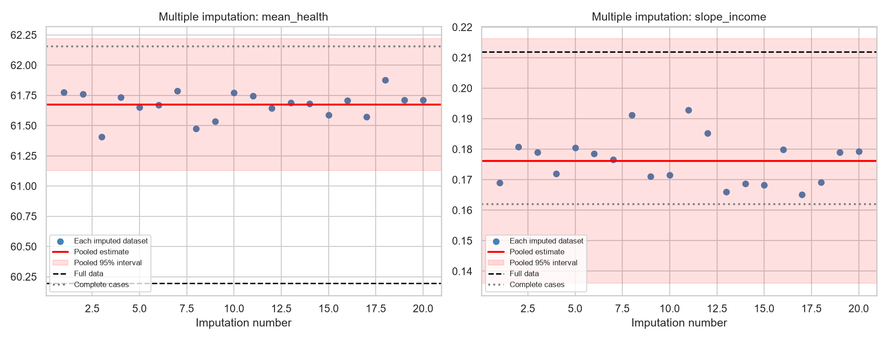
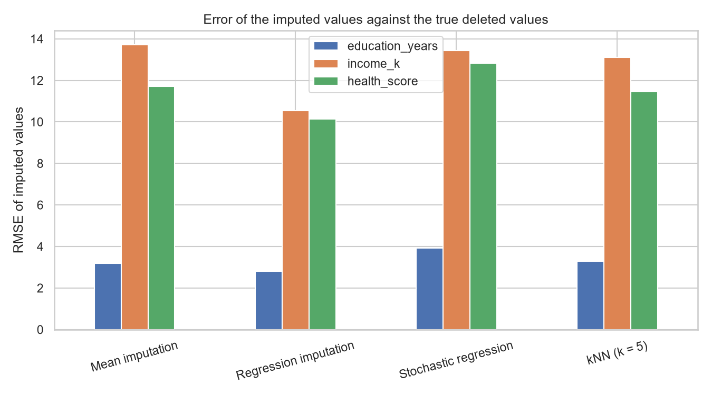

# Topic 22: Missing-Data Analysis and Imputation

## Objective
Describe and visualise missing data, examine what the observed data can say about why
values are missing, compare ways of filling them in (single and multiple imputation),
and measure how much each approach distorts the results.

## Dataset
Synthetic data for 1,000 people generated in `analysis.py` (random seed 42). The data
were generated complete first, so the true values are known, and then values were
deleted by three different mechanisms:
- `age`: always observed.
- `education_years`: missing completely at random (MCAR), about 15% of values.
- `income_k` (income in thousands): missing at random (MAR). Older people are more
  likely to be missing.
- `health_score`: missing not at random (MNAR). People with a low true health score
  are more likely to be missing.

Health was built as 60 - 0.3 x age + 0.2 x income + noise, so the true regression
slopes are -0.3 for age and 0.2 for income.

Files: `data/complete_data.csv` (before deletion), `data/data_with_missing.csv`, and
the imputed datasets `imputed_mean.csv`, `imputed_regression.csv`,
`imputed_stochastic.csv`, `imputed_knn.csv` and `imputed_multiple_first.csv`.

## How to run
```
python analysis.py
```

## Results

### 1. Missing-data summary
Means of the complete data before deletion: age 44.74, education 13.76, income 68.16,
health 60.20.

| Variable | Missing | Percent |
|----------|---------|---------|
| age | 0 | 0.0 |
| education_years | 140 | 14.0 |
| income_k | 204 | 20.4 |
| health_score | 201 | 20.1 |

Missingness patterns:

| Pattern | Rows | Percent |
|---------|------|---------|
| Complete | 549 | 54.9 |
| income_k only | 140 | 14.0 |
| health_score only | 138 | 13.8 |
| education_years only | 91 | 9.1 |
| income_k + health_score | 33 | 3.3 |
| education_years + income_k | 19 | 1.9 |
| education_years + health_score | 18 | 1.8 |
| All three | 12 | 1.2 |

Complete cases = 549 of 1,000 (54.9%), so 451 rows would be lost by listwise deletion.
13.6% of all cells are missing.

### 2. What the observed data say about the mechanism
Welch t-tests compare each other variable between rows where the target is missing and
rows where it is observed:

| Target | Compared variable | Mean when missing | Mean when observed | n missing | p-value |
|--------|-------------------|-------------------|--------------------|-----------|---------|
| education_years | age | 44.09 | 44.85 | 140 | 0.4559 |
| education_years | income_k | 67.89 | 67.40 | 109 | 0.7106 |
| education_years | health_score | 62.08 | 62.00 | 110 | 0.9314 |
| income_k | age | 50.47 | 43.28 | 204 | 2.991e-15 |
| income_k | education_years | 13.91 | 13.66 | 173 | 0.3442 |
| income_k | health_score | 61.32 | 62.19 | 159 | 0.2094 |
| health_score | age | 48.41 | 43.82 | 201 | 3.515e-07 |
| health_score | education_years | 13.27 | 13.82 | 171 | 0.04467 |
| health_score | income_k | 64.75 | 68.13 | 156 | 0.004833 |

Logistic regression of each missingness indicator on age:

| Variable | Odds ratio per year of age | p-value |
|----------|----------------------------|---------|
| education_years | 0.994 | 0.4704 |
| income_k | 1.058 | 2.998e-14 |
| health_score | 1.035 | 8.152e-07 |

What we know because we deleted the values ourselves:

| Quantity | Missing | Observed |
|----------|---------|----------|
| True health score (mean) | 52.97 | 62.01 |
| Age, for income (mean) | 50.47 | 43.28 |

### 3. Estimates from each approach (one dataset)
| Approach | Mean income | SD income | Mean health | SD health | Correlation income-health | Slope of income | Slope of age |
|----------|-------------|-----------|-------------|-----------|---------------------------|-----------------|--------------|
| Full data (truth) | 68.155 | 13.078 | 60.196 | 8.674 | 0.203 | 0.212 | -0.300 |
| Complete cases | 68.095 | 12.785 | 62.155 | 8.013 | 0.146 | 0.162 | -0.251 |
| Mean imputation | 67.469 | 11.536 | 62.014 | 7.142 | 0.137 | 0.130 | -0.184 |
| Regression imputation | 68.086 | 12.228 | 61.640 | 7.322 | 0.224 | 0.210 | -0.262 |
| Stochastic regression | 67.961 | 12.801 | 61.770 | 8.070 | 0.143 | 0.156 | -0.257 |
| kNN (k = 5) | 67.741 | 11.904 | 61.812 | 7.399 | 0.133 | 0.153 | -0.247 |

The slopes come from regressing health on age and income.

Root mean squared error of the imputed values against the true (deleted) values:

| Method | education_years | income_k | health_score |
|--------|-----------------|----------|--------------|
| Mean imputation | 3.184 | 13.719 | 11.701 |
| Regression imputation | 2.804 | 10.555 | 10.129 |
| Stochastic regression | 3.923 | 13.433 | 12.826 |
| kNN (k = 5) | 3.289 | 13.105 | 11.455 |
| Standard deviation of the true deleted values | 3.166 | 13.300 | 7.426 |

### 4. Multiple imputation (20 datasets, Rubin's rules)
| Parameter | Method | Estimate | 95% interval | Approximate population value | Contains it? |
|-----------|--------|----------|--------------|------------------------------|--------------|
| Mean income | Full data | 68.155 | (67.344, 68.967) | 68.5 | Yes |
| Mean income | Complete cases | 68.095 | (67.023, 69.167) | 68.5 | Yes |
| Mean income | Multiple imputation | 68.051 | (67.204, 68.898) | 68.5 | Yes |
| Mean health | Full data | 60.196 | (59.658, 60.734) | 60.2 | Yes |
| Mean health | Complete cases | 62.155 | (61.483, 62.826) | 60.2 | **No** |
| Mean health | Multiple imputation | 61.675 | (61.129, 62.221) | 60.2 | **No** |
| Slope of income | Full data | 0.212 | (0.173, 0.251) | 0.2 | Yes |
| Slope of income | Complete cases | 0.162 | (0.110, 0.213) | 0.2 | Yes |
| Slope of income | Multiple imputation | 0.176 | (0.136, 0.216) | 0.2 | Yes |
| Slope of age | Full data | -0.300 | (-0.344, -0.257) | -0.3 | Yes |
| Slope of age | Complete cases | -0.251 | (-0.308, -0.193) | -0.3 | Yes |
| Slope of age | Multiple imputation | -0.251 | (-0.300, -0.202) | -0.3 | Yes (only just) |

The population values for the two means are approximate (68.5 and 60.2). Pooling details:

| Parameter | Pooled estimate | Pooled SE | Fraction of missing information | df | Between-imputation sd |
|-----------|-----------------|-----------|---------------------------------|----|-----------------------|
| Mean income | 68.0511 | 0.4317 | 0.103 | 1790 | 0.1352 |
| Mean health | 61.6748 | 0.2781 | 0.174 | 625 | 0.1133 |
| Slope of income | 0.1762 | 0.0204 | 0.157 | 772 | 0.0079 |
| Slope of age | -0.2513 | 0.0249 | 0.300 | 211 | 0.0133 |

### 5. Simulation: 200 datasets of 1,000 people
Average error of each estimate relative to the full-data estimate (bias):

| Approach | Mean income | SD income | Mean health | SD health | Correlation | Slope of income | Slope of age |
|----------|-------------|-----------|-------------|-----------|-------------|-----------------|--------------|
| Complete cases | 0.054 | -0.074 | 2.076 | -0.687 | -0.006 | -0.024 | 0.037 |
| Mean imputation | -0.448 | -1.328 | 1.809 | -1.577 | -0.041 | -0.066 | 0.109 |
| Regression imputation | 0.006 | -0.684 | 1.526 | -1.398 | 0.026 | 0.002 | 0.031 |
| Stochastic regression | -0.001 | -0.033 | 1.543 | -0.682 | -0.010 | -0.026 | 0.042 |
| kNN (k = 5) | -0.226 | -0.953 | 1.612 | -1.318 | -0.053 | -0.048 | 0.051 |

Root mean squared error:

| Approach | Mean income | SD income | Mean health | SD health | Correlation | Slope of income | Slope of age |
|----------|-------------|-----------|-------------|-----------|-------------|-----------------|--------------|
| Complete cases | 0.372 | 0.292 | 2.091 | 0.712 | 0.031 | 0.030 | 0.043 |
| Mean imputation | 0.495 | 1.339 | 1.817 | 1.583 | 0.047 | 0.068 | 0.110 |
| Regression imputation | 0.159 | 0.699 | 1.532 | 1.404 | 0.037 | 0.017 | 0.034 |
| Stochastic regression | 0.216 | 0.180 | 1.554 | 0.696 | 0.028 | 0.031 | 0.045 |
| kNN (k = 5) | 0.337 | 0.968 | 1.623 | 1.325 | 0.059 | 0.051 | 0.053 |









Tables: `outputs/missing_summary.csv`, `outputs/patterns.csv`,
`outputs/mechanism_tests.csv`, `outputs/method_comparison.csv`,
`outputs/imputation_rmse.csv`, `outputs/multiple_imputation.csv`,
`outputs/simulation_bias.csv`, `outputs/simulation_rmse.csv`. Console record:
`outputs/console_output.txt`.

### The three mechanisms
| Mechanism | Meaning | Complete-case analysis | Imputation |
|-----------|---------|------------------------|------------|
| MCAR | Missingness is unrelated to any data | Unbiased, but loses information | Works well |
| MAR | Missingness depends only on observed data | Can be biased | Works if the imputation model uses the right variables |
| MNAR | Missingness depends on the missing value itself | Biased | Not repaired by standard methods; needs a model of the missingness or a sensitivity analysis |

## Interpretation
- **Scale of the problem:** Only 54.9% of rows are complete, although just 13.6% of cells
  are missing. Missing values are spread across rows, so listwise deletion would throw
  away 451 of 1,000 people, which costs precision and, depending on the mechanism, can
  add bias.
- **MCAR (education):** Missing education is unrelated to age, income or health (all
  p > 0.45), and the age odds ratio is about 1 (0.994, p = 0.47). This is what MCAR
  looks like. The tests cannot prove MCAR, because a non-significant result is not
  proof, but nothing contradicts it.
- **MAR (income):** Missing income is strongly linked to age: people with missing income
  average 50.5 years against 43.3, and each extra year of age raises the odds of missing
  income by 5.8% (p = 3e-14). Because age is always observed, the data can explain the
  missingness, which is the definition of MAR. Methods that use age can correct for it.
- **MNAR (health) cannot be detected from the observed data alone:** Missing health is
  linked to age (p = 3.5e-7) and to income (p = 0.0048). Education is borderline
  (p = 0.045), which is not convincing with nine tests. That pattern looks like MAR, since
  health is itself related to age and income. The fact that it is MNAR shows up only in
  the values we deleted ourselves: the missing health scores averaged 52.97 against 62.01
  for those observed, a 9-point gap that the observed data cannot show. In real data this
  comparison is impossible, so the mechanism must be argued from subject knowledge.
- **Mean imputation:** It keeps the mean roughly in place but flattens everything else. The
  spread of income falls from 13.08 to 11.54 and of health from 8.67 to 7.14, and the
  income slope drops from 0.212 to 0.130. Every imputed value sits exactly at the centre,
  so variability and relationships are understated. The simulation confirms this is
  systematic: average spread errors of -1.33 and -1.58 and the largest error in the age
  slope (0.109).
- **Regression imputation:** It predicts each missing value from the other variables. It
  gives the most accurate individual values (RMSE 10.55 for income and 10.13 for health,
  the lowest of all methods) and recovers the income slope almost exactly (bias 0.002).
  Because the filled-in values lie exactly on the regression line, they carry no noise,
  and the spread is understated (-0.68 and -1.40). The correlation between income and
  health is overstated in this dataset (0.224 against 0.203). That overstatement is
  expected, because imputed values are perfectly predictable from the other variables.
- **Stochastic regression:** Adding random noise to the predictions keeps the spread: the
  average error of the income SD is only -0.03 and of the health SD -0.68, the best among
  the imputation methods. The price is that individual values are the least accurate (RMSE
  12.83 for health against 10.13 for regression imputation), as the random noise is not
  the true noise. A method can be best for the distribution and worst for individual
  predictions, so the aim of the analysis decides the method. In the single dataset its
  slope for income (0.156) is below the truth (0.212), and in the simulation it shows a
  bias of -0.026. I think noise added to the imputed predictors weakens the slope, but I
  did not test that explanation.
- **kNN:** It lands between mean and regression imputation on most measures. It shrinks the
  spread (-0.95 and -1.32) and weakens the correlation, and its imputed values are no more
  accurate than mean imputation for education and only slightly better for income and
  health.
- **How accurate are the filled-in values?** Mean imputation's error for education (3.184)
  is about the standard deviation of the true values (3.166), which is what filling in the
  average should give. For health, every method has an error (10.1 to 12.8) well above the
  standard deviation of the true deleted values (7.43). Guessing the true mean of the
  deleted values would have beaten all of them. The imputed health values are biased upward
  because the deleted people were unhealthier than the observed ones.
- **MNAR damages every method:** All approaches overestimate mean health by 1.4 to 2.1
  points in the simulation (complete cases +2.08, regression +1.53, stochastic +1.54).
  Imputation reduces the error slightly but cannot remove it, because the methods assume
  that missing values resemble observed ones with the same age and income. Standard
  imputation fixes MAR, not MNAR. With MNAR the sensible response is a sensitivity analysis
  (for example, shifting the imputed values down by plausible amounts and seeing how the
  conclusions change).
- **Complete cases in the simulation:** Complete-case estimates of mean income look almost
  unbiased (+0.054) and the spread is nearly right (-0.074), although income is MAR. I did
  not investigate why. Two selection effects may offset each other (older people are lost
  through missing income, while unhealthy and therefore older, lower-income people are lost
  through missing health), so I would not rely on complete cases being safe in general.
  Their mean health error (+2.08) is the largest of all approaches.
- **Multiple imputation:** Twenty imputed datasets were analysed separately and pooled with
  Rubin's rules, which combine the within-imputation variance and the between-imputation
  variance so that the standard error reflects the uncertainty of the imputed values. Single
  imputation treats imputed values as real data and understates this uncertainty. The pooled
  interval for the income slope (0.136 to 0.216) contains the true value 0.2 and is narrower
  than the complete-case interval (0.110 to 0.213), because it uses all 1,000 rows.
- **Fraction of missing information:** It is 0.10 for mean income, 0.17 for mean health,
  0.16 for the income slope and 0.30 for the age slope. This is the share of the uncertainty
  due to missing data, and it is higher than the percentage of missing cells for the age
  slope. Twenty imputations are enough here (the between-imputation sd is small).
- **Multiple imputation is precise but wrong for MNAR:** The pooled mean health is 61.675
  with an interval of 61.13 to 62.22, which excludes the truth (60.2). The method correctly
  reports uncertainty from the missing values but cannot know about a mechanism it assumes
  away, so the interval is narrow and wrong. The pooled age slope (-0.251) has an interval
  (-0.300 to -0.202) whose lower limit just touches the truth (-0.3). The slope was also
  underestimated in the complete cases, so that estimate was not improved. These are
  results from one dataset, and a simulation of the coverage of the pooled intervals would
  be needed to judge them.
- **Choosing a method:** Mean imputation is simple but distorts spread and relationships and
  is rarely appropriate. Regression imputation is good for filling values and preserves
  regression slopes but overstates correlations. Stochastic regression and multiple
  imputation preserve variability and give honest standard errors under MAR. Under MNAR no
  automatic method is safe.
- **Conclusion:** The first step is to describe how much data is missing and why. Imputation
  methods that use the other variables work under MAR, multiple imputation gives honest
  uncertainty, and a plausible assumption about the mechanism, supported by sensitivity
  analysis, matters more than the choice of algorithm.