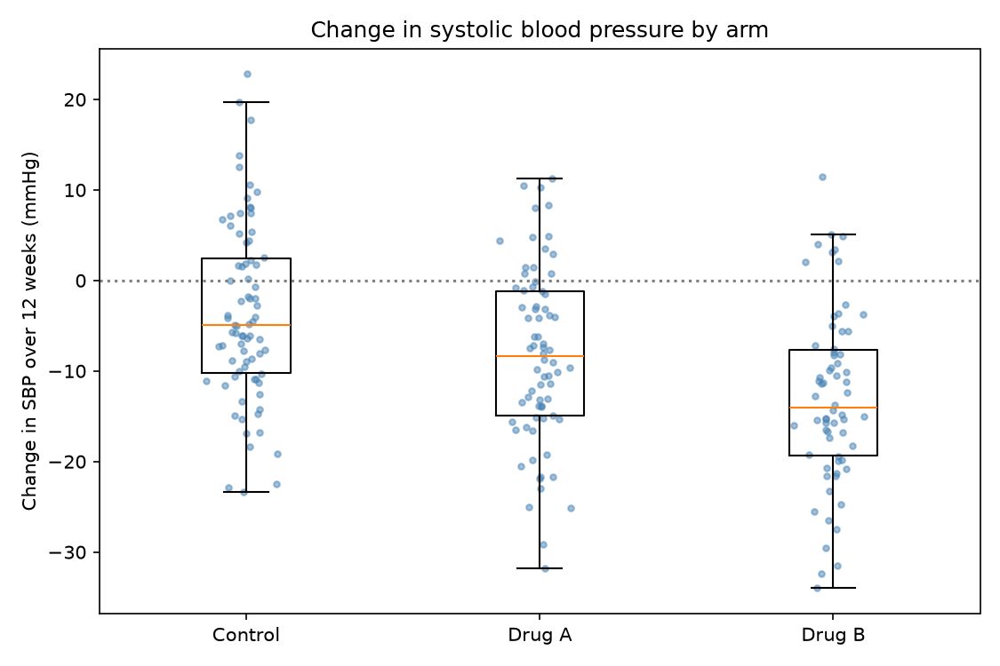
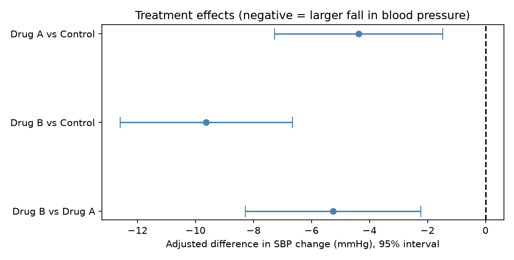
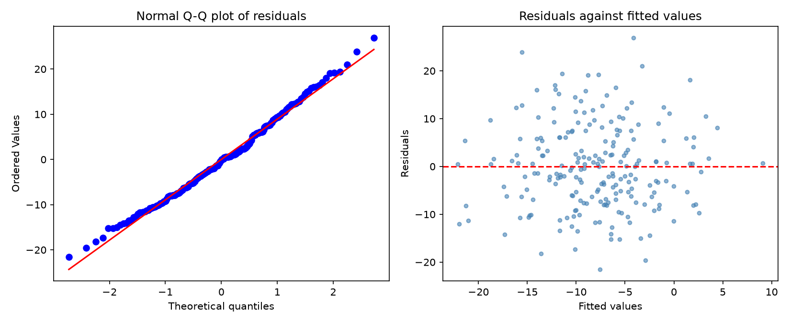

# Topic 23: Statistical Reporting and Reproducible Analysis

## Objective
Produce a statistical report that can be regenerated from scratch: code, tables,
figures, interpretation and conclusions in one document, with every number in the text
computed by code. In Python the equivalent of R Markdown and knitr is a Jupyter
notebook, built here with `nbformat` and executed and exported with `nbconvert`.

## Dataset
A synthetic randomised trial (random seed 2024) of 240 patients, 80 per arm (Control,
Drug A, Drug B). The outcome is the change in systolic blood pressure (SBP) after 12
weeks. Covariates are age, sex and baseline SBP. Some week-12 outcomes are missing
through dropout, so the report has to handle missing data. The data are synthetic and
the results say nothing about real drugs. Saved as `data/trial_data.csv`.

## How to run
```
python build_report.py
```
This builds `report.ipynb`, executes every cell and exports `outputs/report.html`.
Open `report.html` in a browser to read the finished report.

## Results

### Reproducibility record
| Item | Value |
|------|-------|
| Random seed | 2024 |
| SHA-256 of the data file | c1f7458ea07942b868c5c3b7df476177caf2252976b9977dfb2ecb120814df69 |
| Regenerating with the same seed gives an identical file | Yes (checked by an assertion in the notebook) |
| Package versions | `outputs/session_info.txt` |

### Participants and data checks
| Quantity | Value |
|----------|-------|
| Patients randomised | 240 |
| Week-12 outcome missing | 24 (10.0%) |
| Patients analysed (complete cases) | 216 |
| Chi-square test of dropout against arm | p = 0.0067 |

Balance of baseline characteristics across arms: age p = 0.720, baseline SBP
p = 0.653, sex p = 0.659.

Table 1 (baseline characteristics by arm): `outputs/table1_baseline.csv`.
Outcome by arm: `outputs/outcome_by_arm.csv`.

### Primary analysis: adjusted regression
Model: change in SBP on arm, baseline SBP, age and sex, fitted to the 216 complete
cases. R-squared = 0.273.

| Comparison | Adjusted difference (mmHg) | 95% interval | p-value | Holm-adjusted p |
|------------|----------------------------|--------------|---------|-----------------|
| Drug A vs Control | -4.38 | (-7.28, -1.48) | 0.0033 | 0.0033 |
| Drug B vs Control | -9.63 | (-12.60, -6.66) | 1.0e-09 | 2.0e-09 |
| Drug B vs Drug A | -5.26 | (-8.29, -2.23) | 0.00075 | not adjusted |

Unadjusted standardised differences from control: Cohen's d = -0.485 for Drug A and
-0.958 for Drug B (negative means a larger fall).

Regression coefficients: `outputs/table3_regression_coefficients.csv`. Sensitivity
analyses (unadjusted, and adjusted with robust HC3 errors):
`outputs/table4_sensitivity.csv`.

### Model checks
| Check | Result |
|-------|--------|
| Shapiro-Wilk on residuals | p = 0.218 |
| Breusch-Pagan (constant variance) | p = 0.884 |





Files: `report.ipynb` (the executed notebook, which GitHub displays with its outputs),
`outputs/report.html`, `outputs/results_text.md` (the generated results paragraph),
`outputs/key_numbers.json`, `outputs/session_info.txt`, `outputs/console_output.txt`.

### Elements of a reproducible report
| Element | How it is done here |
|---------|---------------------|
| Code and text together | One notebook, executed from top to bottom |
| No hand-typed numbers | The results paragraph is an f-string filled from computed values |
| Fixed randomness | One seed, and the same seed gives an identical data file (hash check) |
| Recorded environment | Package versions are written to `session_info.txt` |
| Built-in checks | Assertions on unique ids and plausible age and blood pressure ranges |
| One-command rebuild | `python build_report.py` regenerates everything |

## Interpretation
- **Both drugs lowered blood pressure.** After adjusting for baseline SBP, age and sex,
  Drug A lowered SBP by 4.4 mmHg more than control (95% interval 1.5 to 7.3,
  Holm-adjusted p = 0.0033) and Drug B by 9.6 mmHg more (6.7 to 12.6, p = 2e-09). Drug B
  lowered it by a further 5.3 mmHg compared with Drug A (2.2 to 8.3, p = 0.00075). All
  three intervals exclude 0.
- **Compared with the truth:** The data were built with true effects of -6 (Drug A) and
  -10 (Drug B), a true difference of -4 between them. All three intervals contain the
  true values. Drug A's estimate (-4.4) is the furthest from its true value, which is
  within what an interval of this width allows.
- **Multiplicity:** The two comparisons with control were treated as primary and adjusted
  with Holm's method. Drug B against Drug A was not adjusted and is reported as a
  secondary result. Its p-value (0.00075) is small enough to survive a sensible
  adjustment for a few comparisons.
- **Effect size and fit:** The unadjusted standardised differences (d = 0.49 and 0.96)
  are medium and large. The model explains 27.3% of the variation in change, which leaves
  a lot of individual variation, so the drugs shift the average without determining any
  one patient's result.
- **Randomisation worked:** Age, baseline SBP and sex are balanced across arms (all
  p > 0.65). Balance p-values do not prove balance, but nothing suggests a problem.
- **Dropout is the main concern.** 24 patients (10%) had no week-12 measurement, and the
  chi-square test says the dropout rate differs between arms (p = 0.0067). The design
  builds in higher dropout for Drug B, so this is expected here. In a real trial it would
  matter: if people drop out because the drug is not working or has side effects, a
  complete-case analysis would be biased. The estimates are conditional on staying in the
  study, and a multiple imputation or sensitivity analysis, as in Topic 22, would be the
  next step.
- **The generated text caught an error:** My first version of the results sentence said
  dropout "did not differ clearly between arms". I wrote that before the number was
  known, and it was false for this data (p = 0.0067). The text now chooses its wording
  from the p-value. A generated report is only as reliable as the conditions its
  sentences check.
- **Assumptions hold:** The residuals are consistent with normality (Shapiro-Wilk
  p = 0.218) and constant variance (Breusch-Pagan p = 0.884). These tests have limited
  power with 216 patients, so the diagnostic plots matter as well. Whether the unadjusted
  and robust-error analyses agree closely with the primary one is shown in
  `table4_sensitivity.csv`, which I have not checked.
- **Reproducibility:** Regenerating the data from the seed gives a file with the same
  SHA-256 hash, so anyone with the same code and package versions can reproduce every
  table, figure and sentence. Changing the data or the model changes the text
  automatically, which removes the copying errors that come from pasting numbers into a
  document.
- **Limitations:** The data are synthetic. The analysis uses complete cases, follow-up is
  a single time point, and a real trial would also report adverse events.
- **Conclusion:** A good statistical report states the question, checks the data, reports
  effects with intervals and adjusted p-values, checks the model, admits limitations, and
  can be rebuilt with one command. In this simulated trial, both drugs reduced blood
  pressure and Drug B reduced it more, with dropout as the main caveat.